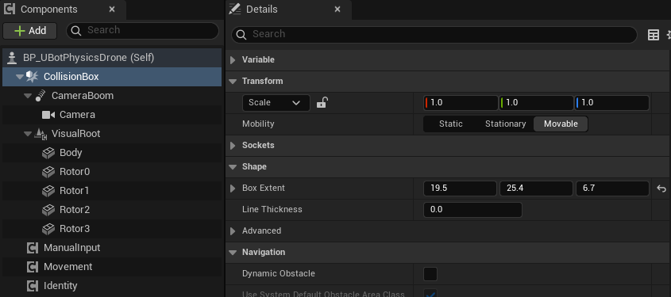
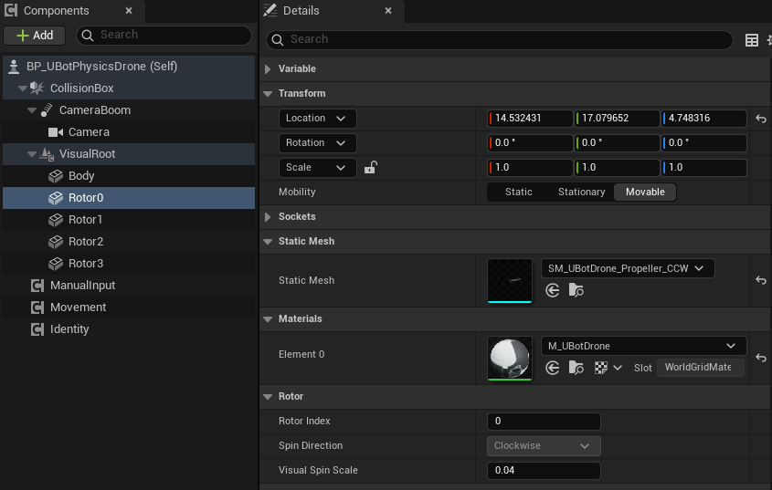

import { Steps } from "@astrojs/starlight/components";

使用插件组件构建无人机 Pawn，并根据转子布局校准可视桨叶的位置，使其与动力学机架一致。

## 快速用法

可通过复制并修改示例蓝图创建无人机，见 [示例无人机与试飞关卡](/aerial/examples/)。从空白 Pawn 构建时，可查询转子布局，确认各电机的位置和旋转方向：

```blueprint
caption: BeginPlay 时输出各电机的位置（m，机体坐标系），用于校准可视桨叶位置
nodes:
  A: AActor.ReceiveBeginPlay
  M: { var: Movement, class: UUBotMultirotorMovementComponent }
  L: UUBotMultirotorMovementComponent.GetRotorLayout
  F: Macro:ForEachLoop
  S: UKismetStringLibrary.Conv_VectorToString
  P: UKismetSystemLibrary.PrintString
wires:
  - A.then -> F.Exec
  - M.Movement -> L.self
  - L.PositionsMeters -> F.Array
  - F.LoopBody -> P.execute
  - F.ArrayElement -> S.InVec
  - S.ReturnValue -> P.InString
```

## 步骤

<Steps>

1. **新建 Pawn**

   新建一个 Pawn 蓝图。使用碰撞形状组件（Box、Sphere 或 Capsule）作为根组件，飞行模型会在每个物理步对该形状执行扫掠检测。键盘和手柄输入要求所属 Actor 为 Pawn，见第 4 步。

   示例的根组件是 `CollisionBox`，通过「Details」面板的 `Box Extent` 设置各轴半尺寸：

   

2. **加飞行模型**

   添加 `uBot Simple Flight`（导航）或 `uBot Multirotor Dynamics`（物理），重命名为 `Movement`。该组件会自动以根组件作为 `Updated Component`，无需额外指定。仅 `uBot Simple Flight` 提供 `Visual Component` 属性；需要外观倾斜时，将该属性设置为承载外观的 Scene 组件。`uBot Multirotor Dynamics` 直接改变根组件姿态，因此不提供此属性。

3. **加桨叶（可选）**

   添加 `uBot Rotor` 组件，`Rotor Index` 设为电机序号，将 `Get Rotor Layout` 返回的米制位置乘以 100，作为该组件相对根组件的位置，单位为 cm。旋转方向在 `BeginPlay` 时根据机架自动设置，在「Details」面板中为只读属性。

   

   编辑器里 `Spin Direction` 显示的是默认值 `Clockwise`，不是最终的旋向。开始运行时，飞行模型按机架给它设置旋向，例如 `Rotor0` 实际是逆时针。

4. **加手动输入、身份和相机（可选）**

   添加 `uBot Multirotor Manual Input`，以支持键盘和手柄控制。该组件仅对 Pawn 生效：Owner 不是 Pawn 时，`BeginPlay` 会直接返回，且不记录警告。添加 `uBot Identity` 设置机器人 ID 和 ROS 命名空间，添加弹簧臂相机。关闭相机弹簧臂的 `Inherit Pitch` 和 `Inherit Roll`，可避免视角随机体俯仰和横滚。

</Steps>

## 关键属性

| 属性或节点 | 说明 |
| --- | --- |
| `Rotor Index`（`uBot Rotor`） | 该桨叶对应的电机序号，按机架转子的顺序 |
| `Visual Spin Scale`（`uBot Rotor`） | 显示转速相对真实转速的比例，默认 0.04，避免在帧率下混叠 |
| `Airframe`（`uBot Multirotor Dynamics`） | 机架：质量、转动惯量、阻力系数和每个转子的位置、旋向、推力系数 |
| `Make Quad X Airframe` | 按臂长（m）和质量（kg）生成四旋翼 X 机架，转动惯量按（质量 / 1.5）×（臂长 / 0.225）² 缩放，其余参数保持默认 |
| `Get Rotor Layout` | 返回按电机序号排列的转子位置（m，机体坐标系，UE 轴）和旋向 |

默认机架的臂长是 0.225 m，转子位于 (±D, ±D)，D = 0.225 / √2 ≈ 0.159 m。机体受到与转子旋向相反的反扭矩。

## 输出与事件

`Get Rotor Speed` 返回一个 `uBot Rotor` 当前的转速（rad/s）。物理无人机的转子转速也在 `Get Multirotor State` 的 `Rotor Speeds Radians Per Second` 里。

## 注意事项

- 物理级机架里转子位置必须与模型中的电机位置一致。示例用的是模型实测的位置，相对根组件为 (±14.53, ±17.08, 4.75) cm，更换模型后应重新测量。
- 机架无效（质量或转动惯量不为正、没有转子、转子不产生推力）时，组件记录错误日志，并使用默认机架。
- 修改 `Airframe` 后，改动在下一次调用 `Reset Flight` 时生效。机架有效性仅在 `BeginPlay` 时检查，`uBot Rotor` 的旋转方向也仅在此时设置；`Reset Flight` 不会重复这些操作。

## 相关参考

- [uBot Rotor](/reference/ubotaerial/uubotrotorcomponent/)：桨叶组件的属性。
- [uBot Multirotor Library](/reference/ubotaerial/uubotmultirotorlibrary/)：`Make Quad X Airframe`。
- [uBot Multirotor Movement](/reference/ubotaerial/uubotmultirotormovementcomponent/)：`Get Rotor Layout` 和共有属性。
