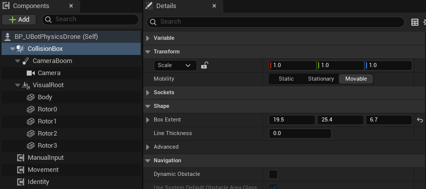
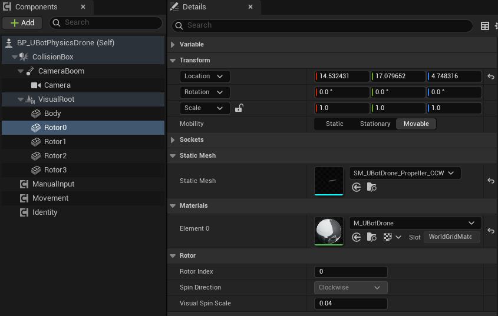

import { Steps } from "@astrojs/starlight/components";

用插件的组件把任意 Pawn 拼成一架无人机，并用转子布局核对桨叶的位置和机架一致。

## 快速用法

最简单的办法是复制一个示例蓝图再改，见 [示例无人机与试飞关卡](/aerial/examples/)。从零拼时，转子布局告诉你每个电机在哪、往哪个方向转：

```blueprint
caption: BeginPlay 时把每个电机的位置（m，机体系）打印出来，用来核对桨叶的摆放
nodes:
  A: AActor.ReceiveBeginPlay
  M: { var: Movement, class: UUBotMultirotorMovementComponent }
  L: UUBotMultirotorMovementComponent.GetRotorLayout
  F: Macro:ForEachLoop
  S: UKismetStringLibrary.Conv_VectorToString
  P: UKismetSystemLibrary.PrintString
wires:
  - A.then -> F.Exec
  - M.Movement -> L.self
  - L.PositionsMeters -> F.Array
  - F.LoopBody -> P.execute
  - F.ArrayElement -> S.InVec
  - S.ReturnValue -> P.InString
```

## 步骤

<Steps>

1. **新建 Pawn**

   新建一个 Pawn 蓝图。根组件用一个碰撞形状（Box、Sphere 或 Capsule）：飞行模型每步扫掠的就是根组件的形状。用键盘或手柄飞时必须是 Pawn，见第 4 步。

   示例的根组件是 `CollisionBox`，在「Details」面板的 `Box Extent` 里设半尺寸：

   

2. **加飞行模型**

   添加 `uBot Simple Flight`（导航）或 `uBot Multirotor Dynamics`（物理），重命名为 `Movement`。它以根组件为 `Updated Component`，不用另外指定。`Visual Component` 只有 `uBot Simple Flight` 有：要让外观倾斜，把它指向要倾斜的 Scene 组件。`uBot Multirotor Dynamics` 没有这个属性，物理无人机是根组件自己倾斜。

3. **加桨叶（可选）**

   添加 `uBot Rotor` 组件，`Rotor Index` 设为电机序号，放在 `Get Rotor Layout` 返回的位置乘 100 cm 处，相对根组件。旋向在 `BeginPlay` 时按机架自动设置，「Details」里只读。

   

   编辑器里 `Spin Direction` 显示的是默认值 `Clockwise`，不是最终的旋向。开始运行时，飞行模型按机架给它设置旋向，例如 `Rotor0` 实际是逆时针。

4. **加手动输入、身份和相机（可选）**

   添加 `uBot Multirotor Manual Input` 用键盘和手柄飞，它只在 Pawn 上起作用：Owner 不是 Pawn 时，`BeginPlay` 直接返回，也不打警告。添加 `uBot Identity` 设置机器人 ID 和 ROS 命名空间，添加弹簧臂相机。相机的弹簧臂要关掉 `Inherit Pitch` 和 `Inherit Roll`，视角才不会随机体倾斜。

</Steps>

## 关键属性

| 属性或节点 | 说明 |
| --- | --- |
| `Rotor Index`（`uBot Rotor`） | 这个桨叶跟随的电机序号，按机架转子的顺序 |
| `Visual Spin Scale`（`uBot Rotor`） | 显示转速相对真实转速的比例，默认 0.04，避免在帧率下混叠 |
| `Airframe`（`uBot Multirotor Dynamics`） | 机架：质量、转动惯量、阻力系数和每个转子的位置、旋向、推力系数 |
| `Make Quad X Airframe` | 按臂长（m）和质量（kg）生成四旋翼 X 机架，转动惯量按 (质量 / 1.5) × (臂长 / 0.225)² 缩放，其余参数保持默认 |
| `Get Rotor Layout` | 返回按电机序号排列的转子位置（m，机体系，UE 轴）和旋向 |

默认机架的臂长是 0.225 m，转子位于 (±D, ±D)，D = 0.225 / √2 ≈ 0.159 m。机体受到与转子旋向相反的反扭矩。

## 输出与事件

`Get Rotor Speed` 返回一个 `uBot Rotor` 当前的转速（rad/s）。物理无人机的转子转速也在 `Get Multirotor State` 的 `Rotor Speeds Radians Per Second` 里。

## 注意事项

- 物理级机架里转子的位置要和模型的电机位置一致。示例用的是模型实测的位置，相对根组件为 (±14.53, ±17.08, 4.75) cm，换成别的模型时要重新量。
- 机架无效（质量或转动惯量不为正、没有转子、转子不产生推力）时，日志报错，并改用默认机架。
- 改 `Airframe` 后，在下一次 `Reset Flight` 生效。但机架有效性检查和 `uBot Rotor` 的旋向只在 `BeginPlay` 时设置，`Reset Flight` 之后不会重新检查或设置。

## 相关参考

- [uBot Rotor](/reference/ubotaerial/uubotrotorcomponent/)：桨叶组件的属性。
- [uBot Multirotor Library](/reference/ubotaerial/uubotmultirotorlibrary/)：`Make Quad X Airframe`。
- [uBot Multirotor Movement](/reference/ubotaerial/uubotmultirotormovementcomponent/)：`Get Rotor Layout` 和共有属性。
