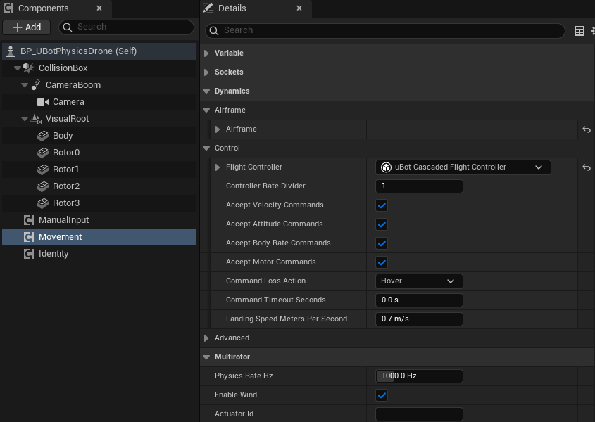

import { Steps } from "@astrojs/starlight/components";

了解物理无人机（`uBot Multirotor Dynamics`）接收速度、姿态、角速度和单电机四种指令，控制模式怎样切换，以及指令中断时它怎样处理。

## 快速用法

下面给无人机发一条姿态指令：横滚 10°，不给推力，高度由无人机自己保持：

```blueprint
caption: 横滚 10° 的姿态指令（不用推力，保持高度）
nodes:
  A: UUBotMultirotorLibrary.FindMultirotorMovement
  R: { ref: UKismetMathLibrary.MakeRotator, set: { Roll: 10 } }
  Q: UKismetMathLibrary.Conv_RotatorToQuaternion
  C: { ref: Make:FUBotAttitudeCommand, hideUnconnected: true }
  D: UUBotAttitudeCommandable.ApplyAttitudeCommand
wires:
  - A.ReturnValue -> D.self
  - R.ReturnValue -> Q.InRot
  - Q.ReturnValue -> C.Orientation
  - C.UBotAttitudeCommand -> D.Command
notes:
  C: 姿态是机体到世界的四元数。`Use Thrust` 为 false 时按 `Vertical Velocity Meters Per Second` 飞爬升率，0 表示保持高度。
```

## 步骤

<Steps>

1. **选无人机**

   用 `BP_UBotPhysicsDrone`（四种指令都接受）或 `BP_UBotBareAirframeDrone`（只接受角速度和单电机指令），见 [示例无人机与试飞关卡](/aerial/examples/)。

2. **取得 `Movement`**

   用 `Find Multirotor Movement` 取得 `Movement` 组件，对它调用接口函数，类别是 `uBot|Actuation`。

3. **发指令**

   四种指令各用一个函数；返回 `false` 表示被拒绝，见下面的“注意事项”。

4. **不再发送时释放**

   对姿态、角速度指令调用 `Release Attitude Command`，对电机指令调用 `Release Motor Command`，无人机按 `Command Loss Action` 处理。

</Steps>

## 关键属性

最近一次被接受的指令决定当前控制模式，`Get Active Control Mode` 读取它。开始时无人机在 `Velocity` 模式下悬停：

| 模式 | 指令 | 内容 |
| --- | --- | --- |
| `Velocity` | `UBot Velocity Command` | 航向系线速度加偏航角速度，按 `Velocity Limits` 截断；悬停和 `Land` 也是这个模式的设定值 |
| `Attitude` | `UBot Attitude Command` | 目标姿态（机体到世界）；`Use Yaw Rate` 时航向按偏航角速度转动 |
| `BodyRate` | `UBot Body Rate Command` | 机体系目标角速度（rad/s，UE 旋向：+Z 向右偏航），不截断 |
| `Motor` | `UBot Motor Command` | 每个电机一个值，不经过飞控 |

姿态和角速度指令的推力有两种给法：`Use Thrust` 为 true 时用 `Normalized Thrust`（0 到 1，最大总推力的比例），否则按 `Vertical Velocity Meters Per Second` 飞爬升率，0 保持高度。

电机指令的 `Type` 是 `Normalized`（0 到 1）或 `AngularVelocity`（rad/s）。`Normalized` 默认是推力比例：转速 = 最大转速 × √指令（`Motor Command Mapping` 为 `Thrust` 时）。值的个数必须等于电机数（`Get Motor Count`，默认机架 4 个），按机架的电机顺序：PX4 四旋翼 X 里 0 右前、1 左后、2 左前、3 右后。

常用属性在 `Movement` 组件上，选中它就能在「Details」面板的 Dynamics 和 Multirotor 下找到：

| 属性 | 默认值 | 作用 |
| --- | --- | --- |
| `Accept Velocity Commands` 等四个 | 开 | 单独关闭某种指令，关闭后接口返回 `false` |
| `Command Loss Action` | `Hover` | 指令丢失时怎么做 |
| `Command Timeout Seconds` | 0 s | 最后一条指令距今超过这么多仿真秒算丢失；0 表示不超时 |
| `Landing Speed Meters Per Second` | 0.7 m/s | `Land` 时的下降速度 |
| `Physics Rate Hz` | 1000 Hz | 每秒物理步数，范围 100 到 4000 Hz |



`Command Loss Action` 有三个取值：

| 取值 | 效果 |
| --- | --- |
| `Hover`（默认） | 刹停并锁定位置，与 `Stop Motion` 相同 |
| `Land` | 原地下降，被地面挡住后停在那里 |
| `CutMotors` | 所有电机指令置 0，无人机下落 |

默认机架是 1.5 kg、轴距 450 mm 的四旋翼 X，最大总推力约为重量的 1.92 倍；机架参数在 `Airframe` 上，改动在下一次 `Reset Flight` 生效；`Airframe` 在 `BeginPlay` 时检查一次。其余属性见 [uBot Multirotor Dynamics](/reference/ubotaerial/uubotmultirotordynamicscomponent/)。

## 输出与事件

- `Get Multirotor State` 返回真值状态（SI 单位、UE 世界轴），含转子转速和比力。
- `Get Last Motor Commands` 返回最近一次实际送给电机的指令。
- `Get Hover Motor Command` 按工程的重力返回悬停所需的归一化电机指令（推力比例），默认机架约 0.52。

用它给四个电机发悬停指令：

```blueprint
caption: 给电机发悬停指令（Make Array 加到 4 个输入，每个电机一个值）
nodes:
  V: { var: Movement, class: UUBotMultirotorDynamicsComponent }
  H: UUBotMultirotorDynamicsComponent.GetHoverMotorCommand
  A: K2Node_MakeArray
  C: { ref: Make:FUBotMotorCommand, hideUnconnected: true, set: { Type: Normalized } }
  D: UUBotMotorCommandable.ApplyMotorCommand
wires:
  - V.Movement -> H.self
  - V.Movement -> D.self
  - H.ReturnValue -> A.[0]
  - A.Array -> C.Values
  - C.UBotMotorCommand -> D.Command
notes:
  A: 在节点上点「Add pin」加到 4 个输入，4 个都接 `Get Hover Motor Command` 的返回值。
```

## 注意事项

- 指令被拒绝（返回 `false`）有四种情况：这种指令被 `Accept … Commands` 关闭，指令含 NaN 或非有限值，姿态四元数的长度接近 0（平方长度小于 0.01），或电机值的个数与电机数不一致。裸机级不接受速度和姿态指令。
- `Stop Motion` 总是刹停并锁定位置，不看 `Command Loss Action`：水平速度低于 0.05 m/s 后，锁定当前的水平位置和高度。
- 发零速度的速度指令只跟踪零速度，不锁定位置，风造成的位移不会被拉回。
- 用 uBotROS 下发指令时，它的组件自带 0.5 s 超时，超时后的处理按组件区分：
  - `uBot ROS Velocity Command` 调用 `Stop Motion`，刹停并锁定位置，不看 `Command Loss Action`。
  - `uBot ROS Attitude Command` 和 `uBot ROS Motor Command` 调用 `Release Attitude Command` 或 `Release Motor Command`，由 `Command Loss Action` 处理。

## 相关参考

- [uBot Multirotor Dynamics](/reference/ubotaerial/uubotmultirotordynamicscomponent/)：全部节点和属性。
- [UBot Attitude Commandable](/reference/ubotcore/uubotattitudecommandable/) 和 [UBot Motor Commandable](/reference/ubotcore/uubotmotorcommandable/)：指令接口。
- [自己写飞控](/aerial/flight-controller/)：用自己的控制器替换内置飞控。
- [从 ROS 2 发飞行指令](/ros/flight-commands/)：用 uBotROS 从 ROS 2 下发姿态、角速度和电机指令。
