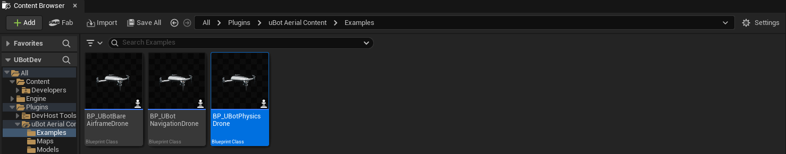
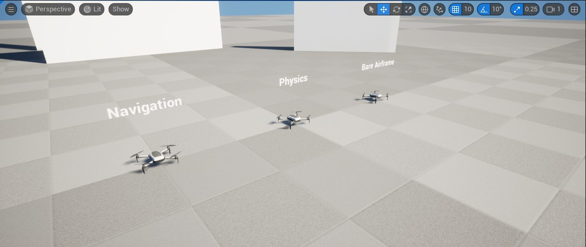
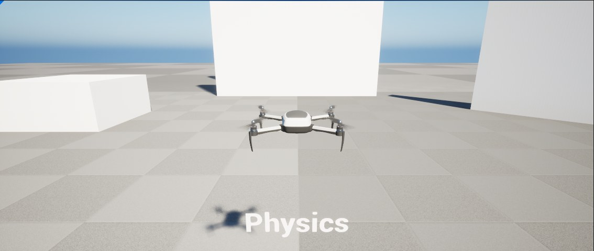
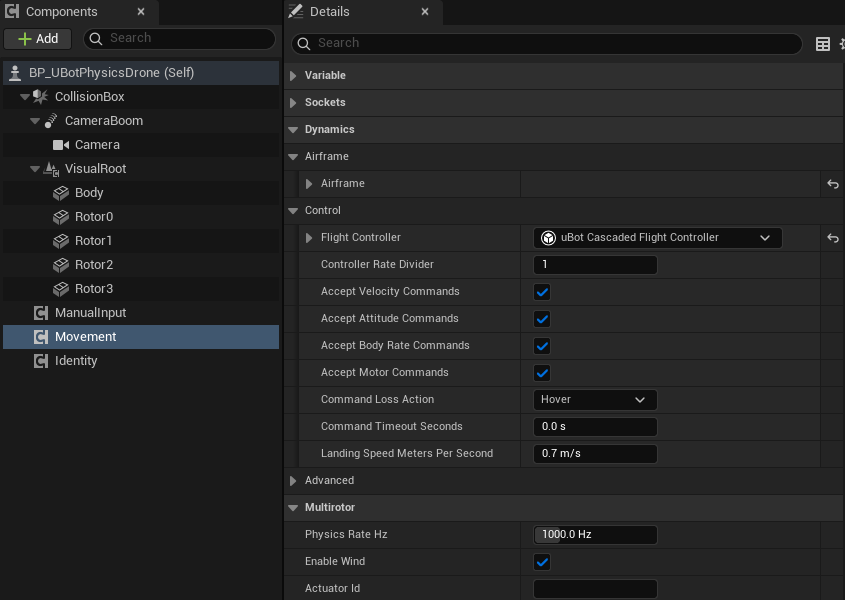

import { Steps } from "@astrojs/starlight/components";

插件提供三架示例无人机和试飞关卡 `L_UBotAerialDemo`，可直接进行试飞，也可将示例复制到工程中并定制为所需无人机。

以下内容对应已发布的 uBotAerial 0.1.1，试飞关卡中的风场由该版本的 uBotAerial 提供。尚未发布的开发版把风场移到 uBotEnvironment，打开包含风 Actor 的示例关卡时需启用 uBotEnvironment；无人机独立飞行不依赖 uBotEnvironment，见[迁移说明](/develop/migration/#风场从-ubotaerial-迁到-ubotenvironment开发版)。

## 快速用法

在 `BeginPlay` 时找到关卡里的示例无人机，取得它的 `Movement` 组件，发送一条 1 m/s 的前进速度指令：

```blueprint
caption: 让关卡里的导航无人机以 1 m/s 前进
nodes:
  A: AActor.ReceiveBeginPlay
  B: { ref: UGameplayStatics.GetActorOfClass, set: { ActorClass: BP_UBotNavigationDrone } }
  C: UUBotMultirotorLibrary.FindMultirotorMovement
  D: { ref: Make:FUBotVelocityCommand, hideUnconnected: true }
  E: { ref: UKismetMathLibrary.MakeVector, set: { X: 1 } }
  F: UUBotVelocityCommandable.ApplyVelocityCommand
wires:
  - A.then -> B.execute
  - B.then -> F.execute
  - B.ReturnValue -> C.Actor
  - C.ReturnValue -> F.self
  - E.ReturnValue -> D.LinearVelocityMetersPerSecond
  - D.UBotVelocityCommand -> F.Command
notes:
  F: uBotAerial 0.1.1 起不需要等待：Actor 之间的 `BeginPlay` 顺序没有保证，无人机自己的 `BeginPlay` 之前发出的指令也会生效。
  E: X 为 1、其余为 0：沿无人机当前航向前进，单位 m/s。
```

## 步骤

### 飞试飞关卡

<Steps>

1. **显示插件内容**

   在 Content Browser 的「Settings」菜单里勾选「Show Plugin Content」，以显示插件资产。在「Plugins > uBot Aerial Content > Examples」下能看到三个示例蓝图：

   

2. **打开关卡并运行**

   打开 `/UBotAerial/Maps/L_UBotAerialDemo`，三架示例无人机并排，每架上方有文字标牌。

   

   点击「Play」。物理无人机已设为由 Player 0 控制：Space 上升，W / A / S / D 平移，E / Q 偏航，Left Ctrl 下降。

   

3. **换一架飞**

   把另一架无人机的 `Auto Possess Player` 设为 Player 0，原来那架改回 `Disabled`。

</Steps>

### 放进自己的关卡

<Steps>

1. **放入示例**

   把 `/UBotAerial/Examples/BP_UBotNavigationDrone` 拖进关卡。无人机默认在放置位置悬停；与地面接触时，其位置受碰撞约束。无人机收到控制指令后会立即响应，无需额外的起飞流程。

2. **让玩家控制它**

   在「Details」面板把 `Auto Possess Player` 设为 Player 0，或在 GameMode 里把 `Default Pawn Class` 设为它。

3. **运行**

   点击「Play」，按键映射与试飞关卡相同。无人机未被玩家控制时，可使用上述蓝图发送指令。

</Steps>

放在地面上时，根组件中心离地 6.7 cm（碰撞盒的半高），碰撞盒刚好贴地。

### 改成自己的

更新插件时，插件目录中的资产会被替换，直接修改这些资产会导致改动丢失。应将示例复制到工程后再修改：右键点击示例并选择「Duplicate」，将副本移到 `/Game` 下，或使用「Asset Actions > Migrate」迁移资产。

要改飞行模型的属性，在复制出来的蓝图的「Components」面板里选中 `Movement`：



## 关键属性

三个示例的组件构成相同，区别在 `Movement` 组件的类型和设置，以及 `ManualInput` 的 `Flight Mode`：物理级和裸机级示例的 `Airframe` 将转子位置设置为模型中的电机轴心位置；裸机级示例还关闭了速度和姿态指令，并将 `ManualInput` 设为 `Rate` 模式。

| 示例 | `Movement` | 接受的指令 | 手动飞行模式 |
| --- | --- | --- | --- |
| `BP_UBotNavigationDrone` | `uBot Simple Flight` | 速度、偏航角速度 | `Velocity` |
| `BP_UBotPhysicsDrone` | `uBot Multirotor Dynamics` | 速度、姿态、角速度、单电机 | `Velocity` |
| `BP_UBotBareAirframeDrone` | `uBot Multirotor Dynamics` | 角速度、单电机 | `Rate` |

示例蓝图以 Pawn 为父类，飞行行为由组件实现，蓝图自身不包含节点逻辑。以下组件名称也用作蓝图变量名，可用于定位组件、添加传感器或修改属性；按类型查找时，可使用 `Get Component by Class`：

| 组件 | 作用 |
| --- | --- |
| `CollisionBox`（根） | 碰撞盒，半尺寸 (19.5, 25.4, 6.7) cm，飞行模型扫掠这个形状 |
| `VisualRoot` | 网格的父级，导航无人机的外观倾斜作用于它 |
| `Body` | 机身网格，没有碰撞 |
| `Rotor0` 到 `Rotor3` | `uBot Rotor`，桨叶随对应电机的转速旋转；导航无人机没有电机，桨叶转速只是显示用的，由加速度推算 |
| `CameraBoom` / `Camera` | 跟随相机，弹簧臂长 120 cm，保留 12 cm 碰撞探针；初始位置贴近地面时可将臂的相对位置 Z 设为 20 cm，见[手动飞行注意事项](/aerial/manual-flight/#注意事项) |
| `Identity` | `uBot Identity`：机器人 ID、ROS 命名空间、基坐标系 |
| `ManualInput` | `uBot Multirotor Manual Input`，见 [键盘和手柄手动飞行](/aerial/manual-flight/) |
| `Movement` | 飞行模型 |

## 输出与事件

- 试飞关卡里有三个示例无人机并排，各有名称标签；还有一块网格地面、一堵墙、一堵 45° 的斜墙、一个 1 m 高的平台和一根立柱。
- 关卡里有一个默认关闭的 `uBot Wind`：恒定风 (0, 5, 0) m/s，阵风标准差 (1, 1, 0.3) m/s。启用风源后，物理无人机会迎风倾斜，见 [风](/aerial/wind/)。
- 插件的 `/UBotAerial/Models/` 下是无人机的模型和材质，模型来源见 [uBotAerial 概述](/aerial/#模型来源)。

## 注意事项

- 看不到示例时，先确认「Show Plugin Content」已勾选。
- 示例在运行开始时即进入悬停控制；放置在地面上不会使其进入独立的地面待机状态，收到指令后仍会立即响应。
- 在无人机自己的 `BeginPlay` 之前发出的速度、姿态、角速度和电机指令，uBotAerial 0.1.1 起会在开始飞行后生效，有多条时以最后一条为准。0.1.0 会在开始飞行时重置并清除这些指令，因此应通过 `Delay` 等方式延后至无人机初始化完成后发送。`Reset Flight` 和 `Stop Motion` 为 true 的 `Teleport Multirotor` 仍然清除指令。

## 相关参考

- [uBot Multirotor Library](/reference/ubotaerial/uubotmultirotorlibrary/)：`Find Multirotor Movement`。
- [用速度指令飞导航无人机](/aerial/simple-flight/)：速度指令的坐标系和响应。
- [自己拼一架无人机](/aerial/build-a-drone/)：通过插件组件构建自定义无人机 Pawn。
