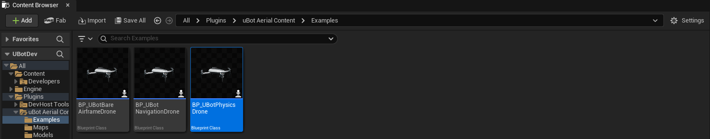
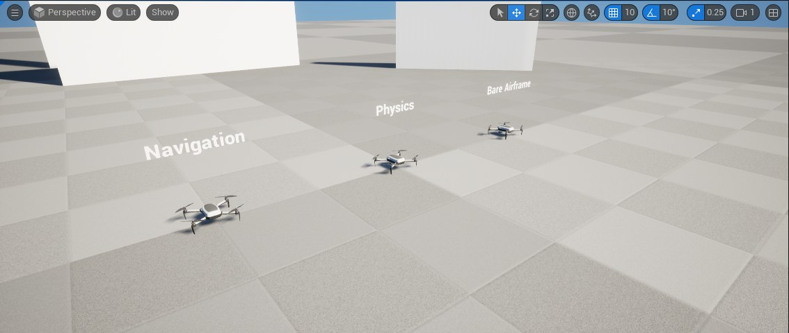
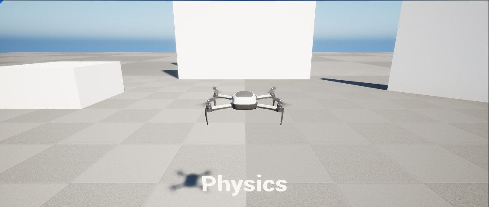

import { Steps } from "@astrojs/starlight/components";

用插件自带的三架示例无人机和试飞关卡 `L_UBotAerialDemo` 马上飞起来，再把示例放进自己的关卡，复制后改成自己的无人机。

以下内容对应已发布的 uBotAerial 0.1.1，试飞关卡中的风由它自带。尚未发布的开发版把风场移到 uBotEnvironment，打开含风 Actor 的示例关卡时需启用它；无人机单独飞行无需这个插件，见[迁移说明](/develop/migration/#风场从-ubotaerial-迁到-ubotenvironment开发版)。

## 快速用法

在 `BeginPlay` 时找到关卡里的示例无人机，取得它的 `Movement` 组件，发一条 1 m/s 的前进速度指令：

```blueprint
caption: 让关卡里的导航无人机以 1 m/s 前进
nodes:
  A: AActor.ReceiveBeginPlay
  B: { ref: UGameplayStatics.GetActorOfClass, set: { ActorClass: BP_UBotNavigationDrone } }
  C: UUBotMultirotorLibrary.FindMultirotorMovement
  D: { ref: Make:FUBotVelocityCommand, hideUnconnected: true }
  E: { ref: UKismetMathLibrary.MakeVector, set: { X: 1 } }
  F: UUBotVelocityCommandable.ApplyVelocityCommand
wires:
  - A.then -> B.execute
  - B.then -> F.execute
  - B.ReturnValue -> C.Actor
  - C.ReturnValue -> F.self
  - E.ReturnValue -> D.LinearVelocityMetersPerSecond
  - D.UBotVelocityCommand -> F.Command
notes:
  F: uBotAerial 0.1.1 起不需要等待：Actor 之间的 `BeginPlay` 顺序没有保证，无人机自己的 `BeginPlay` 之前发出的指令也会生效。
  E: X 为 1、其余为 0：沿无人机当前航向前进，单位 m/s。
```

## 步骤

### 飞试飞关卡

<Steps>

1. **显示插件内容**

   在 Content Browser 的「Settings」菜单里勾选「Show Plugin Content」，才看得到插件的内容。之后在「Plugins > uBot Aerial Content > Examples」下能看到三个示例蓝图：

   

2. **打开关卡并运行**

   打开 `/UBotAerial/Maps/L_UBotAerialDemo`，三架示例无人机并排，每架上方有文字标牌。

   

   点「Play」。物理无人机已设为由 Player 0 控制：Space 上升，W / A / S / D 平移，E / Q 偏航，Left Ctrl 下降。

   

3. **换一架飞**

   把另一架无人机的 `Auto Possess Player` 设为 Player 0，原来那架改回 `Disabled`。

</Steps>

### 放进自己的关卡

<Steps>

1. **放入示例**

   把 `/UBotAerial/Examples/BP_UBotNavigationDrone` 拖进关卡。无人机在放置的位置悬停，放在地面上就停在地面上；任何指令都会让它立即动起来。

2. **让玩家控制它**

   在「Details」面板把 `Auto Possess Player` 设为 Player 0，或在 GameMode 里把 `Default Pawn Class` 设为它。

3. **运行**

   点「Play」，按键同上。不由玩家控制时，用上面的蓝图图发指令。

</Steps>

放在地面上时，根组件中心离地 6.7 cm（碰撞盒的半高），碰撞盒刚好贴地。

### 改成自己的

直接改插件里的资产，更新插件时会丢失。先把示例复制到自己的工程：在示例上右键「Duplicate」后移到 `/Game` 下，或用「Asset Actions > Migrate」，改复制出来的那一份。

要改飞行模型的属性，在复制出来的蓝图的「Components」面板里选中 `Movement`：


## 关键属性

三个示例的组件构成相同，区别在 `Movement` 组件的类型和设置，以及 `ManualInput` 的 `Flight Mode`：物理和裸机架示例的 `Airframe` 把转子位置设成了模型的电机轴，裸机架另外关闭了速度和姿态指令，`ManualInput` 用 `Rate` 模式。

| 示例 | `Movement` | 接受的指令 | 手动飞行模式 |
| --- | --- | --- | --- |
| `BP_UBotNavigationDrone` | `uBot Simple Flight` | 速度、偏航角速度 | `Velocity` |
| `BP_UBotPhysicsDrone` | `uBot Multirotor Dynamics` | 速度、姿态、角速度、单电机 | `Velocity` |
| `BP_UBotBareAirframeDrone` | `uBot Multirotor Dynamics` | 角速度、单电机 | `Rate` |

示例蓝图的父类是 Pawn，不含节点逻辑，行为都在组件里。组件名就是变量名，加传感器、改属性、用 `Get Component by Class` 找组件时按它们找：

| 组件 | 作用 |
| --- | --- |
| `CollisionBox`（根） | 碰撞盒，半尺寸 (19.5, 25.4, 6.7) cm，飞行模型扫掠这个形状 |
| `VisualRoot` | 网格的父级，导航无人机的外观倾斜作用于它 |
| `Body` | 机身网格，没有碰撞 |
| `Rotor0` 到 `Rotor3` | `uBot Rotor`，桨叶随对应电机的转速旋转；导航无人机没有电机，桨叶转速只是显示用的，由加速度推算 |
| `CameraBoom` / `Camera` | 跟随相机 |
| `Identity` | `uBot Identity`：机器人 ID、ROS 命名空间、基坐标系 |
| `ManualInput` | `uBot Multirotor Manual Input`，见 [键盘和手柄手动飞行](/aerial/manual-flight/) |
| `Movement` | 飞行模型 |

## 输出与事件

- 试飞关卡里有三个示例无人机并排，各有名称标签；还有一块网格地面、一堵墙、一堵 45° 的斜墙、一个 1 m 高的平台和一根立柱。
- 关卡里有一个默认关闭的 `uBot Wind`：恒定风 (0, 5, 0) m/s，阵风标准差 (1, 1, 0.3) m/s。打开它，物理无人机会迎风倾斜，见 [风](/aerial/wind/)。
- 插件的 `/UBotAerial/Models/` 下是无人机的模型和材质，模型来源见 [uBotAerial 概述](/aerial/#模型来源)。

## 注意事项

- 看不到示例时，先确认「Show Plugin Content」已勾选。
- 示例开局就在原地悬停；放在地面上时它也不会“落地待机”，任何指令都会让它立即动起来。
- 在无人机自己的 `BeginPlay` 之前发出的速度、姿态、角速度和电机指令，uBotAerial 0.1.1 起会在开始飞行后生效，有多条时以最后一条为准。0.1.0 里它们会被开始飞行时的重置清掉，要先 `Delay` 一小会儿再发。`Reset Flight` 和 `Stop Motion` 为 true 的 `Teleport Multirotor` 仍然清除指令。

## 相关参考

- [uBot Multirotor Library](/reference/ubotaerial/uubotmultirotorlibrary/)：`Find Multirotor Movement`。
- [用速度指令飞导航无人机](/aerial/simple-flight/)：速度指令的坐标系和响应。
- [自己拼一架无人机](/aerial/build-a-drone/)：不用示例蓝图，自己把组件拼起来。
