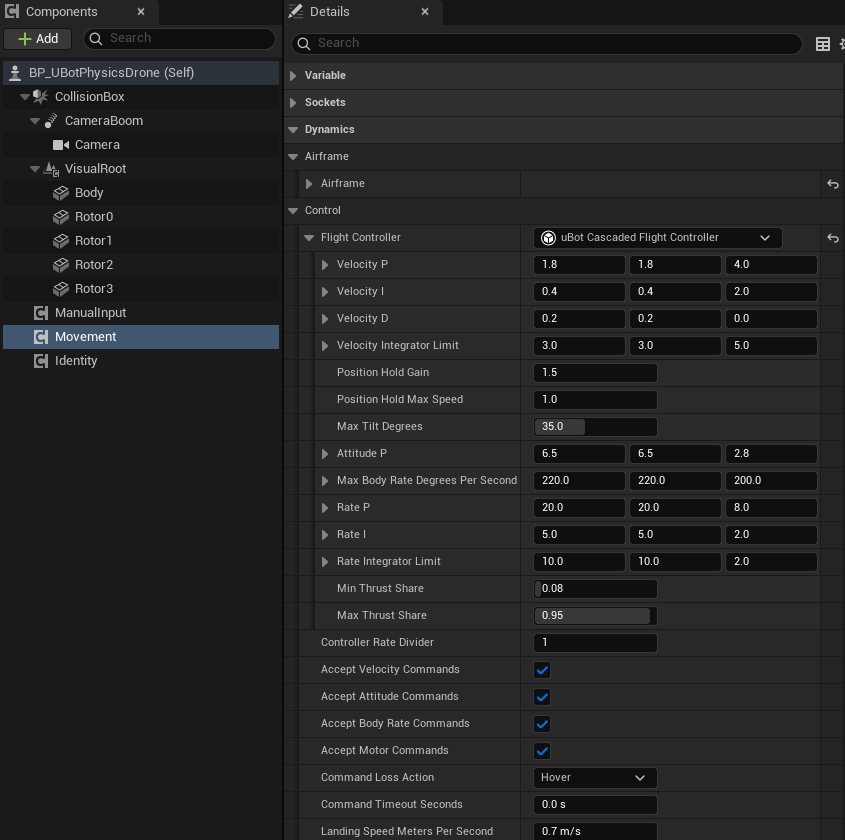
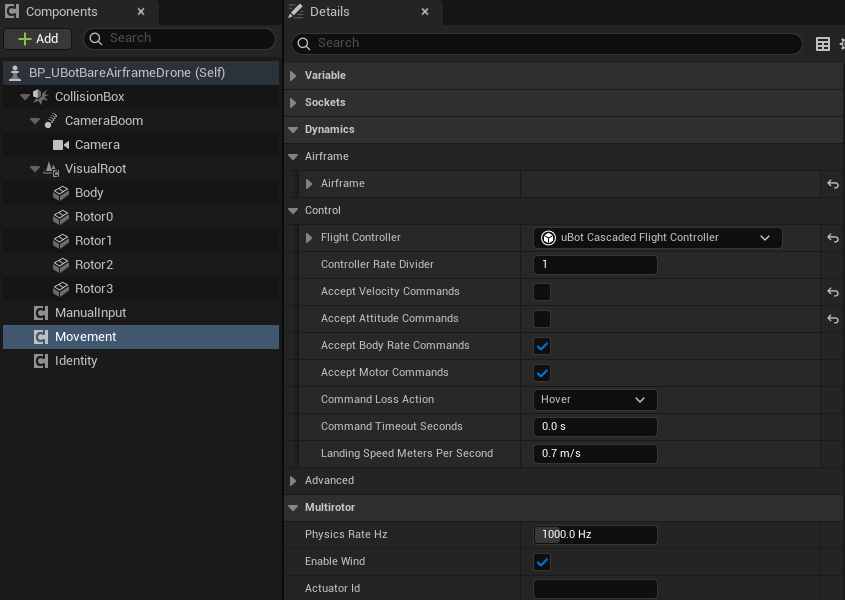

import { Steps } from "@astrojs/starlight/components";

写一个 `uBot Flight Controller` 子类，让物理无人机用它的输出驱动电机，替换内置的串级飞控。

## 快速用法

控制器是一个对象，放进 `uBot Multirotor Dynamics` 的 `Flight Controller` 属性，并让它的 `Supports Control Mode` 对要接管的模式返回 `true`，就生效。运行时也可以换：

```blueprint
caption: BeginPlay 时给无人机换上自己的控制器
nodes:
  A: AActor.ReceiveBeginPlay
  D: { var: Movement, class: UUBotMultirotorDynamicsComponent }
  C: { var: MyController, class: UUBotFlightController }
  S: UUBotMultirotorDynamicsComponent.SetFlightController
wires:
  - A.then -> S.execute
  - D.Movement -> S.self
  - C.MyController -> S.NewController
notes:
  C: 变量的类型是自己写的控制器子类的一个实例。
```

## 步骤

<Steps>

1. **新建子类**

   新建 `uBot Flight Controller` 的蓝图子类或 C++ 子类。

2. **实现 `Compute Motor Commands`**

   输入真值状态 `State`、当前模式的设定值 `Setpoint` 和时间 `Delta Seconds`，输出 `Out Motor Commands`：按电机顺序的 0 到 1 的指令，每个转子一个值。默认按推力比例解释，转速 = 最大转速 × √指令（`Motor Command Mapping` 为 `Thrust` 时）。

3. **选用它**

   在物理无人机的 `Movement` 组件里，从 `Flight Controller` 的下拉列表选这个类；或像上图那样调用 `Set Flight Controller`。

   

4. **实现 `Supports Control Mode`**

   对要接管的模式返回 `true`。基类默认对所有模式返回 `false`，返回 `false` 的模式改用内置飞控，所以不重写它，`Compute Motor Commands` 永远不会被调用。

5. **按需实现 `Reset Controller`**

   清空积分器等记忆并取得机架。

</Steps>

不想在 UE 里写飞控时，用裸机级示例配合 uBotROS 的飞行指令，从 ROS 2 下发角速度或电机指令。裸机级示例的 `Movement` 里，`Accept Velocity Commands` 和 `Accept Attitude Commands` 是关闭的：



## 关键属性

三个函数的约定：

| 函数 | 说明 |
| --- | --- |
| `Compute Motor Commands` | 每个物理步（或每 `Controller Rate Divider` 步）调用一次，返回每个转子一个 0 到 1 的指令（推力比例，转速 = 最大转速 × √指令），按电机序号。`Delta Seconds` 是到下一次调用的时间 |
| `Reset Controller` | 可选。在首次使用、更换控制器、控制模式切换、`Reset Flight` 之后，在下一次计算前调用 |
| `Supports Control Mode` | 必须实现：对要接管的模式返回 `true`，返回 `false` 的模式由内置飞控代飞 |

`Setpoint`（`UBot Flight Setpoint`）按模式生效的字段：

| 模式 | 字段 |
| --- | --- |
| `Velocity` | `Velocity Meters Per Second`（世界系）、`Yaw Rate Radians Per Second`、`Hold Position`、`Hold Position Meters` |
| `Attitude` | `Orientation`、`Use Yaw Rate`、`Yaw Rate Radians Per Second`（`Use Yaw Rate` 为 true 时生效）、`Use Thrust`、`Normalized Thrust`、`Vertical Velocity Meters Per Second` |
| `BodyRate` | `Body Rate Radians Per Second`、`Use Thrust`、`Normalized Thrust`、`Vertical Velocity Meters Per Second` |

悬停、`Land` 和速度指令都是 `Velocity` 模式的设定值。`Supports Control Mode` 对 `Velocity` 返回 `false` 时由内置飞控处理，返回 `true` 时由你的控制器处理。

角速度是机体系的，按 UE 的旋向：+Z 向右偏航。电机模式不经过控制器。

`Movement` 上的 `Controller Rate Divider`（默认 1）让控制器每隔这么多个物理步运行一次，其间保持上一次的指令；此时 `Delta Seconds` 是这么多个步长，物理频率 1000 Hz、除数为 4 时是 0.004 s。

## 输出与事件

内置的 `uBot Cascaded Flight Controller` 是级联结构，每种模式从自己那一级进入：

| 模式 | 经过的环节 |
| --- | --- |
| `Velocity` | 速度环 → 姿态环 → 角速度环 → 推力分配 |
| `Attitude` | 姿态环 → 角速度环 → 推力分配 |
| `BodyRate` | 角速度环 → 推力分配 |

常用增益（默认值按默认机架和 1 kHz 调整）：

| 属性 | 默认值 | 作用 |
| --- | --- | --- |
| `Velocity P` | (1.8, 1.8, 4.0) | 速度环比例增益（世界系 X、Y、Z） |
| `Attitude P` | (6.5, 6.5, 2.8) 1/s | 姿态环比例增益（机体系 X、Y、Z） |
| `Rate P` | (20, 20, 8) 1/s | 角速度环比例增益 |
| `Max Tilt Degrees` | 35° | 速度环要求的最大倾角 |
| `Max Body Rate Degrees Per Second` | (220, 220, 200)°/s | 姿态环要求的最大角速度 |

用 `Get Hover Motor Command` 可以得到悬停所需的归一化指令，作为自己控制器的起点，见 [物理无人机的指令与控制模式](/aerial/dynamics/#输出与事件)。其余增益见 [uBot Cascaded Flight Controller](/reference/ubotaerial/uubotcascadedflightcontroller/)。

## 注意事项

- 蓝图控制器在每个物理步（默认 1 kHz）经过蓝图虚拟机运行，开销大：写成 C++ 子类，或调大 `Controller Rate Divider`。
- 返回的指令个数不等于电机数时，电机停转，日志只报一次错。非有限值按 0 处理，其余限幅到 0 到 1。
- 让 `Supports Control Mode` 对 `Velocity` 返回 `true`，控制器就接管悬停、`Land` 和速度指令，速度设定值要自己处理。
- C++ 子类重写 `ComputeMotorCommands_Implementation`、`ResetController_Implementation` 和 `SupportsControlMode_Implementation`；插件的 README 里有一个只飞角速度指令的完整例子。

## 相关参考

- [uBot Flight Controller](/reference/ubotaerial/uubotflightcontroller/)：基类的全部函数。
- [uBot Multirotor Dynamics](/reference/ubotaerial/uubotmultirotordynamicscomponent/)：`Set Flight Controller` 和 `Flight Controller` 属性。
- [物理无人机的指令与控制模式](/aerial/dynamics/)：指令怎样变成设定值。
