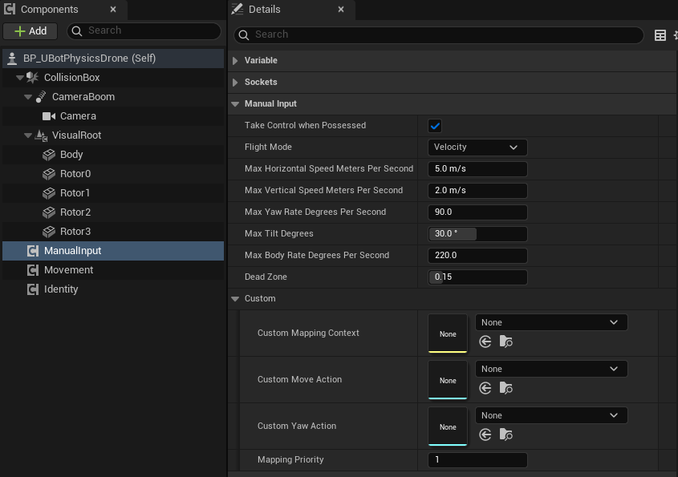

import { Steps } from "@astrojs/starlight/components";

用键盘或手柄手动飞无人机（`uBot Multirotor Manual Input`），了解三种飞行模式各发什么指令，以及怎样切换要操控的无人机。

## 快速用法

下面的蓝图在每个 Tick 把当前摇杆量显示在屏幕上，用来检查输入有没有到达。三个示例蓝图的 `Start with Tick Enabled` 是关的（行为都在组件里），要先在「Class Defaults」里打开它，`Event Tick` 才会运行；也可以把这张图放在别的 Actor 里：

```blueprint
caption: 每个 Tick 显示手动输入的前进量（-1 到 1）
nodes:
  T: AActor.ReceiveTick
  M: { var: ManualInput, class: UUBotMultirotorManualInputComponent }
  G: UUBotMultirotorManualInputComponent.GetAxes
  B: { ref: Break:FUBotManualFlightAxes, hideUnconnected: true }
  S: UKismetStringLibrary.Conv_DoubleToString
  P: UKismetSystemLibrary.PrintString
wires:
  - T.then -> P.execute
  - M.ManualInput -> G.self
  - G.ReturnValue -> B.UBotManualFlightAxes
  - B.Forward -> S.InDouble
  - S.ReturnValue -> P.InString
```

`Is Controlling` 返回这个组件当前是否在接管输入。切换操控另一架无人机，用 `Get Player Controller` 和 `Possess`：

```blueprint
caption: 让 Player 0 改为操控关卡里的物理无人机
nodes:
  A: AActor.ReceiveBeginPlay
  C: { ref: UGameplayStatics.GetPlayerController, set: { PlayerIndex: 0 } }
  D: { ref: UGameplayStatics.GetActorOfClass, set: { ActorClass: BP_UBotPhysicsDrone } }
  P: AController.Possess
wires:
  - A.then -> D.execute
  - D.then -> P.execute
  - C.ReturnValue -> P.self
  - D.ReturnValue -> P.InPawn
```

## 步骤

<Steps>

1. **添加组件**

   示例蓝图里的 `ManualInput` 就是这个组件。自己拼的无人机添加 `uBot Multirotor Manual Input` 即可，所属的 Actor 必须是 Pawn。

2. **让玩家控制这架 Pawn**

   在「Details」面板把 `Auto Possess Player` 设为 Player 0，或者在蓝图里调用 `Possess`。组件只在本地玩家控制这架 Pawn 时接管输入，AI 控制器和远程控制器不触发它。

3. **选飞行模式**

   `Flight Mode` 要和无人机能接受的指令匹配，见下表。选中 `ManualInput`，全部设置都在「Details」面板的 Manual Input 下：

   

4. **检查输入设置**

   工程的「Project Settings > Input > Default Player Input Class」要是 Enhanced Input 的玩家输入类，否则日志报一次错，无人机不响应按键。

</Steps>

键位如下，输入动作和映射上下文在运行时创建，不需要资产：

| 轴 | 键盘 | 手柄（模式 2） |
| --- | --- | --- |
| 前 / 后 | W / S | 右摇杆上 / 下 |
| 右 / 左 | D / A | 右摇杆右 / 左 |
| 上 / 下 | Space / Left Ctrl | 左摇杆上 / 下 |
| 偏航右 / 左 | E / Q | 左摇杆右 / 左 |

地面只是碰撞面：贴着地面也能直接按方向键移动，按 Space 立刻上升。

## 关键属性

`Flight Mode` 决定摇杆的含义：

| `Flight Mode` | 摇杆含义 | 发出的指令 | 示例里用它的无人机 |
| --- | --- | --- | --- |
| `Velocity` | 前后左右是航向系水平速度，上下是升降速度，偏航轴是偏航角速度 | 速度指令 | 导航、物理 |
| `Angle`（自稳） | 前后左右是倾斜，偏航轴转动航向，上下是爬升率 | 姿态指令，不带推力，高度由无人机保持 | 无（物理无人机可选） |
| `Rate`（特技） | 前后左右是横滚和俯仰角速度，偏航轴是偏航角速度，上下是爬升率 | 角速度指令 | 裸机架 |

满偏对应的量：

| 属性 | 默认值 | 作用 |
| --- | --- | --- |
| `Max Horizontal Speed Meters Per Second` | 5 m/s | `Velocity` 模式的水平速度 |
| `Max Vertical Speed Meters Per Second` | 2 m/s | 升降速度 |
| `Max Yaw Rate Degrees Per Second` | 90°/s | 偏航角速度 |
| `Max Tilt Degrees` | 30° | `Angle` 模式的倾角，范围 0 到 60 |
| `Max Body Rate Degrees Per Second` | 220°/s | `Rate` 模式的横滚、俯仰角速度 |
| `Dead Zone` | 0.15 | 摇杆死区，死区边缘重映射为 0，范围 0 到 0.9 |
| `Take Control when Possessed` | 开 | 关闭后组件不接管输入 |

水平两个轴合起来的长度限制为 1，所以斜向不会更快。

## 输出与事件

- 控制期间组件每帧发一条指令。
- 控制结束时，`Velocity` 模式发 `Stop Motion`，无人机刹停并悬停。`Angle` 和 `Rate` 模式发 `Release Attitude Command`，释放姿态指令，接下来由无人机的 `Command Loss Action` 决定，默认是 `Hover`（刹停并悬停），见[物理无人机的指令与控制模式](/aerial/dynamics/#关键属性)。
- 同时有其他发送方（例如 ROS）时，最后到达的指令生效。

## 注意事项

- `Angle` 和 `Rate` 模式下，右摇杆向右是向右倾或横滚，向前是机头下俯，偏航轴向右是向右偏航。
- 导航无人机没有姿态接口，选 `Angle` 或 `Rate` 时日志警告一次。
- 示例蓝图的相机挂在弹簧臂上：臂长 120 cm，俯仰 −15°，只继承机体的偏航，所以物理无人机倾斜、翻滚时视角不会跟着晃。
- 要自定义键位，设置 `Custom Mapping Context`、`Custom Move Action`（前、右、上三个轴）和 `Custom Yaw Action`，映射上下文要映射这两个动作；留空则用内置键位。

## 相关参考

- [uBot Multirotor Manual Input](/reference/ubotaerial/uubotmultirotormanualinputcomponent/)：全部节点和属性。
- [示例无人机与试飞关卡](/aerial/examples/)：哪个示例默认用哪种模式。
- [物理无人机的指令与控制模式](/aerial/dynamics/)：姿态和角速度指令。
