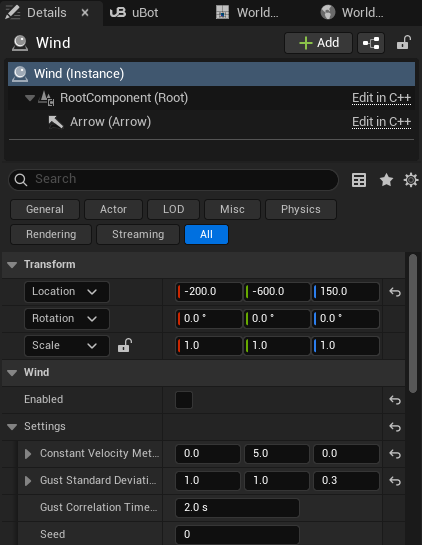

import { Steps } from "@astrojs/starlight/components";

在关卡中放置 `uBot Wind` 可提供恒定风和阵风，并支持通过蓝图在运行时调整风场。

以下节点、截图和参考对应已发布的 uBotAerial 0.1.1，该版本仍自带风场。尚未发布的开发版将风场移到 [uBotEnvironment](/environment/)，使用旧蓝图和关卡前需按[迁移说明](/develop/migration/#风场从-ubotaerial-迁到-ubotenvironment开发版)启用新插件。

## 快速用法

以下蓝图将关卡中的风设置为 3 m/s 的侧风，并启用风源：

```blueprint
caption: 将关卡中的 uBot Wind 设置为 3 m/s 的侧风，并启用风源
nodes:
  A: AActor.ReceiveBeginPlay
  G: { ref: UGameplayStatics.GetActorOfClass, set: { ActorClass: UBotWind } }
  V: { ref: UKismetMathLibrary.MakeVector, set: { Y: 3 } }
  M: { ref: Make:FUBotWindSettings, hideUnconnected: true }
  S: AUBotWind.SetWindSettings
  E: { ref: AUBotWind.SetWindEnabled, set: { bNewEnabled: true } }
wires:
  - A.then -> G.execute
  - G.then -> S.execute
  - G.ReturnValue -> S.self
  - G.ReturnValue -> E.self
  - V.ReturnValue -> M.ConstantVelocityMetersPerSecond
  - M.UBotWindSettings -> S.NewSettings
  - S.then -> E.execute
notes:
  V: Y 为 3：世界坐标系的风速，即空气移动的方向，单位 m/s。
```

## 步骤

<Steps>

1. **放风源**

   把 `uBot Wind` 拖进关卡。风场在整个关卡中空间均匀，与查询位置无关；多个风源 Actor 的风速向量会叠加。编辑器里的箭头显示恒定风的方向，游戏中隐藏。

2. **设置风**

   在「Details」面板填 `Settings`：恒定风速、阵风的标准差、相关时间和种子。

   

3. **控制是否生效**

   `Enabled` 决定此 Actor 是否向风场贡献风速。运行时用 `Set Wind Settings` 和 `Set Wind Enabled` 改变。

4. **让某架无人机不受风**

   在这架无人机的 `Movement` 组件上关闭 `Enable Wind`。

</Steps>

试飞关卡里有一个默认关闭的风源：恒定 (0, 5, 0) m/s，阵风标准差 (1, 1, 0.3) m/s。

## 关键属性

| 属性 | 默认值 | 作用 |
| --- | --- | --- |
| `Enabled` | 开 | 该 Actor 是否向风场贡献风速 |
| `Settings` 下的 `Constant Velocity Meters Per Second` | (0, 0, 0) | 恒定风速，世界坐标系，单位 m/s |
| `Settings` 下的 `Gust Standard Deviation Meters Per Second` | (0, 0, 0) | 每个世界轴阵风的标准差，单位 m/s；0 关闭阵风 |
| `Settings` 下的 `Gust Correlation Time Seconds` | 2 s | 阵风的典型持续时间，越长越平缓，不小于 0.05 s |
| `Settings` 下的 `Seed` | 0 | 阵风的种子 |

## 输出与事件

风速由以下两类来源叠加得到：关卡里的 `uBot Wind` Actor，和用风子系统 `uBot Wind Subsystem` 的 `Set Scripted Wind` 设置的风。

- `Set Scripted Wind(Settings, Enabled)`：设置一份与关卡里的 `uBot Wind` 叠加的风，`Enabled` 为 false 时清除。
- `Get Wind Velocity At(Location Cm)`：当前仿真时间、该位置的风速，单位 m/s。

这两个节点属于 `uBot Wind Subsystem`，调用前需通过引擎的 `Get World Subsystem` 获取子系统引用。风子系统仅存在于 Game 和编辑器内运行（PIE）世界。

阵风是每个世界轴 8 个正弦分量的和，由种子预先生成，并按标准差和相关时间缩放。结果只取决于设置和仿真时间：在相同设置和仿真时刻，各无人机查询得到相同风速。

## 注意事项

- 导航无人机把风当作有界的扰动：恒定风被补偿，不产生位移；风速变化时先随风漂移，再按 `Wind Rejection Time Constant Seconds`（默认 1 s）补偿，漂移速度是风速变化的 `Wind Response`（默认 0.5）倍。
- 物理和裸机无人机按相对空气的速度计算阻力，机体向来风方向倾斜。
- 内置飞行控制器仅在没有指令时，或执行 `Stop Motion`、`Hover` 指令丢失动作后启用位置保持，以修正位置偏移。
- 零速度指令不启用位置保持，因此不会修正风扰动造成的位置偏移。例如 `Velocity` 模式下松开摇杆，或者 ROS 的 `cmd_vel` 为 0。
- `uBot Wind` 在 `BeginPlay` 时向风子系统登记。

## 相关参考

- [uBot Wind](/reference/ubotaerial/aubotwind/) 和 [uBot Wind Subsystem](/reference/ubotaerial/uubotwindsubsystem/)：全部节点和属性。
- [用速度指令飞导航无人机](/aerial/simple-flight/) 和 [物理无人机的指令与控制模式](/aerial/dynamics/)：两类无人机对风的响应。
