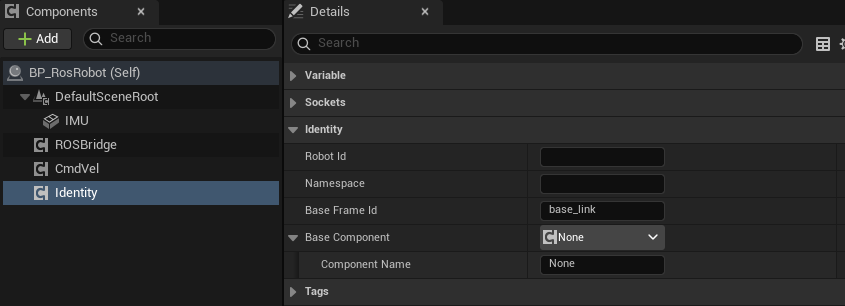

import { Steps } from "@astrojs/starlight/components";

为机器人 Actor 添加 `uBot Identity` 组件，统一配置机器人标识（`Robot Id`）、命名空间（`Namespace`）和基座坐标系标识（`Base Frame Id`），并在蓝图中读取解析后的有效值。

uBotROS 从该组件读取机器人标识，因此可以集中管理相关命名设置。

## 快速用法

`Get Resolved Namespace` 返回应用缺省规则后的命名空间：`Namespace` 留空时，返回机器人标识经过名称净化后的结果。

```blueprint
caption: 开始运行时打印机器人的 Namespace
nodes:
  A: AActor.ReceiveBeginPlay
  V: { var: Identity, class: UUBotIdentityComponent }
  G: UUBotIdentityComponent.GetResolvedNamespace
  P: UKismetSystemLibrary.PrintString
wires:
  - A.then -> P.execute
  - V.Identity -> G.Target
  - G.ReturnValue -> P.InString
notes:
  V: 从「Components」面板把 Identity 组件拖进事件图。
```

## 步骤

<Steps>

1. **添加组件**

   打开机器人的 Actor 蓝图，在「Components」面板点击「Add」，搜索 `uBot Identity`（在「uBot」分类下）。

2. **填写字段**

   在「Details」面板按需填写 `Robot Id`、`Namespace` 等属性。所有字段均可留空；留空时采用下表列出的回退值。

   

3. **读取结果**

   需要读取有效标识时，从组件引用创建 `Get Resolved Robot Id`、`Get Resolved Namespace` 或 `Get Base Frame Id` 节点。直接读取 `Robot Id` 等属性只会返回原始值，不会应用回退规则，因此结果可能为空。

</Steps>

## 关键属性

| 属性 | 默认值 | 留空或无效时 |
| --- | --- | --- |
| `Robot Id` | 空 | 使用所属 Actor 的名称；移除首尾空白字符 |
| `Namespace` | 空 | 使用经过名称净化的机器人标识（`UBot::Identity::SanitizeNameToken`，规则见[标识与命名](/concepts/identity/)）；显式填写的值仅移除首尾空白字符和 `/`，不执行名称净化 |
| `Base Frame Id` | `base_link` | 使用 `base_link` |
| `Base Component` | 空 | 使用所属 Actor 的根组件 |

Actor 名称取自 `AActor::GetName()`，与「Outliner」面板显示的标签无关，打包后仍按相同规则解析。`Base Component` 指向的必须是场景组件（Scene Component），否则同样回退到根组件。

## 输出与事件

组件不提供事件，以下四个节点均为纯函数：

| 节点 | 输出 |
| --- | --- |
| `Get Resolved Robot Id` | String，`Robot Id` 或所属 Actor 的名称；没有所属 Actor 时为空 |
| `Get Resolved Namespace` | String，`Namespace` 或净化后的机器人 ID |
| `Get Base Frame Id` | String，`Base Frame Id` 或 `base_link` |
| `Get Base Component` | Scene Component，指定的场景组件或所属 Actor 的根组件；两者均不可用时为空 |

### 谁会读取它

| 使用方 | 读取内容 | 页面 |
| --- | --- | --- |
| `uBot ROS Sensor Bridge` | `Namespace`（话题前缀）、`Base Frame Id`、`Base Component` | [发布传感器数据](/ros/publish-sensors/) |
| `uBot ROS Velocity Command` | `Namespace`（话题 `/<namespace>/cmd_vel`） | [接收 cmd_vel](/ros/cmd-vel/) |

这两个组件均提供 `Robot Namespace Override`，Sensor Bridge 还提供 `Base Frame Override`。显式填写覆盖项时，使用方优先采用覆盖值。

## 注意事项

- `uBot Identity` 是可选组件。Actor 未添加该组件时，使用方仍按相同规则分别回退到 Actor 名称、净化后的 Actor 名称、`base_link` 和根组件。
- 每个机器人只需添加一个 `uBot Identity` 组件。
- 修改「Outliner」中的 Actor 标签不会改变机器人标识；需要指定机器人标识时，应填写 `Robot Id`。

## 相关参考

- [uBot Identity](/reference/ubotcore/uubotidentitycomponent/)：全部节点和属性。
- [标识与命名](/concepts/identity/)：Sensor Id、Frame Id、名称净化规则和命名建议。
