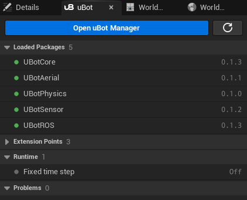

import { Steps } from "@astrojs/starlight/components";

在编辑器的 uBot 面板、蓝图和命令行里查看已安装的 uBot Package（插件）和它们的运行状态。

安装、更新、启用和禁用由 [uBot Manager](/manager/) 或下面的命令行完成，uBot 面板和蓝图只负责查看。

## 快速用法

下面在开始运行时检查 uBotSensor 是否已安装且版本满足约束。`Is uBot Package Version Satisfied` 只看已安装的版本，已禁用的 Package 也算；`^0.1.0` 表示 0.1.0 以上、0.2.0 以下，要确认已启用请再用 `Is uBot Package Enabled`：

```blueprint
caption: 开始运行时检查 uBotSensor 是否已安装且版本为 0.1.x
nodes:
  A: AActor.ReceiveBeginPlay
  C: { ref: UUBotPackageLibrary.IsUBotPackageVersionSatisfied, set: { Name: UBotSensor, Constraint: "^0.1.0" } }
  B: K2Node_IfThenElse
  T: { ref: UKismetSystemLibrary.PrintString, set: { InString: UBotSensor 0.1.x installed } }
  F: { ref: UKismetSystemLibrary.PrintString, set: { InString: UBotSensor missing or wrong version } }
wires:
  - A.then -> B.execute
  - C.ReturnValue -> B.Condition
  - B.True -> T.execute
  - B.False -> F.execute
```

## 步骤

### 打开 uBot 面板

<Steps>

1. **打开面板**

   点编辑器菜单「Window > uBot」（窗口 > uBot），或点状态栏右侧的「uBot: 3 packages · 2 problems」（中文界面是「uBot：3 个 Package · 2 个问题」）。这两个数字是已启用的 uBot Package 数和问题数。

2. **找到面板**

   面板是一个可停靠的标签页，第一次打开时停靠在「Details」面板所在的标签组里。也可以在控制台输入 `uBot.OpenPanel` 打开。

3. **查看状态**

   面板分四个分区，见下表。每行前面的圆点表示严重程度：绿色正常，灰色信息，黄色警告，红色错误。

   

4. **需要安装或更新时**

   点面板顶部的「Open uBot Manager」（打开 uBot Manager），它会带着当前工程启动 uBot Manager。旁边的刷新按钮重新扫描插件并重新读取 Package 索引。

</Steps>

| 分区 | 显示什么 |
| --- | --- |
| 「Loaded Packages」（已加载的 Package） | 已启用的 uBot Package 和版本；索引里有更新的版本时显示 `0.1.0 · 0.1.1 available` |
| 「Extension Points」（扩展点） | 已声明的扩展点和各自的实现数量 |
| 「Runtime」（运行时） | 各 Package 发布的运行状态，比如 uBotROS 的「ROS bridge」；「Fixed time step」；PIE 里还有「Sim time」（每 0.25 s 刷新），没有运行时显示上一次的「Last session」 |
| 「Problems」（问题） | 版本不满足、依赖缺失或被禁用、旧插件与 uBot Package 同时启用、运行时问题、Package 索引读取失败 |

### 在蓝图里查询

`Find uBot Package` 按名称（不区分大小写）找一个 Package，`Return Value` 为 true 表示找到了，`Out Info` 是它的信息。拆开 `Out Info` 就能读到版本号：

```blueprint
caption: 读取 uBotCore 的版本号并打印
nodes:
  A: AActor.ReceiveBeginPlay
  F: { ref: UUBotPackageLibrary.FindUBotPackage, set: { Name: UBotCore } }
  B: K2Node_IfThenElse
  K: { ref: Break:FUBotPackageInfo, hideUnconnected: true }
  P: UKismetSystemLibrary.PrintString
wires:
  - A.then -> B.execute
  - F.ReturnValue -> B.Condition
  - B.True -> P.execute
  - F.OutInfo -> K.UBotPackageInfo
  - K.Version -> P.InString
notes:
  K: "`Version` 在折叠的高级引脚里，点节点下方的 ▾ 展开后才能连线。"
```

### 用命令行查询

`UBotCoreEditor` 提供 `UBotPackage` commandlet，不需要界面，适合 CI：

```powershell
$Editor  = '<UE_5.5>\Engine\Binaries\Win64\UnrealEditor-Cmd.exe'
$Project = '<Project>\<Project>.uproject'

& $Editor $Project -run=UBotPackage -List
& $Editor $Project -run=UBotPackage -Validate
```

| 参数 | 作用 |
| --- | --- |
| `-List` | 以表格打印已安装和索引里的 Package，包括名称、版本、状态和问题数，并列出每个问题。状态是 `Planned`、`Not installed`、`Enabled`、`Disabled`，已改过启用状态但还没重启时是 `Enabled after restart` 或 `Disabled after restart`；表里另有一列只供 uBot Manager 归类用，可以忽略 |
| `-Validate` | 校验已安装的 Package；有任何问题（包括索引错误）就失败 |
| `-Install=<Name>[@<Version>]` | 按依赖顺序克隆缺失的必需依赖和该 Package，然后启用它；省略版本时装最新的可安装版本 |
| `-Update=<Name>` | 在 Package 目录执行 `git pull --ff-only` |
| `-Enable=<Name>`、`-Disable=<Name>` | 启用或禁用；禁用时有已启用的依赖者，需要加 `-Force` 一并禁用 |
| `-Timeout=<Seconds>` | 等待 `-Install` 和 `-Update` 的最长时间，默认 1800 s，0 表示一直等 |

全部成功时退出码为 0；任一操作失败、`-Validate` 发现问题或参数写错时为 1。`-Install`、`-Enable` 和 `-Disable` 改的是 `.uproject`，之后要重启编辑器才会载入新状态。

## 关键属性

`Find uBot Package` 和 `Get Installed uBot Packages` 返回 `UBot Package Info`，常用的字段有：

| 字段 | 含义 |
| --- | --- |
| `Name` | 插件名，例如 `UBotSensor` |
| `Friendly Name` | 显示名 |
| `Version` | 语义化版本号，取自描述文件的 `VersionName` |
| `Enabled` | 是否已启用 |
| `State` | `Enabled` 或 `Disabled` |
| `Requires` | 依赖列表：`Name`、版本约束 `Version`、`Optional` |
| `Provides` | 提供的功能标识，例如 `Sensor.IMU` |
| `Problems` | 依赖校验发现的问题，文字描述 |
| `Base Dir` | 插件目录的绝对路径 |

## 输出与事件

### 蓝图节点

这些节点都是 `UBot Package Library` 里的纯函数，没有事件：

| 节点 | 输出 |
| --- | --- |
| `Get Installed uBot Packages` | 所有已安装的 uBot Package（不论是否启用），按名称排序 |
| `Find uBot Package` | `Return Value` 表示是否找到，`Out Info` 是 `UBot Package Info` |
| `Is uBot Package Enabled` | 已安装并启用时为 true |
| `Get uBot Package Version` | 已安装的版本号；没有安装时是空字符串 |
| `Is uBot Package Version Satisfied` | 已安装且版本满足约束时为 true；没有安装，或版本、约束无法解析时为 false |
| `Get uBot Extension Point Names` | 已声明的扩展点名称，按声明顺序 |
| `Get uBot Extension Names` | 某个扩展点上已注册的扩展名，按注册顺序；扩展点还没有声明时为空 |

### 运行时状态

一次 PIE 或一次游戏运行结束时，uBotCore 把运行时状态写到 `<Project>/Saved/uBot/status.json`。每次覆盖，所以只保留最近一次运行。uBot Manager 读取其中的 `session` 和 `problems`，在「上次运行」里显示。

| 字段 | 内容 |
| --- | --- |
| `session` | `kind`（`PIE` 或 `Game`）、开始和结束时间（UTC） |
| `packages` | 已安装的 uBot Package：名称、版本、是否启用 |
| `extensionPoints` | 已声明的扩展点和当时的实现数量 |
| `runtime` | 各 Package 发布的状态项：`id`、`label`、`value`、`detail`、`severity`（`ok`、`info`、`warning` 或 `error`） |
| `problems` | 各 Package 报告的问题：`id`、`package`、`severity`、`code`、`params` 和英文 `message` |

另外，`Validate Packages on Startup` 打开时，所有模块加载完后会检查一次，把每个问题以 `LogUBot` 警告写进日志，最后输出一行 `uBot packages: N installed, M enabled, K problem(s).`。

## 注意事项

- 蓝图只能查询已安装的 Package。只出现在索引里、还没安装的 Package 查不到，查询结果里的 `Available Versions`、`Index Versions` 等索引字段也是空的。
- 查询结果来自启动时（以及点面板刷新按钮时）的扫描。在 `.uproject` 里启用或禁用 Package 后，要重启编辑器才会生效。
- 扩展点和运行时状态项只能在 C++ 里声明和发布，蓝图里只能查询扩展点的名字。用法见[在 C++ 中使用传感器与接口](/develop/cpp/)。
- uBot 面板只显示状态，不做安装、更新、启用或禁用。
- 找不到 uBot Manager 时，面板会弹出带下载链接的通知；可以在[设置项](/core/settings/)里指定它的路径。
- 维护者用 `-run=UBotDocExport` 导出这套文档的参考数据，使用者用不到。

## 相关参考

- [UBot Package Library](/reference/ubotcore/uubotpackagelibrary/)：全部查询节点。
- [UBot Package Info](/reference/ubotcore/structs/fubotpackageinfo/)：每个字段的含义。
- [uBotCore 设置项](/core/settings/)：`Validate Packages on Startup` 和 `Manager Executable`。
- [uBot Manager 手册](/manager/)：安装、更新、启用和禁用 Package。
- [编写自己的 uBot Package](/develop/package-authoring/)：版本约束的写法。
- [连接与状态](/ros/connection/)：「ROS bridge」状态项的含义。
