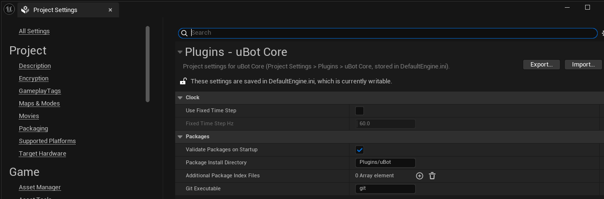
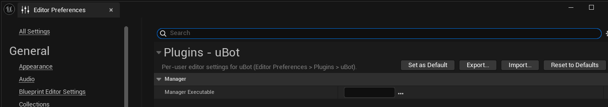

uBotCore 的设置分为项目设置和编辑器偏好两种，设置表给出每一项的默认值和作用。

## 在哪里改

| 种类 | 菜单 | 范围 |
| --- | --- | --- |
| 项目设置「uBot Core」 | 「Edit > Project Settings > Plugins > uBot Core」（编辑 > 项目设置 > 插件 > uBot Core） | 整个项目，供所有项目成员共享 |
| 编辑器偏好「uBot」 | 「Edit > Editor Preferences > Plugins > uBot」（编辑 > 编辑器偏好设置 > 插件 > uBot） | 按用户和项目分别保存 |





## 设置表

### 项目设置「uBot Core」：「Clock」分类

| 名称 | 默认值 | 作用 |
| --- | --- | --- |
| `Use Fixed Time Step` | 未勾选 | 勾选后，每个 Game 或 PIE 世界开始运行（BeginPlay）时启用引擎固定步长。取消勾选不会关闭已经启用的固定步长 |
| `Fixed Time Step Hz` | 60 Hz | 固定步长的频率，范围 1 到 1000 Hz；勾选 `Use Fixed Time Step` 后才能编辑 |

固定步长的用法见[仿真时钟](/core/clock/)。

### 项目设置「uBot Core」：「Packages」分类

| 名称 | 默认值 | 作用 |
| --- | --- | --- |
| `Validate Packages on Startup` | 已勾选 | 所有模块加载完成后检查已安装的 Package，并将每个问题作为 `LogUBot` 警告写入日志 |
| `Package Install Directory` | `Plugins/uBot` | 命令行 `-Install` 安装新 Package 的目录，相对于项目目录 |
| `Additional Package Index Files` | 空 | 额外的 Package 索引文件（格式 2），绝对路径或相对于项目目录；同名条目由后加载的覆盖 |
| `Git Executable` | `git` | 命令行安装和更新时使用的 Git 可执行文件，不能指定为 shell 或批处理脚本 |

`Package Install Directory` 和 `Git Executable` 只影响命令行，见 [Package 查询与编辑器面板](/core/packages/)；uBot Manager 使用自身的[设置](/manager/settings/)。主索引优先采用 uBot Manager 写入的 `Saved/uBot/index.json`，该文件不存在时采用 uBotCore 自带的 `Index/index.json`；额外索引文件在主索引之后按配置顺序加载。

### 编辑器偏好「uBot」

| 名称 | 默认值 | 作用 |
| --- | --- | --- |
| `Manager Executable` | 空 | uBot 面板通过「Open uBot Manager」启动的 `ubot-manager.exe` 路径；相对路径以项目目录为基准解析 |

`Manager Executable` 留空或文件不存在时，依次尝试 uBot Manager 注册的路径（注册表 `HKCU\Software\AstreoX\uBot Manager` 的 `Executable` 值）和 `%LOCALAPPDATA%\uBot Manager\ubot-manager.exe`。两处均未找到可执行文件时，面板会弹出包含下载链接的通知。

## 保存位置

| 设置 | 文件 | 段 |
| --- | --- | --- |
| 项目设置「uBot Core」 | `Config/DefaultEngine.ini` | `[/Script/UBotCore.UBotCoreSettings]` |
| 编辑器偏好「uBot」 | `Saved/Config/WindowsEditor/EditorPerProjectUserSettings.ini` | `[/Script/UBotCoreEditor.UBotEditorSettings]` |

项目设置应随项目提交到版本控制。编辑器偏好保存在 `Saved/` 下，不应提交。也可以直接修改 ini 配置文件：

```ini
[/Script/UBotCore.UBotCoreSettings]
bUseFixedTimeStep=True
FixedTimeStepHz=60.0
+AdditionalPackageIndexFiles=Config/uBotPackages.json
```
