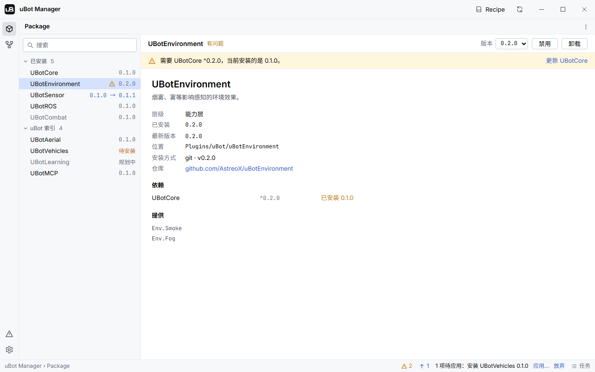
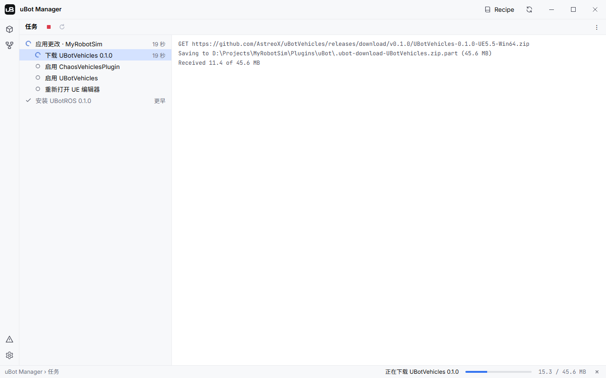
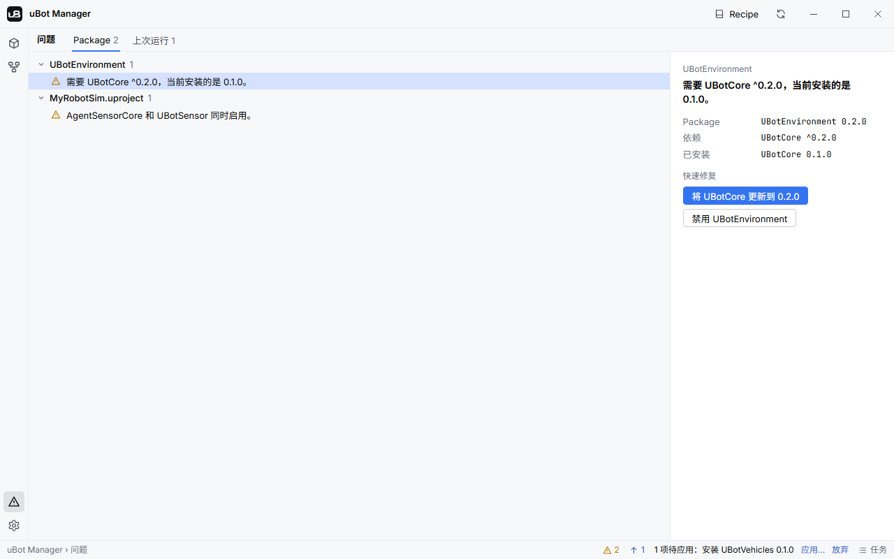

import { Steps } from "@astrojs/starlight/components";

uBot Manager 在 UE 工程里安装、更新、启用、禁用和卸载 uBot 插件，这一页带你认识它的界面。

它是 Windows 桌面程序，面向 UE 5.5 工程，安装方法见 [安装](/start/install/)。uBot 插件在界面里写作 Package，下文引用界面文字时沿用这个写法。

## 启动与选择项目

有三种方式启动：

| 方式 | 做法 |
| --- | --- |
| 从 UE 编辑器 | 打开 `Window > uBot`，点「打开 uBot Manager」（英文界面是 Open uBot Manager），它会带着当前工程启动 |
| 直接运行 | 运行 `ubot-manager.exe`，打开上次使用的项目 |
| 指定项目 | `ubot-manager.exe --project E:\Sims\MyRobotSim\MyRobotSim.uproject` |

同一时间只有一个 uBot Manager 在运行：再次启动时，新进程把项目交给已在运行的实例，由它打开并回到前台。编辑器找不到它时会弹出通知，也可以在 `Editor Preferences > Plugins > uBot` 的 `Manager Executable` 里指定路径。

首次启动的语言跟随系统界面语言，主题默认深色。

<Steps>

1. **打开项目**

   没有项目时，「Package」视图中间是「打开项目」页：点「打开…」选择一个 `.uproject` 文件，或点「最近的项目」里的一项（最多 10 个）。

2. **切换项目**

   已经打开项目时，点「Package」「依赖图」「任务」视图标题栏右侧的 ⋮ 菜单，选「打开项目…」或「最近的项目」里的一项。菜单里还有「在资源管理器中显示」和「在 UE 编辑器中打开」。

3. **下次启动**

   自动打开上一个项目，前提是 `.uproject` 文件还在。

</Steps>

任务运行时不能切换项目，菜单项会置灰，提示「另一个任务正在运行。」

## 各视图

| 视图 | 怎么打开 | 用来做什么 |
| --- | --- | --- |
| 「Package」 | 左侧工具栏的第一个按钮 | 查看和管理插件：安装、更新、启用、禁用、卸载 |
| 「依赖图」 | 左侧工具栏的第二个按钮 | 看插件之间谁依赖谁 |
| 「问题」 | 工具栏下方的警告图标，或状态栏上的错误、问题计数 | 查看依赖缺失、版本不满足等问题，并执行快速修复 |
| 「任务」 | 状态栏右侧的「任务」 | 看应用更改的步骤和日志，停止或重新运行任务 |
| 「设置」 | 工具栏最下方的齿轮 | 打开设置对话框，见 [uBot Manager 设置](/manager/settings/) |

鼠标停在工具栏按钮上会显示它的名称。标题栏右侧的「Recipe」打开 [组合方案](/manager/recipes/)，旁边的刷新按钮（「刷新」）重新下载索引并重新扫描项目。

### 「Package」视图

图中是示例数据，插件和版本不代表当前的索引。

左侧列表分「已安装」和「uBot 索引」两组，可以按名称或提供的能力搜索。选中一项，右侧显示它的详情：

| 位置 | 内容 |
| --- | --- |
| 标题行 | 插件名、状态，右侧是版本下拉框和操作按钮 |
| 横幅 | 插件有问题时，显示第一个问题和它的快速修复 |
| 字段 | 「已安装」「最新版本」「位置」「安装方式」「仓库」 |
| 「依赖」 | 每个依赖和它的满足情况，如「已满足」「将安装」「缺失」 |
| 「提供」 | 插件声明的能力标签 |

状态显示在插件名旁边：

| 状态 | 含义 |
| --- | --- |
| 「已启用」 | 已安装，并在 `.uproject` 里启用 |
| 「已禁用」 | 已安装，但在 `.uproject` 里被禁用 |
| 「有更新」 | 索引里有比已安装版本更新的版本 |
| 「有问题」 | 有依赖等问题，详见「问题」视图 |
| 「未安装」 | 索引里有，工程里没有 |
| 「规划中」 | 还没有发布，按钮显示「暂不可用」；可以在设置里隐藏 |

### 「依赖图」视图

依赖图把插件画成卡片，按依赖从左到右排列，箭头 A → B 表示 B 依赖 A。有问题的卡片带警告图标，双击卡片回到「Package」视图并选中它。

工具栏上的「可安装」和「规划中」两个复选框决定显示哪些卡片；按住 `Ctrl` 滚动滚轮缩放，拖动空白处平移，「适应窗口」恢复全貌。文档里的 [依赖图](/start/introduction/) 画法相同。

### 状态栏

- 错误和问题计数：点一下打开「问题」视图。
- 更新计数：点一下回到「Package」视图，选中第一个有更新的插件。
- 「1 项待应用：安装 UBotROS 0.1.0」之类的文字，右边是「应用…」和「放弃」。
- 「任务」：打开「任务」视图。

## 任务

应用更改后，uBot Manager 按计划里的步骤依次执行，步骤和日志都在「任务」视图里。左边是任务和它的步骤，右边是日志：点任务看摘要，点步骤看这一步的输出。

图中是示例数据，是一次正在下载预编译包的任务。

- 一次只运行一个任务，步骤按顺序执行，输出实时进入日志。
- 步骤状态有「未开始」「运行中」「已完成」「失败」「已跳过」「已取消」；编辑器还开着时，需要它关闭的步骤显示「等待 UE 编辑器关闭」。
- 某一步失败时，后面的步骤标为「已跳过」，已经完成的步骤不会回滚。
- 点「停止」、关闭程序，或在命令行按 `Ctrl+C`，会结束当前步骤的整个进程树：这一步标为「已取消」，剩余步骤标为「已跳过」。
- 「重新运行」只用于当前项目里已结束的任务。
- 保留最近 30 个任务，每步最多 5000 行日志；程序退出时仍在运行的任务，下次启动标为失败。

任务运行时，状态栏显示当前步骤、进度条和 `n/m`；下载预编译包时，进度是已下载的字节数。

## 问题与快速修复

问题在每次刷新时重新计算，只有已启用的插件会产生依赖类问题。

<Steps>

1. **打开「问题」视图**

   点工具栏的警告图标，或点状态栏上的错误、问题计数。

2. **选标签**

   「Package」标签是项目现在的问题；「上次运行」标签是编辑器上一次运行记下的问题。

3. **选一条**

   左侧的问题按来源分组；选中一条，右侧显示它的事实和「快速修复」按钮。

4. **点快速修复**

   依赖类的修复不会立即执行，而是进入待应用列表，由你在「应用更改」里确认。「忽略」把这个问题对当前项目隐藏。

</Steps>

图中是示例数据，右侧列出了两个快速修复。

状态栏只统计错误和警告，信息级的问题不计数。常见的问题如下，插件名只是示例：

| 问题 | 级别 | 快速修复 |
| --- | --- | --- |
| 依赖的版本不满足：「需要 UBotCore ^0.2.0，当前安装的是 0.1.0。」 | 警告 | 「将 UBotCore 更新到 0.2.0」；「禁用 UBotEnvironment」 |
| 依赖没有安装：「需要 UBotCore ^0.1.0，但尚未安装。」 | 警告 | 「安装 UBotCore」（索引里有时）；「禁用 UBotROS」 |
| 依赖被禁用：「需要 UBotCore，但它已禁用。」 | 警告 | 「启用 UBotCore」；「禁用 UBotROS」 |
| 需要的引擎插件被禁用：「需要引擎插件 ChaosVehiclesPlugin，但它已禁用。」 | 警告 | 「启用 ChaosVehiclesPlugin」 |
| 引擎里没有需要的插件：「需要引擎插件 ChaosVehiclesPlugin，当前引擎中没有。」 | 错误 | 「忽略」 |
| 旧插件和取代它的插件同时启用：「AgentSensorCore 和 UBotSensor 同时启用。」 | 警告 | 「禁用 AgentSensorCore」；「忽略」 |
| 预编译版本是为另一个引擎版本编译的：「UBotSensor 安装的是 UE 5.4 的预编译版本，但此项目使用 UE 5.5。」 | 警告 | 「重新安装 UBotSensor」；「禁用 UBotSensor」 |
| 插件的描述文件（`.uplugin`）有误 | 警告 | 无 |
| 依赖循环 | 错误 | 无 |
| 「找不到此项目使用的引擎 5.5。」 | 错误 | 「打开编译设置」 |
| 索引源加载失败：「无法加载 …」 | 信息或警告 | 「忽略」 |
| ROS 桥接连不上：「无法连接 127.0.0.1:8268 上的 ubot_ros_bridge。」 | 信息 | 「打开 ROS 设置」 |

「上次运行」标签显示编辑器写下的 `Saved/uBot/status.json`：一次 PIE（Play In Editor）会话或打包后游戏的一次运行结束时，UBotCore 把各插件在运行中报告的问题写进去，例如 uBotROS 没能连上 ROS 桥接。每条带上会话的时间。

ROS 桥接的检查在每次刷新时进行，前提是 UBotROS 已启用，并且打开了「设置 > ROS 桥接 > 刷新时检查桥接」。它向工程配置的地址发起 TCP 连接，2 秒内连不上就给出信息级的问题。

## 下一步

- [安装、更新、移除插件](/manager/packages/)：加入待应用列表，看计划，应用。
- [组合方案](/manager/recipes/)：一次装好一组插件。
- [uBot Manager 设置](/manager/settings/)：设置项、保存位置和索引源。
- [命令行 ubot](/manager/cli/)：在脚本和 CI 里做同样的事。
