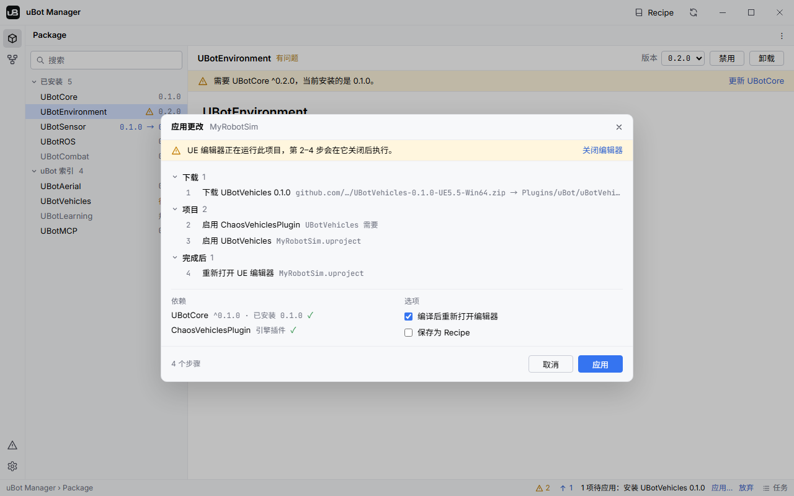

import { Steps } from "@astrojs/starlight/components";

这一页说明怎样在 uBot Manager 里安装、更新、启用、禁用和卸载插件，以及预编译安装与源码编译的区别。

## 步骤

所有操作走同一个流程：先把更改加入待应用列表，看过计划再执行。

<Steps>

1. **选中插件**

   在「Package」视图左侧的列表里选中一个插件。

2. **加入待应用列表**

   点详情右上角的按钮（见下面各节）。按钮不会马上执行：状态栏出现「1 项待应用：安装 UBotROS 0.1.0」，旁边是「应用…」和「放弃」。再点同一个按钮（这时写着「取消安装」之类）可以撤销这一项；每个插件最多保留一项，新的覆盖旧的。

3. **查看计划**

   点「应用…」，打开「应用更改」对话框。顶部是错误和警告，中间是步骤，底栏是步骤数；有错误时「应用」不可用。

4. **应用**

   点「应用」。界面切到「任务」视图，任务在那里运行，结束后项目状态自动刷新。

</Steps>

### 安装

选中「未安装」的插件，在版本下拉框里选版本（默认是最新版本），点「安装」。「规划中」的插件按钮显示「暂不可用」，不能安装。

- 缺少的依赖一起安装，用满足版本约束的最高版本；已装但被禁用的依赖会启用，版本不满足的会更新。
- 插件需要的引擎插件只会在 `.uproject` 里启用，不会安装；引擎里没有的，计划会报错「引擎中没有名为 … 的插件。」
- 插件放进安装目录 `Plugins/uBot` 下的一个文件夹，同时在 `.uproject` 里启用。文件夹名取自索引里的 `folder`，没有就取仓库地址的最后一段。

### 预编译与源码编译

uBot Manager 有两种方式把插件装进工程：

| 方式 | 做什么 | 需要 |
| --- | --- | --- |
| 预编译安装 | 下载预编译压缩包，校验 SHA-256，解压到安装目录 | 不需要 git，也不用编译 |
| 源码编译 | 克隆插件的仓库，检出索引里这个版本的 `ref`（git 标签），再编译 | git，和 Visual Studio 2022 |

下面三条同时满足时，安装和更新使用预编译包：

1. 「设置 > 安装 > 有预编译版本时优先使用」已勾选（默认勾选）。
2. 项目的引擎是 Epic 启动器安装的，也就是 `.uproject` 的 `EngineAssociation` 是 `5.5` 这类版本号。源码构建的引擎不使用预编译包。
3. 索引里这个版本有当前引擎（`主版本.次版本`，如 `5.5`）、Win64 的预编译条目。

不满足时克隆并编译。前两条满足、只是索引里没有这个版本的预编译包时，计划会警告「没有适用于 UE 5.5 的 UBotROS 0.1.0 预编译版本，将从源码编译。」

- 看一个插件是怎么装的：详情里的「安装方式」显示「git · v0.1.0」「预编译 · UE 5.5 · Win64」或「本地文件夹」。
- 没安装的插件，「最新版本」旁边有灰色的「预编译」时，安装最新版本会用预编译包。
- 想从预编译改成源码编译：取消勾选「有预编译版本时优先使用」，卸载后重新安装。

计划里的「编译」步骤只在确实有 C++ 要编译时才出现：本次计划克隆或检出了某个启用的插件，或者某个启用的插件有 C++ 模块却没有 `Binaries/Win64` 里的 `UnrealEditor-*.dll`。代码全部来自预编译包的计划没有「编译」步骤，底栏也没有「需要编译」。需要编译却找不到 Visual Studio 2022 时，计划警告「需要编译 C++，但没有找到 Visual Studio 2022。」

预编译包只含编辑器用的二进制。在编辑器里使用不需要编译；打包游戏时，UE 要为游戏目标编译插件的 C++，这仍然需要 Visual Studio 2022。

### 更新

在版本下拉框里选目标版本：比已安装的新，按钮是「更新到 …」；比已安装的旧，是「降级到 …」。状态栏的更新计数和「有更新」状态提示有新版本。

更新怎么做，取决于插件当初是怎么装的：

| 「安装方式」 | 更新做什么 |
| --- | --- |
| 「git · …」 | 在已有的检出里 `fetch` 标签，再检出目标版本的 `ref`；即使目标版本有预编译包也不换成它 |
| 「预编译 · …」 | 下载目标版本的预编译包，替换原来的文件夹 |
| 「本地文件夹」 | 同上；没有适用的预编译包时报错「没有适用于 UE 5.5 的 UBotCore 0.2.0 预编译版本；请卸载后重新安装，改为从源码编译。」 |

git 检出必须是干净的：有本地修改时计划报错「… 有本地修改。」检出在分支上时只警告，更新后会切换到新版本的标签。已有的 git 检出不会换成预编译安装，预编译安装也不会变成 git 检出；要换，卸载后重新安装。

### 启用与禁用

「启用」和「禁用」只修改 `.uproject` 的 `Plugins` 列表，文件夹原样保留，已禁用的插件在列表里显示为「已禁用」。

- 启用时，缺少的依赖和需要的引擎插件会一并处理。
- 禁用时，依赖它的插件一起禁用，计划警告「禁用 UBotSensor 会同时禁用 UBotROS。」

### 卸载

点「卸载」：删除 `.uproject` 里的条目，把插件文件夹移到回收站，计划里的步骤是「移除 …」，细节写着「… → 回收站」。依赖它的插件会一起禁用。

插件文件夹在项目目录之外，或者那个文件夹里除了这个插件还有别的内容时，计划会报错，不会删除。

### 引擎版本不匹配

UE 不会加载为别的引擎版本编译的模块。会遇到三种情况：

| 情况 | 表现 | 怎么办 |
| --- | --- | --- |
| 要安装的版本不支持当前引擎 | 计划警告「UBotSensor 0.1.0 支持 UE ~5.5，此项目使用的是 5.6.0。」，不阻止应用 | 确认引擎版本，或换一个支持的版本 |
| 已启用的预编译插件是为另一个引擎版本编译的，比如工程升级到了 UE 5.6 | 「问题」视图警告「UBotSensor 安装的是 UE 5.4 的预编译版本，但此项目使用 UE 5.5。」 | 快速修复「重新安装 UBotSensor」，对同一个版本重新下载适合当前引擎的预编译包 |
| 找不到项目使用的引擎 | 「问题」视图报错「找不到此项目使用的引擎 5.5。」，需要编译的更改无法应用 | 快速修复「打开编译设置」，在「引擎」里选一个已注册的引擎 |

没有「重新安装」时只能禁用，或卸载后从源码安装：设置里的「有预编译版本时优先使用」已关闭、引擎不是启动器版本，或索引里没有已安装版本对应这个引擎的预编译包。

## 关键属性

这些设置影响安装和更新，在「设置」对话框里改，详见 [uBot Manager 设置](/manager/settings/)。

| 设置 | 默认值 | 作用 |
| --- | --- | --- |
| 「安装 > 安装目录」 | `Plugins/uBot` | 插件装到哪里；必须在工程的 `Plugins` 文件夹或 `AdditionalPluginDirectories` 的某一项之内 |
| 「安装 > 有预编译版本时优先使用」 | 开 | 满足条件时用预编译包，不克隆也不编译 |
| 「安装 > Git 可执行文件」 | `git` | 克隆和更新 git 检出时用的 git；旁边的「测试」运行 `git --version` |
| 「编译 > 配置」 | `Development` | 编译配置，可选 `Development` 和 `DebugGame` |
| 「编译 > 应用前等待 UE 编辑器关闭」 | 开 | 编辑器开着时，需要它关闭的步骤等它关闭再执行 |
| 「编译 > 编译后重新打开编辑器」 | 开 | 「应用更改」里同名选项的初始值 |
| 「编译 > 编译后运行 Package 测试」 | 关 | 编译后无界面运行这些插件的自动化测试 |

## 输出与事件

「应用更改」对话框把计划列成步骤：

图中是示例数据，计划里没有「编译」步骤，因为代码全部来自预编译包。

| 区域 | 内容 |
| --- | --- |
| 顶部横幅 | 错误（计划无法应用）和警告；编辑器开着时，提示哪几步要等它关闭，旁边有「关闭编辑器」 |
| 「下载」 | 克隆、检出、下载预编译包，依赖在前 |
| 「项目」 | 改 `.uproject`：启用引擎插件，启用或禁用插件，移除条目 |
| 「编译」 | 编译项目，只在有 C++ 要编译时出现 |
| 「完成后」 | 运行测试，重新打开 UE 编辑器 |
| 「依赖」 | 这次更改带来的依赖是否满足 |
| 「选项」 | 「编译后重新打开编辑器」；「保存为 Recipe」，任务成功后把项目里启用的 uBot 插件存成你自己的组合方案，见 [组合方案](/manager/recipes/) |

应用之后，磁盘上会有这些变化：

| 变化 | 位置 |
| --- | --- |
| 插件文件夹 | 安装目录下，默认是 `Plugins/uBot/<文件夹>` |
| 启用状态 | `.uproject` 的 `Plugins` 列表；缩进、换行、字段顺序和其他字段保持不变 |
| 预编译安装的标记 | 插件文件夹里的 `.ubot-install.json`，由 uBot Manager 写入，记录版本、引擎和下载地址 |
| 任务记录 | 「任务」视图里的任务和日志 |

## 注意事项

- 某一步失败时，后面的步骤跳过，已经完成的步骤不会回滚。中途取消的克隆会删除不完整的文件夹，失败或取消的下载会删除它的临时文件。
- UE 编辑器正在运行此项目时，除克隆和下载到新文件夹以外的步骤要等编辑器关闭。「设置 > 编译 > 应用前等待 UE 编辑器关闭」关闭时，「应用更改」会提示「UE 编辑器正在运行此项目，请先关闭它再应用。」
- 安装目录里以 `.ubot-` 开头的文件夹是 uBot Manager 自己的临时文件夹，扫描项目时会被跳过。
- `.uproject` 是只读文件（例如 Perforce 工作区）时，计划报错「… 为只读；请先签出它或清除只读属性。」
- 克隆私有仓库需要事先配好 SSH key 或 credential helper，uBot Manager 运行 git 时禁用了交互式提示。
- 检出的 `.git/config` 里如果配置了会让 git 运行外部程序的项（过滤器、`core.sshCommand`、自定义 credential helper 等），uBot Manager 拒绝更新，因为这个文件可能是随工程带来的。

## 相关参考

- [界面导览](/manager/)：视图、任务、问题与快速修复。
- [uBot Manager 设置](/manager/settings/)：安装目录、预编译开关和索引源。
- [命令行 ubot](/manager/cli/)：用 `ubot plan` 和 `ubot apply` 做同样的事。
