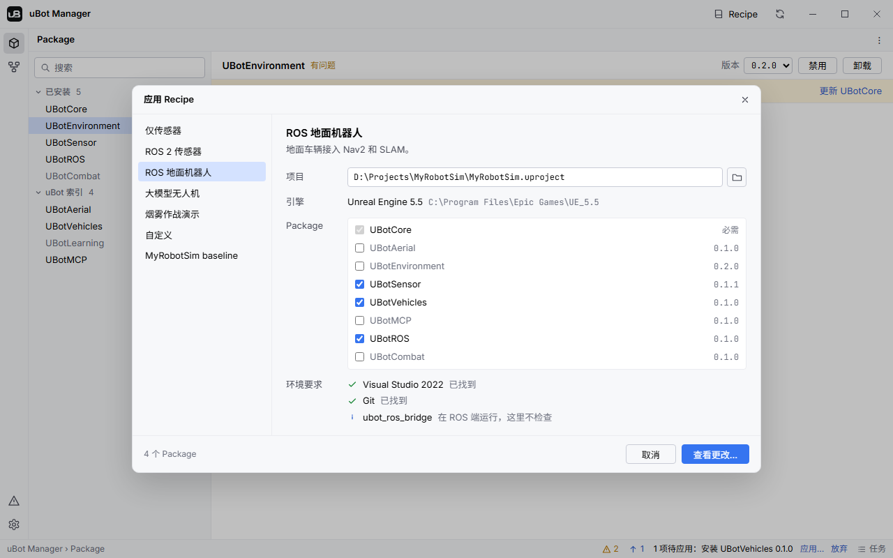

import { Steps } from "@astrojs/starlight/components";
import RecipeTable from "../../../components/RecipeTable.astro";

组合方案（Recipe）定义了一组配套插件，可通过 uBot Manager 的「应用 Recipe」对话框统一安装。

各组合的适用场景参见[选择组合](/start/recipes/)。应用组合和保存自定义组合的操作如下。

## 步骤

<Steps>

1. **打开对话框**

   点击标题栏的「Recipe」，打开「应用 Recipe」。

2. **选组合**

   在左侧的列表里选一个组合。窗口右侧显示它的名称、说明和包含的插件。

3. **选项目**

   「项目」里是要应用到的 `.uproject`：直接输入路径，或点右边的文件夹按钮（「浏览…」）选择。「引擎」一行显示该项目使用的 UE 版本。

4. **调整插件**

   在「Package」列表里勾选要包含的插件。UBotCore 固定勾选，标着「必需」；可在预设组合的基础上添加或取消插件。

5. **看环境要求**

   「环境要求」检查 Visual Studio 2022 和 Git 是否存在，结果是「已找到」或「未找到」。

6. **查看更改**

   点击「查看更改…」，打开「应用更改」对话框，其中列出安装或启用计划，后续操作参见 [安装、更新、移除插件](/manager/packages/)。所有插件都已安装并启用时，对话框提示「无需更改」。

</Steps>

图中是示例数据，组合的可用状态和插件版本不代表当前的索引。

## 关键属性

对话框各区域的作用如下：

| 项 | 作用 |
| --- | --- |
| 左侧列表 | 索引提供的预设组合和用户保存的自定义组合；含有规划中插件的组合显示为灰色，带「规划中」标记 |
| 「项目」 | 应用组合的目标项目；如果显示的路径不是目标项目，请先打开正确的项目 |
| 「引擎」 | 该项目使用的 UE 版本 |
| 「Package」 | 组合包含的插件和它们的版本；规划中的插件不能勾选 |
| 「环境要求」 | Visual Studio 2022 和 Git；组合声明了 ROS 桥接时，还会列出 `ubot_ros_bridge`，该程序在 ROS 2 端运行，对话框不会检查其安装或运行状态 |

索引里的组合如下，含有规划中插件的标着「规划中」：

<RecipeTable />

## 输出与事件

应用 Recipe 会执行以下操作：

- 为缺少的插件安装最新版本。
- 启用已安装但被禁用的插件。

应用组合不会更新已安装的插件，也不会禁用其他插件。任务出现在「任务」视图里，标题是「应用 Recipe … · 项目名」。

如需保存项目当前的插件组合，在「应用更改」对话框中勾选「保存为 Recipe」，并填写「Recipe 名称」（默认为项目名）。任务成功后，uBot Manager 会将项目中所有已启用的 uBot 插件保存为自定义组合；如果名称已存在，则替换原组合。

保存的组合会显示在左侧列表中，也可通过命令行 `ubot recipes` 查询。

## 注意事项

- 规划中的插件不能勾选，所以含有它们的组合只会处理其余的插件。命令行的 `ubot recipe` 会直接拒绝这样的组合。
- 从源码安装的插件要编译，需要 Visual Studio 2022；全部使用预编译包的安装不需要它。
- 组合操作仅执行安装和启用；更新、禁用或卸载插件需使用「Package」视图，见 [安装、更新、移除插件](/manager/packages/)。

## 相关参考

- [选择组合](/start/recipes/)：各组合适合的场景。
- [安装、更新、移除插件](/manager/packages/)：「应用更改」对话框和任务。
- [命令行 ubot](/manager/cli/)：用 `ubot recipes` 和 `ubot recipe` 应用组合。
