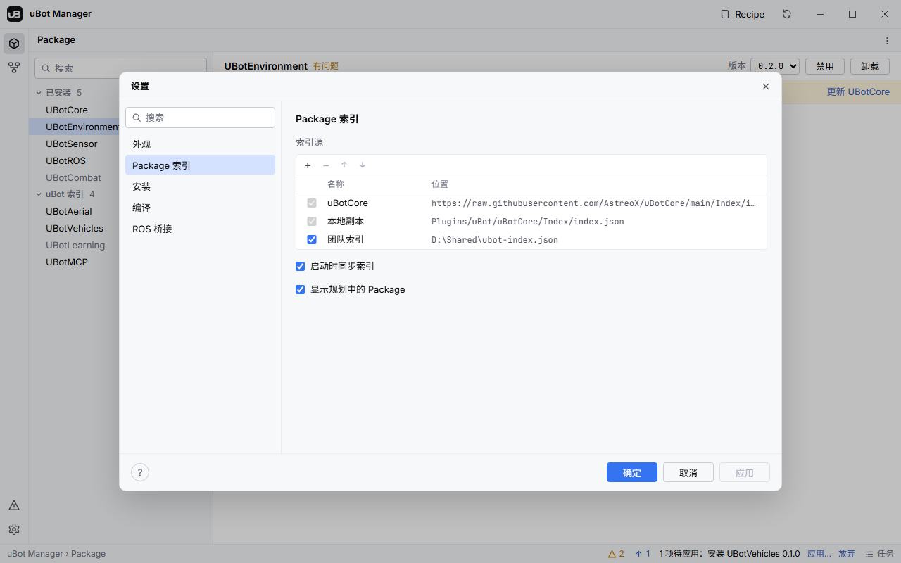

uBot Manager 的设置在「设置」对话框里修改，设置表给出每一项的默认值和作用。

## 在哪里改

点左侧工具栏最下方的齿轮，打开「设置」对话框。左侧是六个分类：「外观」「Package 索引」「安装」「编译」「ROS 桥接」「关于」，上方有搜索框。

点「确定」或「应用」后保存。主题在选择时就预览，点「取消」会恢复。「问题」视图里的快速修复「打开编译设置」和「打开 ROS 设置」会直接打开对应的分类。

## 设置表

### 外观

| 名称 | 默认值 | 作用 |
| --- | --- | --- |
| 「主题」 | 深色 | 深色、浅色或跟随系统 |
| 「语言」 | 跟随系统界面语言 | English 或简体中文，重启 uBot Manager 后生效 |

### Package 索引

| 名称 | 默认值 | 作用 |
| --- | --- | --- |
| 「索引源」 | 两个内置源 | 插件和组合方案从哪里读取，见下面的 [索引源](#索引源) |
| 「启动时同步索引」 | 开 | 启动时先用本地文件和缓存显示界面，再同步远程索引 |
| 「显示规划中的 Package」 | 开 | 关闭后，「Package」视图不再列出规划中的插件，依赖图里的「规划中」复选框默认不勾选（可以手动勾上） |

### 安装

| 名称 | 默认值 | 作用 |
| --- | --- | --- |
| 「安装目录」 | `Plugins/uBot` | 插件装到哪里；必须在工程的 `Plugins` 文件夹或 `AdditionalPluginDirectories` 的某一项之内 |
| 「Git 可执行文件」 | `git` | 克隆和更新 git 检出时用的 git，在 `PATH` 里或指定完整路径；旁边的「测试」运行 `git --version`。必须是 git 本身，不能是 `cmd`、PowerShell、`bash` 或 `.bat` 脚本 |
| 「有预编译版本时优先使用」 | 开 | 满足条件时下载预编译包，不克隆也不编译，条件见 [安装、更新、移除插件](/manager/packages/) |

### 编译

| 名称 | 默认值 | 作用 |
| --- | --- | --- |
| 「引擎」 | 项目使用的引擎 | 编译用的 UE，可以改选另一个已注册的引擎 |
| 「配置」 | `Development` | 编译配置，可选 `Development` 和 `DebugGame` |
| 「应用前等待 UE 编辑器关闭」 | 开 | 编辑器开着时，需要它关闭的步骤等它关闭再执行；关闭此项，这些步骤会直接失败 |
| 「编译后重新打开编辑器」 | 开 | 「应用更改」里同名选项的初始值 |
| 「编译后运行 Package 测试」 | 关 | 编译后无界面运行本次安装、更新或启用的插件的自动化测试 |

「引擎」的下拉框列出已注册的引擎，每项写着版本和安装位置。`settings.json` 里的 `build.engineId` 也可以直接写引擎根目录。

### ROS 桥接

| 名称 | 默认值 | 作用 |
| --- | --- | --- |
| 「主机」 | `127.0.0.1` | uBotROS 连接 ROS 桥接的主机 |
| 「端口」 | `8268` | 端口，1 到 65535；旁边的「测试连接」检查连得上还是连不上 |
| 「刷新时检查桥接」 | 开 | UBotROS 已启用时，每次刷新都向这个地址发起 TCP 连接；2 秒内连不上，「问题」视图给出一条信息级的问题 |

「安装」和「ROS 桥接」两个分类第一次打开时，会自动测试一次 git 和桥接。

### 关于

0.1.2 起提供。

| 名称 | 默认值 | 作用 |
| --- | --- | --- |
| 「版本」 | | 正在运行的 uBot Manager 的版本号 |
| 「启动时检查 uBot Manager 有没有新版本」 | 开 | 启动时向 GitHub 询问一次最新的发布版本；检查失败时不提示 |
| 「检查更新」 | | 马上检查一次，结果是「已是最新版本」、「… 已发布」（旁边的「打开发布页面…」在浏览器里打开发布页面）或失败原因 |

检查只向 GitHub 的发布接口询问最新的版本号，请求里只有程序名和版本号，不会下载或安装任何东西。有新版本时，状态栏出现「新版本 x.y.z」，点它打开这个分类。

## 保存位置

| 内容 | 位置 |
| --- | --- |
| 设置 | `%APPDATA%\AstreoX\uBot Manager\settings.json` |
| 任务历史 | `%LOCALAPPDATA%\AstreoX\uBot Manager\tasks.json` |
| 索引缓存 | `%LOCALAPPDATA%\AstreoX\uBot Manager\cache\` |
| 程序路径（供编辑器查找） | `HKCU\Software\AstreoX\uBot Manager` 的 `Executable` |
| 项目的 ROS 桥接地址 | `<项目>/Config/DefaultUBotROS.ini`，段 `[/Script/UBotROS.UBotROSSettings]`，键 `BridgeHost` 和 `BridgePort` |
| 合并后的索引（uBot Manager 写） | `<项目>/Saved/uBot/index.json` |
| 运行状态（uBot Manager 读） | `<项目>/Saved/uBot/status.json` |

- 工程里装了 UBotROS 时，ROS 的主机和端口属于这个工程：读写 `Config/DefaultUBotROS.ini`，这也是 UE 读取的文件；写在 `DefaultEngine.ini` 里的同名段不生效。没有 UBotROS 时用 `settings.json` 里的值。
- 对话框里没有的内容也在 `settings.json` 里：最近的项目、对「问题」选了「忽略」的记录，以及你保存的组合方案。
- 设置了环境变量 `UBOT_MANAGER_HOME` 时，设置、任务历史和缓存都放在它指向的目录下，并且不写注册表。测试和 CI 应该设置它。
- `settings.json` 里不认识的键会保留；某个键的类型不对，只让它自己回到默认值。整个文件无法解析时使用默认设置，并在下次保存前把原文件复制为 `settings.json.bad-<时间戳>`。

## 索引源

索引（index）是一份列出插件、版本、依赖和组合方案的 JSON 文件，uBot Manager 靠它知道有哪些插件可以装。「设置 > Package 索引」里有一张有序的索引源列表，前面的优先。

图中是示例数据，第三个索引源是示例里添加的「团队索引」。

| 索引源 | 位置 | 说明 |
| --- | --- | --- |
| 「uBotCore」 | `https://raw.githubusercontent.com/AstreoX/uBotCore/main/Index/index.json` | 内置，通过 HTTPS 下载，超时 10 秒，遵循环境变量 `HTTPS_PROXY` 和 `HTTP_PROXY` |
| 「本地副本」 | 工程里已安装的 UBotCore 的 `Index/index.json` | 内置；没有安装 UBotCore 时不可用，这不算故障 |
| 你添加的 | `https://` 地址或文件路径 | 文件路径可以是绝对路径，也可以相对项目目录；`http://` 只接受本机地址 |

- 列表上方的 + 和 − 添加、移除索引源，↑ 和 ↓ 调整顺序。选中自己添加的一行，可以改它的名称和位置，行首的复选框决定是否启用。
- 两个内置源只能调整顺序，不能删除或禁用。
- 同一个插件出现在多个索引源里时，列表中靠前的那个整体生效；组合方案按 `id` 合并，规则相同。
- 索引文件超过 8 MiB、格式版本不是 2，或内容不符合格式，都会被拒绝，原因写在问题里。

### 失败与回退

- 远程索引下载成功后缓存到 `%LOCALAPPDATA%\AstreoX\uBot Manager\cache\`，下载失败时使用缓存。失败原因可以在标题栏刷新按钮的提示里看到。
- 没有缓存时，靠后的索引源（一般是本地副本）顶上；所有索引源都没有给出索引时，使用编译进程序的内置副本。
- 加载失败的索引源会在「问题」视图的「Package 索引」组里出现。用了缓存，或内置源失败而索引仍然可用时，只是提示；自己添加的源失败又没有缓存，或完全没有索引可用时，是警告。每条都可以「忽略」。

### 同步时机

启动时先用本地文件和缓存把界面显示出来，再同步远程索引（「启动时同步索引」默认开启）。之后点标题栏的刷新按钮会重新下载并重新扫描项目，悬停可以看到每个索引源的状态。

做计划时只用本地的索引数据，不会重新下载。每次刷新后，uBot Manager 把合并后的索引写入 `<项目>/Saved/uBot/index.json`，编辑器里的 uBot 面板读取它。
