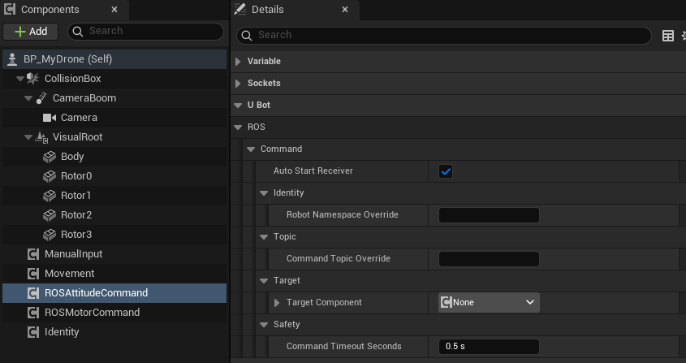
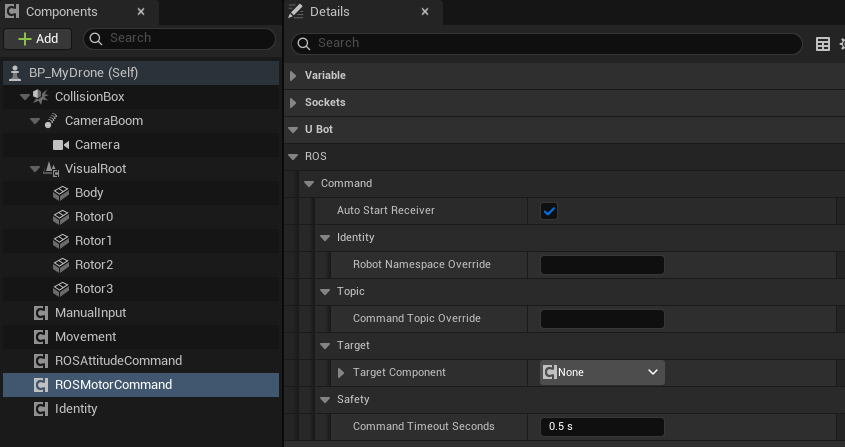

import { Steps } from "@astrojs/starlight/components";

用 `uBot ROS Attitude Command` 和 `uBot ROS Motor Command` 接收 ROS 2 的姿态、角速度和电机指令，交给 UE 里的无人机，用来研究飞控。

## 快速用法

两个组件和 [接收 cmd_vel](/ros/cmd-vel/) 的速度指令组件用法相同：每收到一条有效指令就触发事件，没有现成的执行器时也可以直接在蓝图里处理：

```blueprint
caption: 每收到一条姿态或角速度指令，在屏幕上显示它的推力（0 到 1）
nodes:
  A: { ref: UUBotROSAttitudeCommandComponent.OnAttitudeCommand, component: AttitudeCmd }
  B: { ref: Break:FUBotAttitudeCommand, hideUnconnected: true }
  S: UKismetStringLibrary.Conv_DoubleToString
  P: UKismetSystemLibrary.PrintString
wires:
  - A.then -> P.execute
  - A.Command -> B.UBotAttitudeCommand
  - B.NormalizedThrust -> S.InDouble
  - S.ReturnValue -> P.InString
notes:
  B: 指令已经换算成 UE 的轴向。`Use Thrust` 为 false 时，推力无意义，由无人机自己保持高度。
```

## 步骤

<Steps>

1. **装 ROS 2 端的消息包**

   桥在订阅时才加载消息类型，所以只用其中一个组件时，只需要装对应的消息包：`ros-humble-mavros-msgs`（姿态和角速度）或 `ros-humble-actuator-msgs`（单电机）。两个都用：`sudo apt install ros-humble-mavros-msgs ros-humble-actuator-msgs`。

2. **添加组件**

   在无人机的蓝图上点「Components」面板的「Add」，搜索 `uBot ROS Attitude Command`（姿态和角速度）或 `uBot ROS Motor Command`（单电机），可以两个都加。属性在「Details」面板的「U Bot > ROS > Command」下：

   

3. **确定话题**

   默认话题是 `/<namespace>/cmd_attitude`（`mavros_msgs/msg/AttitudeTarget`）和 `/<namespace>/cmd_motors`（`actuator_msgs/msg/Actuators`）。命名空间取自 `uBot Identity`，规则与 [接收 cmd_vel](/ros/cmd-vel/#步骤) 相同。

4. **确定谁来执行指令**

   目标是实现了 uBotCore 姿态或电机指令接口的对象，例如 uBotAerial 的 `uBot Multirotor Dynamics`，见 [物理无人机的指令与控制模式](/aerial/dynamics/)。`Target Component` 为空时自动查找。

5. **从 ROS 2 发指令**

   ```bash
   # 姿态：ROS 世界系下的绝对姿态，机头指向 +y（向左），推力 60%
   ros2 topic pub -r 50 /drone/cmd_attitude mavros_msgs/msg/AttitudeTarget "{orientation: {z: 0.7071068, w: 0.7071068}, thrust: 0.6}"
   # 角速度：绕 z 轴 1 rad/s（向左偏航），不给推力（保持高度）
   ros2 topic pub -r 50 /drone/cmd_attitude mavros_msgs/msg/AttitudeTarget "{type_mask: 192, body_rate: {z: 1.0}}"
   # 四个电机的转速（rad/s）
   ros2 topic pub -r 100 /drone/cmd_motors actuator_msgs/msg/Actuators "{velocity: [800.0, 800.0, 800.0, 800.0]}"
   ```

   命令里的 `drone` 换成你的命名空间。

</Steps>

## 关键属性

两个组件共有的 5 个属性（来自 `uBot ROS Command Receiver`）与速度指令组件相同。速度指令组件另有 `Max Linear Speed Meters Per Second` 和 `Max Angular Speed Radians Per Second` 两个限速，这两个组件没有：

| 属性 | 默认值 | 作用 |
| --- | --- | --- |
| `Auto Start Receiver` | true | `Begin Play` 时订阅 |
| `Robot Namespace Override` | 空 | 空则用 `uBot Identity` 的命名空间 |
| `Command Topic Override` | 空 | 非空时替代默认话题 |
| `Target Component` | 空 | 接收指令的组件；空则自动查找 |
| `Command Timeout Seconds` | 0.5 s | 超过这么久（仿真时间）没有新指令，就释放指令；0 关闭超时 |



## 输出与事件

### 消息如何转换

`AttitudeTarget` 由 `type_mask` 决定是姿态指令还是角速度指令：

| `type_mask` | 结果 |
| --- | --- |
| 不含 `IGNORE_ATTITUDE`（128） | 姿态指令：`orientation`（ROS 世界系）换算成 UE 的姿态；`body_rate` 不使用 |
| 含 `IGNORE_ATTITUDE` | 角速度指令：`body_rate`（FLU）换算成 UE 的角速度；带 `IGNORE_ROLL_RATE`（1）、`IGNORE_PITCH_RATE`（2）、`IGNORE_YAW_RATE`（4）的轴为 0 |
| 不含 `IGNORE_THRUST`（64） | `thrust`（飞行器最大总推力的比例）截到 0 到 1 后使用 |
| 含 `IGNORE_THRUST` | 不给推力，无人机自己保持高度 |

`Actuators` 的换算：`velocity[]` 有值时按电机转速（rad/s，负值按 0），否则用 `normalized[]`（截到 0 到 1）；`position[]` 不使用。值的个数与目标的电机数（`Get Motor Count`）不同时不下发，触发 `On Command Error`。

ROS 世界系和机体系（FLU）到 UE 轴向的换算见 [坐标与单位](/concepts/coordinates-and-units/)。

### 节点和事件

| 节点 | 作用 |
| --- | --- |
| `On Attitude Command` / `On Body Rate Command` | 每条有效的姿态或角速度指令换算后触发，`Command` 是结果 |
| `On Motor Command` | 每条有效的电机指令换算后触发 |
| `On Command Timeout` | 每次超时触发一次，在目标收到释放之后 |
| `On Command Error` | 订阅失败、消息畸形、个数不符或目标不可用；`Error Message` 是原因 |
| `Get Last Attitude Command` / `Get Last Body Rate Command` / `Get Last Motor Command` | 最近一条有效指令 |
| `Set Target Component` | 用一个组件直接替换 `Target Component`；传空则恢复自动查找 |

### 超时与安全

超过 `Command Timeout Seconds` 没有新指令时，目标收到一次 `Release Attitude Command` 或 `Release Motor Command`，由无人机自己兜底。uBotAerial 的物理无人机默认刹车悬停，见 [物理无人机的指令与控制模式](/aerial/dynamics/#关键属性)。`End Play` 时指令仍然有效也会释放。

```blueprint
caption: 超时释放后，或指令出错时提示
nodes:
  A: { ref: UUBotROSCommandReceiverComponent.OnCommandTimeout, component: AttitudeCmd }
  B: { ref: UKismetSystemLibrary.PrintString, set: { InString: attitude command timed out } }
  C: { ref: UUBotROSCommandReceiverComponent.OnCommandError, component: AttitudeCmd }
  D: UKismetSystemLibrary.PrintString
wires:
  - A.then -> B.execute
  - C.then -> D.execute
  - C.ErrorMessage -> D.InString
```

## 注意事项

- 订阅的 QoS 是 best_effort / volatile / 深度 10，`ros2 topic pub` 默认的 reliable 发布者可以直接用。
- ROS 2 端要持续发布：发布间隔超过 `Command Timeout Seconds`，指令就被释放。上面的例子用 `-r 50` 和 `-r 100`。
- 这两个组件不含控制逻辑，只换算消息。飞控在无人机一侧（内置或 [自己写](/aerial/flight-controller/)）。

## 相关参考

- [uBot ROS Attitude Command](/reference/ubotros/uubotrosattitudecommandcomponent/) 和 [uBot ROS Motor Command](/reference/ubotros/uubotrosmotorcommandcomponent/)：全部节点和属性。
- [uBot ROS Command Receiver](/reference/ubotros/uubotroscommandreceivercomponent/)：三个指令组件共有的超时、错误事件和目标设置。
- [接收 cmd_vel](/ros/cmd-vel/)：速度指令。
