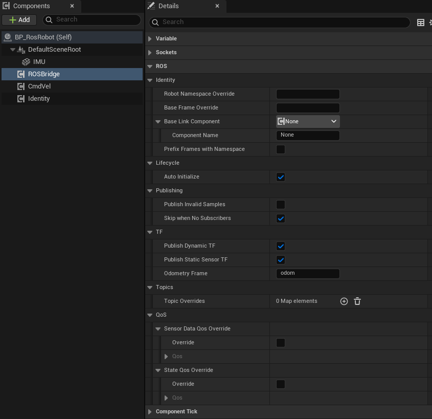
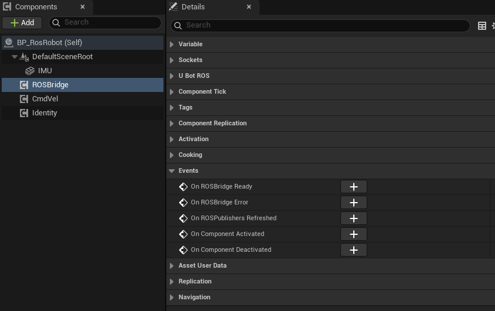

import { Steps } from "@astrojs/starlight/components";

为 Actor 添加 `uBot ROS Sensor Bridge`，可将该 Actor 上的 uBot 传感器数据发布到 ROS 2 话题，并配置话题名称、消息类型和服务质量（Quality of Service，QoS）。

## 快速用法

Sensor Bridge 自动发现所属 Actor 上的 uBot 传感器，为每个传感器创建一个发布器。发布器创建完成或配置发生错误时，组件触发相应事件：

```blueprint
caption: 发布器创建完成，或配置出错时在屏幕上提示
nodes:
  A: { ref: UUBotROSSensorBridgeComponent.OnROSBridgeReady, component: ROSBridge }
  B: { ref: UKismetSystemLibrary.PrintString, set: { InString: ROS publishers ready } }
  C: { ref: UUBotROSSensorBridgeComponent.OnROSBridgeError, component: ROSBridge }
  D: UKismetSystemLibrary.PrintString
wires:
  - A.then -> B.execute
  - C.then -> D.execute
  - C.ErrorMessage -> D.InString
notes:
  C: 话题冲突、重复的 Frame Id 等配置错误都从这里报告。
```

## 步骤

<Steps>

1. **给 Actor 加传感器**

   在同一个 Actor 上添加要发布的 uBot 传感器：[位姿](/sensor/pose/)、[里程计](/sensor/odometry/)、[IMU](/sensor/imu/)、[2D 激光雷达](/sensor/lidar-2d/)、[3D 激光雷达](/sensor/lidar-3d/)、[RGB 相机](/sensor/rgb-camera/)和[深度相机](/sensor/depth-camera/)。

2. **添加 Sensor Bridge**

   在「Components」面板点击「Add」，搜索 `uBot ROS Sensor Bridge`，重命名为 `ROSBridge`。组件只搜索所属 Actor 本身和它的组件，不搜索子 Actor。属性在「Details」面板的「ROS」类别下，分为 Identity、Lifecycle、Publishing、TF、Topics 和 QoS 几个子类别：

   

3. **命名机器人（可选）**

   再添加 `uBot Identity`，将 `Namespace` 设置为 `robot1`，生成的话题名称采用 `/robot1/...` 形式。未添加该组件时，命名空间使用经过名称规范化处理的 Actor 名称，见[标识与命名](/concepts/identity/)。

4. **绑定事件**

   选中 `ROSBridge`，在「Details」面板的「Events」区域点击 `On ROSBridge Ready` 和 `On ROSBridge Error` 旁的「+」，按照上方节点图连接节点。

   

5. **运行并查看**

   先启动桥（见[准备 ROS 2 端](/ros/ros2-setup/)），再点击「Play」。输出日志中出现 `ROS sensor bridge '...' on '...' ready: namespace '/robot1', N sensor(s), M topic(s)`，ROS 2 中用 `ros2 topic list` 查看话题。

</Steps>

## 关键属性

| 属性 | 默认值 | 作用 |
| --- | --- | --- |
| `Robot Namespace Override` | 空 | 空则用 `uBot Identity` 的命名空间；`/` 表示根命名空间；每一段都会进行名称规范化处理 |
| `Base Frame Override` | 空 | 空则用 `uBot Identity` 的基坐标系（默认 `base_link`） |
| `Prefix Frames with Namespace` | false | 所有坐标系标识改为 `<namespace>/<frame>`，多机器人时避免重名，见 [TF 与 /clock](/ros/tf-and-clock/) |
| `Publish Invalid Samples` | false | 是否也发布无效样本（例如 `Warming Up`） |
| `Skip when No Subscribers` | true | 桥报告某个话题没有订阅者时，不编码这个话题的消息；相机还跳过 GPU 读回 |
| `Topic Overrides` | 空 | 按逻辑键覆盖默认话题，见下面的“话题覆盖” |
| `Sensor Data Qos Override` | 不覆盖 | 覆盖传感器数据的 QoS，见下面的“QoS” |
| `State Qos Override` | 不覆盖 | 覆盖位姿和里程计的 QoS |
| `Auto Initialize` | true | `Begin Play` 时自动初始化；关闭后调用 `Restart ROSBridge` |

TF 相关的 `Publish Dynamic TF`、`Publish Static Sensor TF`、`Odometry Frame` 和 `Base Link Component` 见 [TF 与 /clock](/ros/tf-and-clock/)。

### 话题覆盖

`Topic Overrides` 是一个映射（Map），以逻辑键为键，以 [`UBot ROSTopic Override`](/reference/ubotros/structs/fubotrostopicoverride/)为值。启用某项覆盖时，勾选 `Override` 并填写 `Topic`。

| 传感器 | 逻辑键 | 同类型有多个时 |
| --- | --- | --- |
| Pose | `pose` | 经过名称规范化处理的 `Sensor Id` |
| Odometry | `odom` | 经过名称规范化处理的 `Sensor Id` |
| IMU | `imu` | 经过名称规范化处理的 `Sensor Id` |
| 2D LiDAR | `scan` | 经过名称规范化处理的 `Sensor Id` |
| 3D LiDAR | `lidar` | 经过名称规范化处理的 `Sensor Id` |
| RGB 相机 | `rgb_camera`、`rgb_camera.camera_info` | `<SensorId>`、`<SensorId>.camera_info` |
| 深度相机 | `depth_camera`、`depth_camera.camera_info` | `<SensorId>`、`<SensorId>.camera_info` |

覆盖值按绝对话题处理：缺少前导 `/` 会补上，不再加命名空间。

## 输出与事件

### 话题与消息

默认话题是 `/<namespace>/<路径>`，下表仅列出路径部分。同一个 Actor 上存在多个同类型传感器时，路径改用各自经过名称规范化处理的 `Sensor Id`；相机是 `<SensorId>/image_raw` 和 `<SensorId>/camera_info`。

| 传感器 | 默认路径 | ROS 类型 |
| --- | --- | --- |
| Pose | `pose` | `geometry_msgs/msg/PoseStamped` |
| Odometry | `odom` | `nav_msgs/msg/Odometry` |
| IMU | `imu/data` | `sensor_msgs/msg/Imu` |
| 2D LiDAR | `scan` | `sensor_msgs/msg/LaserScan` |
| 3D LiDAR | `lidar/points` | `sensor_msgs/msg/PointCloud2` |
| RGB 相机 | `camera/color/image_raw` | `sensor_msgs/msg/Image`（`bgra8`） |
| RGB 相机 | `camera/color/camera_info` | `sensor_msgs/msg/CameraInfo` |
| 深度相机 | `camera/depth/image_raw` | `sensor_msgs/msg/Image`（`32FC1`，米） |
| 深度相机 | `camera/depth/camera_info` | `sensor_msgs/msg/CameraInfo` |

消息头里的 `frame_id` 取自传感器的属性：

| 传感器 | `frame_id` | 默认值 |
| --- | --- | --- |
| Pose | `Reference Frame Id` | `world` |
| Odometry | `header` 用 `Odometry Frame Id`，`child_frame_id` 用 `Child Frame Id` | `odom`、`base_link` |
| IMU、2D / 3D LiDAR | `Frame Id` | `imu_sensor`、`lidar_2d`、`lidar_3d` |
| RGB / 深度相机 | `<Frame Id>_optical` | `rgb_camera_optical`、`depth_camera_optical` |

消息内容的要点：

| 消息 | 要点 |
| --- | --- |
| 全部 | 时间戳是传感器采样时的仿真时间，见 [TF 与 /clock](/ros/tf-and-clock/) |
| `PointCloud2` | 无组织点云（`height` = 1），小端；字段 `x`、`y`、`z`（float32，偏移 0 / 4 / 8）、`intensity`（float32，12）、`ring`（uint16，16）、`time`（float32，18），`point_step` = 22；帧里没有强度时 `intensity` 为 0；所有坐标有限时 `is_dense` 为 true |
| `LaserScan` | 按 ROS 约定镜像，角度向左为正；未命中的样本为 `+inf`；帧里有强度时一并发布 |
| `Image` | RGB 是 `bgra8`，`step` = 宽 × 4；深度是 `32FC1`，单位米，无效像素为 0 |
| `CameraInfo` | 理想针孔相机：`plumb_bob`，`d` 为 5 个 0，`K` 和 `P` 由 `Fx`、`Fy`、`Cx`、`Cy` 得到，`R` 为单位阵 |
| `Odometry`、`Imu` | 位置、速度、朝向和角速度换算成 ROS 约定，协方差按轴换号，见[坐标系与单位](/concepts/coordinates-and-units/) |

### QoS

IMU、激光雷达和图像话题默认使用传感器数据 QoS；位姿和里程计话题使用状态 QoS。相机内参话题使用独立的固定 QoS，不受上述两种 QoS 覆盖设置影响。

| 名称 | 可靠性（Reliability） | 持久性（Durability） | 历史深度（Depth） | 用途 |
| --- | --- | --- | --- | --- |
| 传感器数据 | Best Effort | Volatile | 5 | IMU、2D / 3D LiDAR、图像 |
| 状态 | Reliable | Volatile | 10 | 位姿、里程计 |
| 相机内参 | Reliable | Volatile | 1 | `camera_info` |

`Sensor Data Qos Override` 和 `State Qos Override` 是 [`UBot ROSQos Override`](/reference/ubotros/structs/fubotrosqosoverride/)：勾选 `Override`，再填 `Qos` 的 `Reliability`、`Durability` 和 `Depth`（1 到 1000）。`/tf`、`/tf_static`、`/clock` 和 `cmd_vel` 的 QoS 见各自的页面。

### 状态与事件

| 节点 | 作用 |
| --- | --- |
| `Is ROSBridge Ready` | 状态是 `Ready` 时为 true |
| `Get ROSBridge Status` | [`EUBot ROSSensor Bridge Status`](/reference/ubotros/enums/eubotrossensorbridgestatus/)：`Uninitialized`、`Initializing`、`Ready`、`Error`、`Stopped` |
| `Get ROSBridge Error` | 最近一次配置错误的说明 |
| `Get Discovered Sensor Count` | 有发布器的传感器个数 |
| `Get Active Publisher Topics` | 已声明的全部话题，排序后的字符串数组 |
| `Get Resolved Namespace` | 默认话题用的命名空间，已净化，没有前导 `/`；根命名空间为空 |
| `Get Resolved Base Frame Id` | 实际发布的基坐标系，开启坐标系前缀时，包含命名空间前缀 |
| `Refresh Sensor Publishers` | 重新发现传感器并重建发布器；组件未在运行时，会先执行初始化 |
| `Restart ROSBridge`、`Stop ROSBridge` | 重新初始化，或移除全部发布器（状态变为 `Stopped`） |
| `On ROSBridge Ready` | 发布器创建完成之后触发 |
| `On ROSBridge Error` | 配置有问题时触发，`Error Message` 是原因 |
| `On ROSPublishers Refreshed` | `Refresh Sensor Publishers` 成功之后触发，`Publisher Count` 是现在声明的话题数 |

### 配置校验

出现以下任一配置问题时，组件进入 `Error` 状态、记录日志并触发 `On ROSBridge Error`，且不发布任何话题。

- 话题不是合法的绝对 ROS 名称：只能用 `A-Za-z0-9_` 和 `/`，每一段不能以数字开头，不超过 255 个字符。
- 同一个话题被分配了两次。
- 传感器的 `Sensor Id` 或 `Frame Id` 为空。
- 同类型传感器里 `Sensor Id` 重复，或者任意两个传感器的 `Frame Id` 重复。
- 基坐标系或里程计坐标系无法解析。

## 注意事项

- 组件在发布器创建完成后进入 `Ready`，该状态不要求桥已连接。断开期间 best_effort 数据直接丢弃，reliable 数据排队，见[连接与状态](/ros/connection/)。
- 没有订阅者的话题默认不编码、不发送，所以 `ros2 topic list` 里有话题，不代表 UE 持续发送数据。传感器话题是 best_effort，编写订阅者或在 RViz 中显示时，把 QoS 设为 best_effort。
- 话题频率就是传感器的 `Update Rate Hz`，不会施加额外的频率限制。图像和点云的编码在游戏线程完成，数据量大时降低分辨率或采样频率，并用 `ros2 topic hz` 和 `ros2 topic bw` 实测。
- 勾选 `Override` 之后，`Qos` 从 Best Effort / Volatile / 5 开始，应按实际需求设置这些字段。
- 相机仅在需要发布图像时执行 CPU 像素读回：`Skip when No Subscribers` 开启时（默认），桥已连接而图像话题没有订阅者，就不读回；关闭它则每个样本都读回。图像话题是 best_effort，桥尚未连接时同样不读回。读回失败时仅记录一次警告（Warning）。
- 没有对应发布器的传感器会被跳过。为自定义传感器添加发布器见[为自定义传感器添加 ROS 发布器](/develop/ros-publisher/)。

## 相关参考

- [uBot ROS Sensor Bridge](/reference/ubotros/uubotrossensorbridgecomponent/)：全部节点和属性。
- [TF 与 /clock](/ros/tf-and-clock/)：传感器的 TF 和仿真时钟。
- [连接与状态](/ros/connection/)：桥的连接状态和排查。
- [标识与命名](/concepts/identity/)：命名空间和坐标系标识的解析规则。
