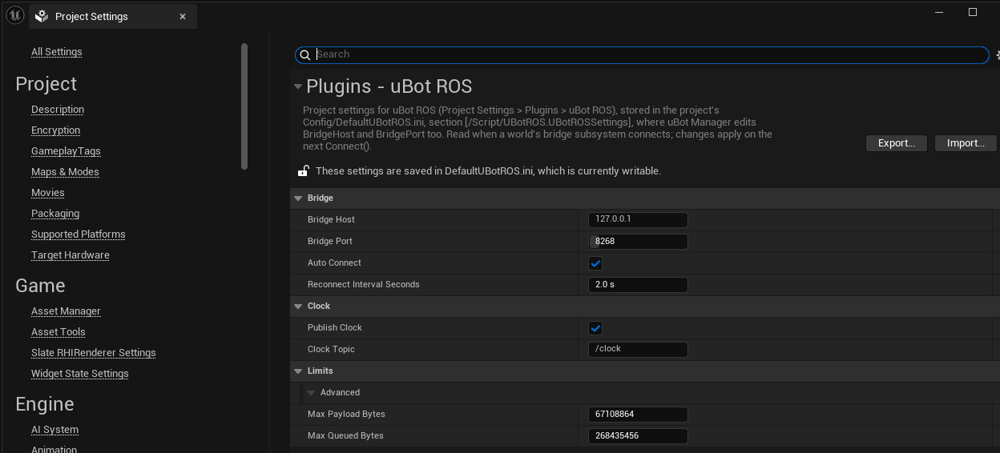

uBotROS 的设置在「Edit > Project Settings」里修改，设置表给出每一项的默认值和作用。

## 在哪里改

打开「Edit > Project Settings」，在左侧「Plugins」下找到「uBot ROS」。「Limits」分类里的两项是高级设置，要展开分类底部的箭头才显示。



uBot Manager 的「设置 > ROS 桥接」读写同一个文件里的 `Bridge Host` 和 `Bridge Port`，其余设置只能在「Project Settings」里改。

## 设置表

| 分类 | 名称 | ini 键 | 默认值 | 作用 |
| --- | --- | --- | --- | --- |
| 「Bridge」 | `Bridge Host` | `BridgeHost` | `127.0.0.1` | 桥的地址，IP 或主机名；主机名在后台线程里解析，优先使用 IPv4 结果 |
| 「Bridge」 | `Bridge Port` | `BridgePort` | 8268 | 桥的 TCP 端口，范围 1 到 65535 |
| 「Bridge」 | `Auto Connect` | `bAutoConnect` | true | Game 或 PIE 世界开始时自动连接；关闭后，从蓝图调用 `Connect` 或 `Connect To` |
| 「Bridge」 | `Reconnect Interval Seconds` | `ReconnectIntervalSeconds` | 2 s | 连接失败或断开后的重试间隔，最小 0.05 s |
| 「Clock」 | `Publish Clock` | `bPublishClock` | true | 桥已连接时，每个世界 Tick 发布一条 `rosgraph_msgs/msg/Clock` |
| 「Clock」 | `Clock Topic` | `ClockTopic` | `/clock` | `/clock` 的话题，必须是绝对话题；勾选 `Publish Clock` 后才能编辑 |
| 「Limits」 | `Max Payload Bytes` | `MaxPayloadBytes` | 67108864（64 MiB） | 单帧负载上限，需与桥的 `max_payload_bytes` 一致，最小 1024 |
| 「Limits」 | `Max Queued Bytes` | `MaxQueuedBytes` | 268435456（256 MiB） | 等待发送的数据和等待分发的接收消息的字节预算，最小 65536 |

- `Max Queued Bytes` 超出时，先丢弃最旧的 best_effort 数据，再拒绝新的 reliable 数据并警告。它小于 `Max Payload Bytes` + 12 时，连接时自动提高到这个值，并记一条警告。
- 地址、端口、重连间隔和 `Max Payload Bytes`、`Max Queued Bytes` 在连接启动时读取；`Publish Clock` 和 `Clock Topic` 每个 Tick 重新读取。
- 对同一个地址重复调用 `Connect` 什么也不做。要让新的重连间隔或队列限制生效，先 `Disconnect` 再 `Connect`，见[连接与状态](/ros/connection/)。

`uBot ROS Sensor Bridge` 和 `uBot ROS Velocity Command` 的属性存在 Actor 或蓝图里，不在这里，见[发布传感器数据](/ros/publish-sensors/)和[接收 cmd_vel](/ros/cmd-vel/)。

## 保存位置

设置保存在工程的 `Config/DefaultUBotROS.ini`，`[/Script/UBotROS.UBotROSSettings]` 段，随工程一起提交：

```ini
[/Script/UBotROS.UBotROSSettings]
BridgeHost=127.0.0.1
BridgePort=8268
```

- uBot Manager 只改 `BridgeHost` 和 `BridgePort` 两行，其余内容不变；没有安装 uBotROS 的工程，使用 uBot Manager 自己保存的值。
- 插件目录里自带的 `Config/DefaultUBotROS.ini` 只放 CoreRedirects（旧插件名称的重定向），是另一个文件，不用改。
- 早期版本把这些设置写在 `Config/DefaultEngine.ini`。现在只读取 `DefaultUBotROS.ini`，`DefaultEngine.ini` 里的这一段不再生效，升级后设置会回到默认值。把整段剪切到 `DefaultUBotROS.ini`，或在「Project Settings」里重新设置一遍。
