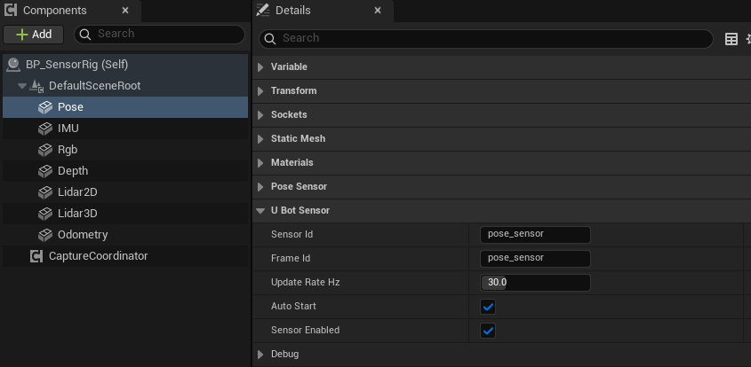

import { Steps } from "@astrojs/starlight/components";

所有 uBot 传感器都支持启动、停止和手动采样，并提供事件通知和主动读取两种数据获取方式。

以下示例使用位姿传感器（`uBot Pose Sensor`），其他传感器的用法相同。

## 快速用法

### 启动、停止与手动采样

关闭 `Auto Start` 后，由蓝图决定传感器的启动和停止时机：

```blueprint
caption: 开始运行时启动传感器，5 秒后停止
nodes:
  B: AActor.ReceiveBeginPlay
  S: UUBotSensorComponent.StartSensor
  D: { ref: UKismetSystemLibrary.Delay, set: { Duration: 5 } }
  T: UUBotSensorComponent.StopSensor
  V: { var: Pose, class: UUBotPoseSensorComponent }
wires:
  - B.then -> S.execute
  - V.Pose -> S.Target
  - S.then -> D.execute
  - D.Completed -> T.execute
  - V.Pose -> T.Target
```

如需完全控制每次采样的时机，应关闭 `Auto Start`，并通过 `Sample Sensor` 触发采样，不调用 `Start Sensor`。传感器启动后会按 `Update Rate Hz` 自动采样；如果同时手动采样，同一仿真时刻可能产生两个样本，IMU 和里程计的第二个样本将处于 `Invalid Delta Time` 状态：

```blueprint
caption: 每个 Tick 手动采集一个样本，并在样本有效时输出提示
nodes:
  E: AActor.ReceiveTick
  V: { var: Pose, class: UUBotPoseSensorComponent }
  S: UUBotSensorComponent.SampleSensor
  C: K2Node_IfThenElse
  P: { ref: UKismetSystemLibrary.PrintString, set: { InString: 采到了一个有效样本 } }
wires:
  - E.then -> S.execute
  - V.Pose -> S.Target
  - S.then -> C.execute
  - S.ReturnValue -> C.Condition
  - C.True -> P.execute
```

- `Start Sensor`：启动成功后触发 `On Sensor Started`，立即采集一个样本，随后每隔 1 / `Update Rate Hz` 秒采样一次。传感器已在运行时直接返回 true。
- `Sensor Enabled` 为 false 时 `Start Sensor` 返回 false。带 `Capture Group Id` 的相机也返回 false，见[相机采集协调器](/sensor/capture-coordinator/)。
- `Stop Sensor`：停止定时采样并触发 `On Sensor Stopped`，最近一次的数据保留。
- `Sample Sensor`：无需启动传感器，即可立即触发一次采样。样本为 `Valid` 时返回 true。

### 事件推送

每次采样后，传感器触发 `On Sensor Sampled`，`Header` 是这一次的帧头：

```blueprint
caption: 每次采样都检查帧头，样本有效时打印序号
nodes:
  E: { ref: UUBotSensorComponent.OnSensorSampled, component: Pose }
  H: { ref: Break:FUBotFrameHeader, hideUnconnected: true }
  C: K2Node_IfThenElse
  S: UKismetStringLibrary.Conv_Int64ToString
  P: UKismetSystemLibrary.PrintString
wires:
  - E.Header -> H.UBotFrameHeader
  - E.then -> C.execute
  - H.Valid -> C.Condition
  - H.Sequence -> S.InInt
  - S.ReturnValue -> P.InString
  - C.True -> P.execute
```

各类传感器还提供专用的数据事件，例如 `On Pose Data Updated`，事件参数包含本次采样的完整数据。

### 主动读取

如需主动读取数据，可在 `Event Tick` 或计时器回调中读取最近一次采样结果。`Get Latest Frame Header` 只读缓存，不会触发采样：

```blueprint
caption: 每个 Tick 读最近一次的帧头，打印序号
nodes:
  E: AActor.ReceiveTick
  V: { var: Pose, class: UUBotPoseSensorComponent }
  G: UUBotSensorComponent.GetLatestFrameHeader
  H: { ref: Break:FUBotFrameHeader, hideUnconnected: true }
  S: UKismetStringLibrary.Conv_Int64ToString
  P: UKismetSystemLibrary.PrintString
wires:
  - V.Pose -> G.Target
  - G.ReturnValue -> H.UBotFrameHeader
  - H.Sequence -> S.InInt
  - S.ReturnValue -> P.InString
  - E.then -> P.execute
```

- 逐帧读取时，连续多次调用可能返回同一个样本。比较帧头的 `Sequence`，可以判断数据是否已更新。
- 每种传感器有专用的读取节点，例如 `Get Latest Pose Data`，见[传感器概述](/sensor/)。

## 步骤

<Steps>

1. **添加传感器**

   在「Components」面板点击「Add」，在「uBot」分类下选一个传感器，例如 `uBot Pose Sensor`。

2. **摆放**

   组件本身就是传感器坐标系，它的位置和朝向就是传感器的位置和朝向。将传感器组件附着到待测部件，再调整其相对位置和朝向。

3. **设置标识和频率**

   在「Details」面板的「Sensor」类别里设置 `Sensor Id`、`Frame Id` 和 `Update Rate Hz`。

   

4. **选择启动方式**

   `Auto Start` 默认开启，传感器在运行开始时自动启动。如需由蓝图控制启动时机，应关闭该属性，并在所需时刻调用 `Start Sensor`。

5. **读取数据**

   选中组件，在「Details」面板底部「Events」区域点击事件旁的「+」，生成事件节点；也可以使用上方示例中的主动读取方式。

</Steps>

## 关键属性

所有传感器共有的属性在「Details」面板的「Sensor」类别（及其「Debug」、「Model」、「Noise」子类别）下：

| 属性 | 默认值 | 作用 |
| --- | --- | --- |
| `Sensor Id` | 各传感器的默认值，如 `pose_sensor` | 写入帧头的传感器标识；为空时用组件名 |
| `Frame Id` | 各传感器的默认值 | 写入帧头的坐标系名称；为空时用 `Sensor Id` |
| `Update Rate Hz` | 基类为 10 Hz，各传感器的默认频率见[概述](/sensor/) | 采样频率，范围 0.1 到 240 Hz |
| `Auto Start` | true | 运行开始时自动启动，运行结束时自动停止 |
| `Sensor Enabled` | true | 总开关；false 时不能启动，手动采样只得到 `Disabled` 帧头 |
| `Noise Enabled` | false | 噪声开关，仅对 IMU、里程计和两种激光雷达有效 |
| `Random Seed` | 1337 | 每次 `Start Sensor` 用它重置随机序列 |
| `Debug Visualization` | false | 运行时画调试射线，只有激光雷达使用 |
| `Hide Sensor Model in Game` | true | 游戏中隐藏传感器模型 |

这些属性在蓝图中只读。运行期间可修改的通用设置为采样频率（`Set Update Rate Hz`，限制在 0.1 到 240 Hz，不会重启传感器）和模型显示。各传感器的专用属性见各自的页面。

### 传感器模型的显示

每个传感器组件都附带一个模型，用于在视口中确认传感器的安装位置。模型没有碰撞，不投射阴影。

| 做法 | 说明 |
| --- | --- |
| `Hide Sensor Model in Game` | 默认打开，游戏中隐藏模型；在「Details」面板中取消勾选即可显示 |
| `Set Sensor Model Visible in Game` | 运行中切换，参数 `Model Visible` 为 true 时显示 |
| `Is Sensor Model Visible in Game` | 读取当前是否显示 |

## 输出与事件

| 事件 | 引脚 | 什么时候触发 |
| --- | --- | --- |
| `On Sensor Started` | 无 | `Start Sensor` 启动成功，在第一个样本之前 |
| `On Sensor Stopped` | 无 | 传感器从运行变为停止，包括运行结束时的自动停止 |
| `On Sensor Sampled` | `Header` | 每次采样之后，包括无效样本和 `Disabled` 样本 |
| `On Sensor Error` | `Error Message` | 采样出错时，例如位姿传感器的参考组件无效 |

每个样本的帧头（`Header`）带 `Sensor Id`、`Frame Id`、`Sequence`、`Timestamp Seconds`、`Valid` 和 `Status`。使用数据前应检查 `Valid`，字段和状态码见[帧头与采样状态](/concepts/frame-header/)。

- `Get Latest Frame Header`：最近一次采样的帧头。传感器尚未采过样时，它是默认值：`Sequence` 为 0，`Status` 为 `Error`。
- `Get Dropped Sample Count`：因单帧跨越多个采样时刻而跳过的采样次数，`Start Sensor` 时清零。
- 不关心具体类型时，可以通过 `UBot Sensor` 接口读取：`Get Sensor Id`、`Get Sensor Type`、`Is Sensor Running`、`Get Latest Sensor Header`。见[插件之间怎么对接](/concepts/interfaces/)。

## 注意事项

- 组件的 `BeginPlay` 先于 Actor 的 `Event BeginPlay`。`Auto Start` 在那时已经触发了 `On Sensor Started` 和第一个样本，因此，在 `Event BeginPlay` 中绑定事件将无法接收这些初始事件。通过「Details」面板「Events」区域的「+」生成事件节点，可以接收启动事件和首个样本。
- 传感器专用的数据事件（例如 `On Pose Data Updated`）在 `On Sensor Sampled` 之前触发。在数据事件回调中调用 `Get Latest Frame Header` 得到的是上一次的帧头，请改用数据自带的 `Header`。
- 每个世界更新周期（World Tick）最多采集一个样本。帧率低于 `Update Rate Hz` 时，实际采样频率等于帧率，跳过的采样时刻计入 `Get Dropped Sample Count`。见[仿真时钟与采样调度](/concepts/clock-and-scheduling/)。
- 暂停时传感器不自动采样，但仍可手动调用 `Sample Sensor`。由于仿真时间停止推进，手动样本的时间戳保持不变。
- `Random Seed` 只在 `Start Sensor` 时生效。如果始终只调用 `Sample Sensor` 而不启动传感器，`Random Seed` 不会用于重置噪声序列。
- 数据里的坐标轴保持 UE 约定（X 前、Y 右、Z 上），单位是米、秒、弧度，没有做 ROS 转换。见[坐标系与单位](/concepts/coordinates-and-units/)。

## 相关参考

- [uBot Sensor Component](/reference/ubotsensor/uubotsensorcomponent/)：所有传感器共有的节点和属性。
- [UBot Frame Header](/reference/ubotcore/structs/fubotframeheader/)：帧头的字段。
- [EUBot Sample Status](/reference/ubotcore/enums/eubotsamplestatus/)：状态码。
- [标识与命名](/concepts/identity/)：`Sensor Id` 和 `Frame Id` 的取值规则。
