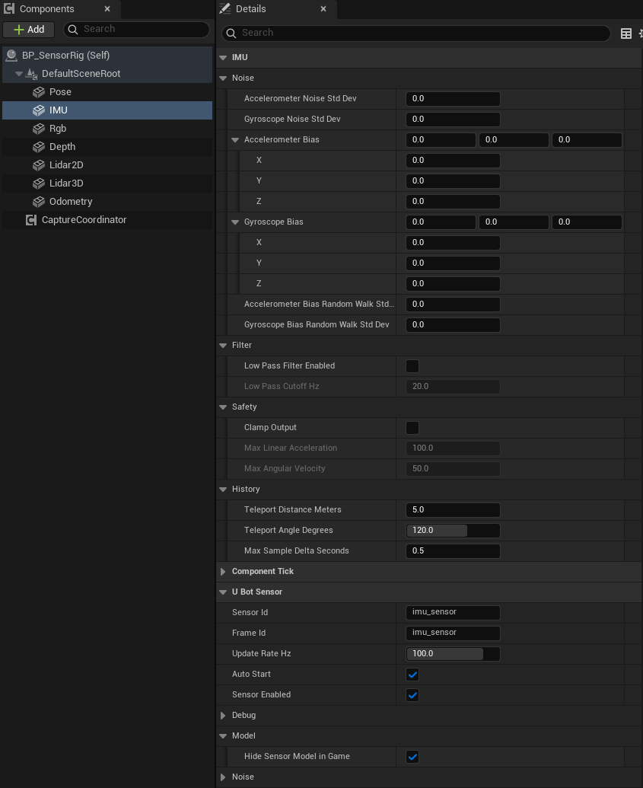

import { Steps } from "@astrojs/starlight/components";

惯性测量单元（Inertial Measurement Unit，IMU）传感器 `uBot IMU Sensor` 输出姿态、角速度和比力，并支持噪声、偏置、滤波和限幅设置。

## 快速用法

使用前需要为 Actor 添加 `uBot IMU Sensor` 组件，做法见[五分钟上手](/start/quickstart/)。

### 每次采样时读取姿态角

IMU 每采样一次就触发 `On Imu Data Updated`，在这个事件里把姿态四元数换算成横滚（Roll）、俯仰（Pitch）和偏航（Yaw）：

```blueprint
caption: 每次采样时把姿态换算成三个角度
nodes:
  A: { ref: UUBotImuSensorComponent.OnImuDataUpdated, component: IMU }
  B: { ref: Break:FUBotImuSensorData, hideUnconnected: true }
  C: UKismetMathLibrary.Quat_Rotator
  D: UKismetMathLibrary.BreakRotator
wires:
  - A.Data -> B.UBotImuSensorData
  - B.OrientationQuaternion -> C.Q
  - C.ReturnValue -> D.Rotation
notes:
  B: 选中节点，在「Details」面板中取消勾选不需要的字段，即可隐藏对应引脚。
  C: 从 `Orientation Quaternion` 拖出，搜索 `ToRotator (Quat)`。
```

将使用这些角度的处理逻辑连接到事件的执行引脚。[`Break Rotator`](/reference/engine/#UKismetMathLibrary-BreakRotator) 输出 `X (Roll)`、`Y (Pitch)` 和 `Z (Yaw)`，单位都是度：Roll 和 Yaw 在 -180 到 180 之间，Pitch 在 -90 到 90 之间。

这是组件在 UE 世界坐标系下的姿态。需要采用右手坐标系（例如 ROS 和 MuJoCo 的约定）的四元数时，使用 `UE To Right-Handed Rotation` 换算，见[坐标约定库](/core/conventions/)。

### 在自己的时机读取

如需主动读取数据，可在 `Event Tick` 或计时器回调中调用 `Get Latest IMUData`，获取最近一次样本。返回数据的字段含义和处理方式与事件参数相同，以下示例读取比力：

```blueprint
caption: 每个 Tick 读取最近一次样本，打印比力
nodes:
  T: AActor.ReceiveTick
  V: { var: IMU, class: UUBotImuSensorComponent }
  G: UUBotImuSensorComponent.GetLatestIMUData
  B: { ref: Break:FUBotImuSensorData, hideUnconnected: true }
  S: UKismetStringLibrary.Conv_VectorToString
  P: { ref: UKismetSystemLibrary.PrintString, set: { Key: imu_force } }
wires:
  - T.then -> P.execute
  - V.IMU -> G.Target
  - G.ReturnValue -> B.UBotImuSensorData
  - B.LinearAccelerationMetersPerSecondSquared -> S.InVec
  - S.ReturnValue -> P.InString
notes:
  V: 从「Components」面板把 IMU 组件拖进事件图。
```

- `Get Latest IMUData` 只读缓存，不会触发采样，开销很小。
- 逐帧读取时，连续多次调用可能返回同一个样本；比较帧头的 `Sequence`，可以判断数据是否已更新。

### 读取角速度和比力

角速度和比力仅在有效样本中包含可用的测量值，使用前应检查帧头的 `Valid`：

```blueprint
caption: 样本有效时打印比力，静止水平放置时约为 (0, 0, 9.8) m/s²
nodes:
  E: { ref: UUBotImuSensorComponent.OnImuDataUpdated, component: IMU }
  B: { ref: Break:FUBotImuSensorData, hideUnconnected: true }
  H: { ref: Break:FUBotFrameHeader, hideUnconnected: true }
  C: K2Node_IfThenElse
  S: UKismetStringLibrary.Conv_VectorToString
  P: UKismetSystemLibrary.PrintString
wires:
  - E.Data -> B.UBotImuSensorData
  - B.Header -> H.UBotFrameHeader
  - E.then -> C.execute
  - H.Valid -> C.Condition
  - B.LinearAccelerationMetersPerSecondSquared -> S.InVec
  - S.ReturnValue -> P.InString
  - C.True -> P.execute
```

角速度（Angular Velocity）单位是 rad/s，比力（Specific Force）单位是 m/s²，均在传感器的本地坐标系中表示（X 前、Y 右、Z 上）。比力是运动加速度减去重力，所以静止水平放置时读数约为 (0, 0, 9.8)，自由下落时接近 (0, 0, 0) m/s²。

## 步骤

<Steps>

1. **添加组件**

   在「Components」面板点击「Add」，搜索 `uBot IMU Sensor`，重命名为 `IMU`，附着到待测刚体。

2. **设置噪声（可选）**

   默认没有噪声。需要时先在「Sensor」类别的「Noise」子类别中勾选 `Noise Enabled`，然后在「IMU」类别的「Noise」子类别中填写噪声和偏置。

3. **设置滤波和限幅（可选）**

   在「IMU」类别的「Filter」子类别中勾选 `Low Pass Filter Enabled`，在「Safety」子类别中勾选 `Clamp Output`。

   

4. **连接蓝图节点**

   选中组件，在「Details」面板底部「Events」区域点击 `On Imu Data Updated` 旁的「+」，按照上方节点图连接节点。

</Steps>

## 关键属性

| 属性 | 默认值 | 作用 |
| --- | --- | --- |
| `Update Rate Hz` | 100 | 采样频率，单位 Hz |
| `Noise Enabled` | false | 噪声、偏置和偏置随机游走的总开关 |
| `Random Seed` | 1337 | 每次 `Start Sensor` 用它重置随机序列 |
| `Accelerometer Noise Std Dev` | 0 | 加速度计白噪声的标准差，单位 m/s² |
| `Gyroscope Noise Std Dev` | 0 | 陀螺仪白噪声的标准差，单位 rad/s |
| `Accelerometer Bias` | (0, 0, 0) | 加速度计固定偏置，单位 m/s²，本地坐标系 |
| `Gyroscope Bias` | (0, 0, 0) | 陀螺仪固定偏置，单位 rad/s，本地坐标系 |
| `Accelerometer Bias Random Walk Std Dev` | 0 | 加速度计偏置的随机游走，单位 m/s²/√s |
| `Gyroscope Bias Random Walk Std Dev` | 0 | 陀螺仪偏置的随机游走，单位 rad/s/√s |
| `Low Pass Filter Enabled` | false | 低通滤波开关 |
| `Low Pass Cutoff Hz` | 20 | 低通滤波的截止频率，单位 Hz，最小 0.1 |
| `Clamp Output` | false | 限幅开关 |
| `Max Linear Acceleration` | 100 | 比力大小的上限，单位 m/s² |
| `Max Angular Velocity` | 50 | 角速度大小的上限，单位 rad/s |
| `Teleport Distance Meters` | 5 | 相邻两个样本间的位移超过该阈值时，判定为瞬移 |
| `Teleport Angle Degrees` | 120 | 相邻两个样本间的转角超过该阈值时，判定为瞬移 |
| `Max Sample Delta Seconds` | 0.5 | 相邻样本的时间间隔超过该上限时，样本无效；状态模式下，刚体状态的年龄超过该上限时，样本也无效 |
| `Use Body State` | true | 0.1.2 起。机体具有刚体状态源时读取其真值；关闭后始终使用差分模式，见[读取刚体状态](/sensor/body-state/)。在「IMU」类别的「Motion」子类别中 |

通用属性（`Auto Start`、`Sensor Id` 等）见[传感器通用用法](/sensor/basics/)。

### 噪声、偏置、滤波和限幅

IMU 首先计算无噪声的角速度和比力：差分模式通过相邻样本的位姿差分计算，0.1.2 起提供的状态模式直接读取刚体状态。随后，两种模式均按下表执行相同的后处理流程：

| 顺序 | 处理 | 相关属性 |
| --- | --- | --- |
| 1 | 偏置按随机游走累加：每个样本加一个量级为 σ√Δt 的随机量，Δt 是样本间隔 | `Accelerometer Bias Random Walk Std Dev`、`Gyroscope Bias Random Walk Std Dev` |
| 2 | 输出加上当前偏置和白噪声 | `Accelerometer Bias`、`Gyroscope Bias`、`Accelerometer Noise Std Dev`、`Gyroscope Noise Std Dev` |
| 3 | 一阶低通滤波 | `Low Pass Filter Enabled`、`Low Pass Cutoff Hz` |
| 4 | 把向量的长度限制在上限以内，方向不变 | `Clamp Output`、`Max Linear Acceleration`、`Max Angular Velocity` |

第 1、2 步只在 `Noise Enabled` 打开时进行，固定偏置同样受该开关控制。`Reset IMUBias` 将偏置恢复为「Details」面板中的设定值，并清除随机游走累积的偏置。

## 输出与事件

`Get Latest IMUData` 返回 `UBot Imu Sensor Data`，通过 `Break UBot Imu Sensor Data` 访问各字段：

| 字段 | 单位 | 说明 |
| --- | --- | --- |
| `Header` | | 帧头；`Valid` 为 true 时角速度和比力才有值 |
| `Orientation Quaternion` | | 组件在 UE 世界坐标系下的朝向，不加噪声，每个样本都有 |
| `Angular Velocity Rad Per Second` | rad/s | 本地坐标系下的角速度，非 `Valid` 样本为 0 |
| `Linear Acceleration Meters Per Second Squared` | m/s² | 本地坐标系下的比力，非 `Valid` 样本为 0 |
| `Orientation Variance` | | 目前不填充，始终为 0 |
| `Angular Velocity Variance` | rad²/s² | `Gyroscope Noise Std Dev` 的平方，三个轴相同 |
| `Linear Acceleration Variance` | m²/s⁴ | `Accelerometer Noise Std Dev` 的平方，三个轴相同 |

- `On Imu Data Updated`：每次采样都触发，通过 `Data` 引脚提供数据，包括 `Warming Up` 等无效样本。
- `Get Latest IMUData`：返回最近一次样本，不会触发采样。
- `Sample IMU`：立即采样一次，样本为 `Valid` 时返回 true。
- `Reset IMUBias`、`Reset IMUHistory`：分别用于恢复偏置和清空历史（包括状态模式的历史），之后差分模式的前两个样本是 `Warming Up`，第三个起恢复 `Valid`；状态模式只有第一个样本是 `Warming Up`。
- `Is Using Body State`、`Get Body State Age Seconds`（0.1.2 起）：分别返回最新样本是否使用刚体状态，以及所用状态的年龄（单位 s）。

### 状态码

差分模式下，IMU 通过相邻样本的位置和姿态差分计算运动量，因此需要先积累历史样本，才能输出有效测量值。状态模式（0.1.2 起，见[读取刚体状态](/sensor/body-state/)）只有第一个样本是 `Warming Up`：

| `Status` | `Valid` | 什么时候 |
| --- | --- | --- |
| `Warming Up` | false | 差分模式：启动或 `Reset IMUHistory` 之后的前两个样本，100 Hz 时第三个样本最早在启动后 0.02 s。状态模式：第一个样本；状态未提供加速度且状态时间尚未推进时，继续保持该状态；刚体尚未提供状态时，以及模式切换后的首个样本也处于该状态 |
| `Valid` | true | 已积累计算所需的历史样本 |
| `Invalid Delta Time` | false | 与上一个样本的仿真时间差为 0，或超过 `Max Sample Delta Seconds`；状态模式下状态的年龄不在 [-1e-6 s, `Max Sample Delta Seconds`] 内时，也处于该状态 |
| `Teleport Detected` | false | 相邻样本间位移超过 `Teleport Distance Meters`，或转角超过 `Teleport Angle Degrees` |
| `Disabled` | false | `Sensor Enabled` 为 false；只触发 `On Sensor Sampled`，没有 `On Imu Data Updated` |

`Invalid Delta Time` 和 `Teleport Detected` 会清空历史：下一个样本是 `Warming Up`，再下一个恢复 `Valid`。IMU 不会给出 `Error`。

## 注意事项

- 使用角速度和比力前，应检查 `Valid`。无效样本的这两项都是 0。
- 采样间隔不能超过 `Max Sample Delta Seconds`（0.5 s）。`Update Rate Hz` 低于 2 Hz 时每个样本都是 `Invalid Delta Time`；如需降低采样频率，应相应增大该时间上限。超过 0.5 s 的卡顿帧也会让 IMU 重新预热。
- 瞬移的判据是相邻两个样本的位移和转角，不是速度。100 Hz 时 5 m 对应 500 m/s；帧率低、样本间隔变大时，同样的速度更容易被判为瞬移，高速载具可适当增大瞬移检测阈值。
- 自动采样运行时不要再手动调用 `Sample IMU`。如果手动样本与自动样本对应同一仿真时刻，时间差为 0，会得到 `Invalid Delta Time` 并清空历史。
- 白噪声和偏置随机游走都用三个均匀随机数相加近似高斯分布，0.1.1 中每个轴的实际标准差约为设定值的 0.7 倍。方差字段报告设定值的平方，即使 `Noise Enabled` 关闭也会填充。
- 低通滤波的状态从 0 开始，开启后最初几个有效样本的输出会偏向 0；静止时的比力需要经过多个样本，才逐渐上升到约 9.8 m/s²。
- 机体有刚体状态源（例如无人机）时，IMU 从 0.1.2 起读取刚体状态提供的真值；如果传感器安装在相对刚体运动的部件上（例如云台），应关闭 `Use Body State`。传感器相对刚体的位置（杠杆臂）会计入速度和加速度。
- 噪声、滤波、限幅和瞬移阈值在蓝图中只读，要在「Details」面板中设置；运行期间可通过 `Set Update Rate Hz` 修改采样频率，并调用上述两个重置节点。

## 相关参考

- [uBot IMU Sensor](/reference/ubotsensor/uubotimusensorcomponent/)：全部节点和属性。
- [UBot Imu Sensor Data](/reference/ubotsensor/structs/fubotimusensordata/)：每个字段的含义和单位。
- [读取刚体状态](/sensor/body-state/)：状态模式的规则、状态年龄和预热过程。
- [帧头与采样状态](/concepts/frame-header/)：`Valid` 和状态码。
- [传感器通用用法](/sensor/basics/)：启动、停止、手动采样和通用事件。
- [坐标系与单位](/concepts/coordinates-and-units/)：UE 与右手系之间的换算。
