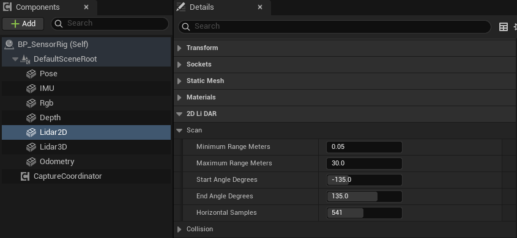
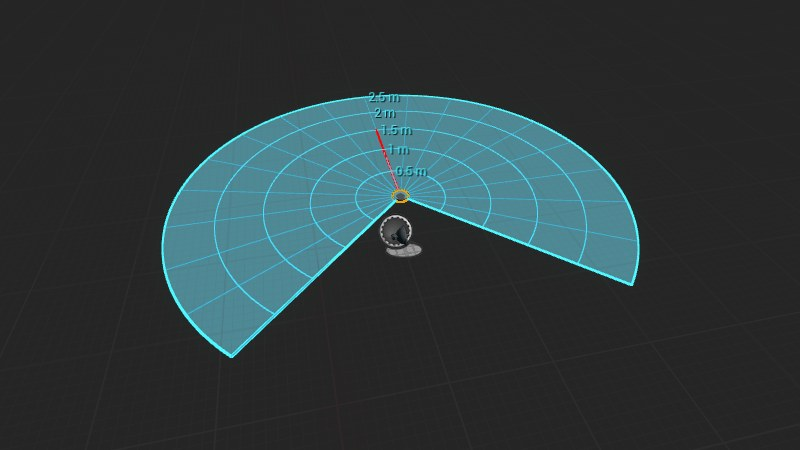

import { Steps } from "@astrojs/starlight/components";

用 `uBot 2D LiDAR Sensor` 扫描传感器的本地 XY 平面，并在蓝图中按索引读出每一束射线的距离。

## 快速用法

```blueprint
caption: 每次扫描后读取正前方射线的距离
nodes:
  A: { ref: UUBot2DLidarSensorComponent.On2DLidarFrameReady, component: Lidar2D }
  B: { ref: UUBot2DLidarFrame.GetRangeByIndex, set: { Index: 270 } }
  C: K2Node_IfThenElse
  D: UKismetStringLibrary.Conv_DoubleToString
  E: UKismetSystemLibrary.PrintString
wires:
  - A.then -> C.execute
  - A.Frame -> B.Target
  - B.Hit -> C.Condition
  - B.RangeMeters -> D.InDouble
  - C.then -> E.execute
  - D.ReturnValue -> E.InString
notes:
  B: 默认 541 束射线覆盖 -135° 到 135°，索引 270 正好在 0°，即传感器的 X 轴方向。
  C: 没有命中（或索引越界）时 `Hit` 为 false，此时 `Range Meters` 不是真实距离。
```

## 步骤

<Steps>

1. **添加组件**

   在「Components」面板点击「Add」，搜索 `uBot 2D LiDAR Sensor`，重命名为 `Lidar2D`，并附着到机器人上。组件本身就是传感器坐标系，X 轴指向扫描的 0° 方向。

2. **设置扫描范围**

   选中组件，在「Details」面板的「2D Li DAR > Scan」里设置起止角、射线数和量程（range）。默认值是 -135° 到 135°、541 束、0.05 m 到 30 m。

   

   编辑器将类别名称中的 `LiDAR` 显示为 `Li DAR`，查找时应以界面中的名称为准。

3. **连接蓝图节点**

   在「Details」面板的「Events」区域点击 `On 2DLidar Frame Ready` 旁的「+」，按照上方节点图连接节点。

4. **运行**

   `Auto Start` 默认开启，开始运行后传感器立即扫描一次，之后按 `Update Rate Hz`（10 Hz）持续扫描。

</Steps>

## 关键属性

### 扫描参数

| 属性 | 默认值 | 作用 |
| --- | --- | --- |
| `Start Angle Degrees` | -135 | 扫描起始角，单位 °。向右（+Y）为正，必须小于 `End Angle Degrees` |
| `End Angle Degrees` | 135 | 扫描结束角，单位 ° |
| `Horizontal Samples` | 541 | 射线数，范围 2 到 4096。首尾两束都在扫描范围的边界上，相邻射线的间隔等于角度范围除以（射线数 - 1） |
| `Minimum Range Meters` | 0.05 | 最小量程，单位 m |
| `Maximum Range Meters` | 30 | 最大量程，单位 m，必须大于最小量程 |
| `Range Noise Std Dev Meters` | 0 | 距离噪声的标准差，单位 m。同时需要开启 `Noise Enabled`，只作用于命中的射线 |
| `Update Rate Hz` | 10 | 扫描频率，单位 Hz |
| `Sensor Id`、`Frame Id` | `lidar_2d` | 帧头中的传感器标识和坐标系标识，见[帧头与采样状态](/concepts/frame-header/) |

### 射线检测设置

每束射线执行一次按通道的单线检测（Line Trace by Channel）。

| 属性 | 默认值 | 作用 |
| --- | --- | --- |
| `Trace Channel` | Visibility | 检测用的碰撞通道，仅检测对该通道设置了阻挡（Block）响应的物体 |
| `Trace Complex` | false | 为 true 时对复杂碰撞（逐三角面）检测，开销更高 |
| `Ignore Owner` | true | 忽略传感器所属的 Actor，避免检测到机器人自身 |
| `Ignored Actors` | 空 | 额外忽略的 Actor 列表 |
| `Debug Visualization` | false | 运行时抽样绘制部分射线，命中为绿色，未命中为红色 |

### 编辑器预览

在编辑器视口里选中组件，会画出扫描范围：填色的扇形、按距离画的圆弧、按角度画的射线，以及圆弧上的距离标注。下图为示意图：为了让扇区完整可见，量程调小了，默认值以属性表为准。



下面的属性在「Details」面板的「2D Li DAR > Editor Preview」里，只用于编辑器，不影响采样：

| 属性 | 默认值 | 作用 |
| --- | --- | --- |
| `Range Preview Color` | 浅蓝 (0.05, 0.65, 1.0) | 扇形、圆弧、射线和标注的颜色 |
| `Range Preview Opacity` | 0.12 | 扇形填色的不透明度，范围 0 到 1；0 表示不填色 |
| `Distance Grid Interval Meters` | 5 | 距离圆弧的间隔，单位 m，最小 0.1。圆弧最多 8 条，量程较大时，圆弧间隔自动加倍 |
| `Angular Grid Interval Degrees` | 15 | 角度射线的间隔，单位 °，范围 1 到 90 |
| `Show Range Labels` | true | 在圆弧上标出距离，格式如 `5 m` |

通用属性（`Auto Start`、`Noise Enabled` 等）见[传感器通用用法](/sensor/basics/)。

## 输出与事件

- `On 2DLidar Frame Ready`：每次产生有效帧后触发，`Frame` 引脚提供本次生成的帧对象。
- `Get Latest 2DLidar Frame`：返回最近一帧，不会触发新的扫描；尚未完成采样时返回空值。
- `Sample 2DLidar`：手动扫描一次，得到有效帧时返回 true。
- 通用事件 `On Sensor Sampled`、`On Sensor Error` 见[传感器通用用法](/sensor/basics/)。

`Frame` 是一个 `UBot 2DLidar Frame` 对象，按下表读取：

| 节点 | 返回 |
| --- | --- |
| `Get Sample Count` | 射线数 |
| `Get Range by Index` | `Range Meters`（单位 m）、`Hit`，以及索引是否有效的 `Return Value` |
| `Get Intensities` | 每束射线一个强度 |
| `Copy All Ranges (High Cost)` | 全部距离的副本 |
| `Copy All Hit Flags (High Cost)` | 全部命中标志的副本 |

帧上的属性有 `Angle Min Radians`、`Angle Max Radians`、`Angle Increment Radians`（单位 rad）、`Range Min Meters`、`Range Max Meters`、`Scan Period Seconds`（单位 s，等于 1 / `Update Rate Hz`）和 `Header`。`Sensor Transform World` 是扫描时传感器在 UE 世界坐标系中的变换，位置单位 cm。

### 强度

强度（Intensity）范围是 0 到 255，计算式为 `255 * Clamp(Dot(-RayDirectionWorld, ImpactNormal), 0, 1)`：射线垂直入射时强度最大，接近切向入射时强度接近 0。未命中的射线和被烟雾截断的射线强度为 0。

## 注意事项

- 没有命中时 `Hit` 为 false，距离等于 `Maximum Range Meters`；使用距离前应检查 `Hit`。
- 距离被限制在 `Minimum Range Meters` 和 `Maximum Range Meters` 之间，命中距离小于最小量程时，按最小量程报告。
- `Copy All ...（High Cost）` 每次调用都会复制整个数组，射线数多、频率高时开销明显。仅需读取少量射线时，使用 `Get Range by Index`，需要全部数据时调用一次并将结果保存到变量中。
- `Start Angle Degrees` 不小于 `End Angle Degrees`，或最大量程不大于最小量程时，这次采样的状态是 `Error`，触发 `On Sensor Error`，不产生帧。
- 烟雾等感知介质会截断射线，见[感知介质（烟雾干扰）](/sensor/medium/)。
- 每次扫描执行 `Horizontal Samples` 次射线检测，默认每秒 5410 次。各传感器的开销对比见[性能与采样频率](/sensor/performance/)。

## 相关参考

- [uBot 2D LiDAR Sensor](/reference/ubotsensor/uubot2dlidarsensorcomponent/)：全部属性。
- [UBot 2DLidar Frame](/reference/ubotsensor/uubot2dlidarframe/)：帧上的节点和属性。
- [传感器通用用法](/sensor/basics/)：启动、停止、手动采样和通用事件。
- [帧头与采样状态](/concepts/frame-header/)：`Header` 里的 `Valid` 和状态码。
- [坐标系与单位](/concepts/coordinates-and-units/)：UE 坐标系和 uBot 的单位约定。
