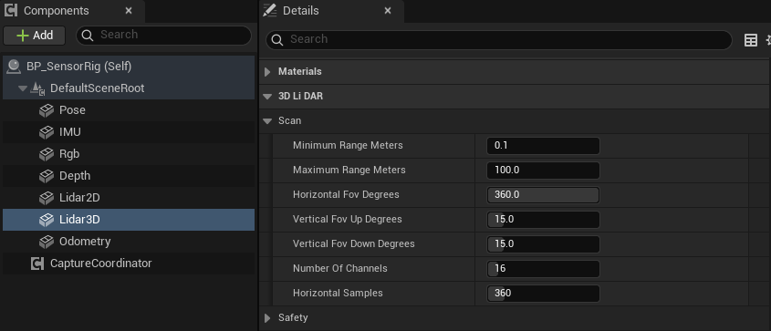
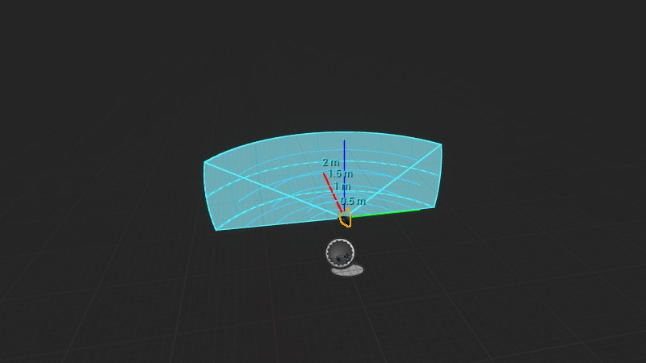

import { Steps } from "@astrojs/starlight/components";

用 `uBot 3D LiDAR Sensor` 在水平和垂直方向上扫描，并在蓝图里从点云（point cloud）帧中读出点和强度。

## 快速用法

```blueprint
caption: 每次扫描后读出第 0 个点，并打印它到传感器的距离
nodes:
  A: { ref: UUBot3DLidarSensorComponent.On3DLidarFrameReady, component: Lidar3D }
  B: { ref: UUBotPointCloudFrame.GetPointByIndex, set: { Index: 0 } }
  C: K2Node_IfThenElse
  D: UKismetMathLibrary.VSize
  E: UKismetStringLibrary.Conv_DoubleToString
  F: UKismetSystemLibrary.PrintString
wires:
  - A.then -> C.execute
  - A.Frame -> B.Target
  - B.ReturnValue -> C.Condition
  - B.PointMeters -> D.A
  - D.ReturnValue -> E.InDouble
  - C.then -> F.execute
  - E.ReturnValue -> F.InString
notes:
  B: "`Point Meters` 在传感器坐标系下，单位 m。"
  C: "`Return Value` 为 false 说明索引越界，例如这一帧没有任何命中点。"
  D: 点到原点的长度就是这个点的距离。
```

## 步骤

<Steps>

1. **添加组件**

   在「Components」面板点「Add」，搜索 `uBot 3D LiDAR Sensor`，重命名为 `Lidar3D`，并附着到机器人上。

2. **设置视场与线数**

   选中组件，在「Details」面板的「3D Li DAR > Scan」里设置视场（Field of View，FOV）、通道（channel）数和每个通道的射线数。默认是水平 360°、垂直上下各 15°、16 个通道、每个通道 360 条射线。

   

   编辑器把类别名里的 `LiDAR` 拆成 `Li DAR`，按截图里显示的找。

3. **连蓝图**

   在「Events」区点 `On 3DLidar Frame Ready` 旁的「+」，照上图连线。

4. **运行**

   `Auto Start` 默认开启，开始运行后传感器立即扫描一次，之后按 `Update Rate Hz`（10 Hz）持续扫描。

</Steps>

## 关键属性

### 视场与线数

| 属性 | 默认值 | 作用 |
| --- | --- | --- |
| `Horizontal Fov Degrees` | 360 | 水平视场，单位 °，范围 0.01 到 360。以传感器的 X 轴为中心，左右各占一半 |
| `Vertical Fov Up Degrees` | 15 | 向上的视场，单位 °，范围 0 到 90 |
| `Vertical Fov Down Degrees` | 15 | 向下的视场，单位 °，范围 0 到 90 |
| `Number Of Channels` | 16 | 垂直方向的线数（通道），范围 1 到 256。从向下到向上均匀分布，只有 1 个通道时水平射出 |
| `Horizontal Samples` | 360 | 每个通道的射线数，范围 1 到 8192。水平视场是 360° 时首尾不重复，其他视场首尾都取到 |
| `Maximum Rays Per Scan` | 65536 | 单次扫描的射线数上限，见下方注意事项 |
| `Minimum Range Meters` | 0.1 | 最小量程，单位 m |
| `Maximum Range Meters` | 100 | 最大量程，单位 m，必须大于最小量程 |
| `Range Noise Std Dev Meters` | 0 | 距离噪声的标准差，单位 m。同时需要开启 `Noise Enabled`，只作用于命中的射线 |
| `Update Rate Hz` | 10 | 扫描频率，单位 Hz |
| `Sensor Id`、`Frame Id` | `lidar_3d` | 帧头里的传感器 ID 和 TF frame id，见[帧头与采样状态](/concepts/frame-header/) |

### 射线检测设置

每束射线做一次按通道的单线检测（Line Trace by Channel）。

| 属性 | 默认值 | 作用 |
| --- | --- | --- |
| `Trace Channel` | Visibility | 检测用的碰撞通道，只有对该通道设为阻挡（Block）的物体会被扫到 |
| `Trace Complex` | false | 为 true 时对复杂碰撞（逐三角面）检测，开销更高 |
| `Ignore Owner` | true | 忽略传感器所属的 Actor，避免扫到机器人自己 |
| `Ignored Actors` | 空 | 额外忽略的 Actor 列表 |
| `Debug Visualization` | false | 运行时抽样画出一部分射线，命中为绿色，未命中为红色 |

### 编辑器预览

在编辑器视口里选中组件，会画出视场的外壳：填色的量程范围、按距离画的圆弧、按角度画的经纬线，以及距离标注。图中是示意：为了让外壳完整可见，量程和视场调小了，数值以设置表为准。



下面的属性在「Details」面板的「3D Li DAR > Editor Preview」里，只用于编辑器，不影响采样：

| 属性 | 默认值 | 作用 |
| --- | --- | --- |
| `Range Preview Color` | 浅蓝 (0.05, 0.65, 1.0) | 外壳、网格和标注的颜色 |
| `Range Preview Opacity` | 0.12 | 外壳填色的不透明度，范围 0 到 1；0 表示不填色 |
| `Distance Grid Interval Meters` | 5 | 距离圆弧的间隔，单位 m，最小 0.1。圆弧最多 8 条，量程很大时间隔会自动加倍 |
| `Angular Grid Interval Degrees` | 15 | 角度网格线的间隔，单位 °，范围 1 到 90 |
| `Show Range Labels` | true | 在圆弧上标出距离，格式如 `5 m` |

通用属性（`Auto Start`、`Noise Enabled` 等）见[传感器通用用法](/sensor/basics/)。

## 输出与事件

- `On 3DLidar Frame Ready`：每次产生有效帧后触发，`Frame` 是这一帧。
- `Get Latest 3DLidar Frame`：返回最近一帧，不会触发新的扫描；还没有采过样时为空。
- `Sample 3DLidar`：手动扫描一次，得到有效帧时返回 true。
- 通用事件 `On Sensor Sampled`、`On Sensor Error` 见[传感器通用用法](/sensor/basics/)。

### 点云帧

`Frame` 是一个 `UBot Point Cloud Frame` 对象，只包含有效命中的点。

| 节点 | 返回 |
| --- | --- |
| `Get Point Count` | 命中点数 |
| `Get Total Ray Count` | 这次扫描发射的射线总数 |
| `Get Point by Index` | `Point Meters`、`Ring Index`、`Time Offset Seconds`、`Intensity`、`Has Intensity`，以及索引是否有效的 `Return Value` |
| `Get Intensities` | 每个点一个强度，与点一一对应 |
| `Has Intensity Data` | 这一帧有没有强度数据 |
| `Copy All Points (High Cost)` | 全部点的副本 |
| `Copy All Ring Indices (High Cost)` | 全部环号的副本 |
| `Copy All Time Offsets (High Cost)` | 全部时间偏移的副本 |
| `Copy All Intensities (High Cost)` | 全部强度的副本 |

- `Point Meters`：传感器坐标系下的点，单位 m，坐标轴保持 UE 约定（X 前、Y 右、Z 上）。
- `Ring Index`：点所在的通道序号（环号），0 是最下面的一条线。
- `Time Offset Seconds`：目前恒为 0，一次扫描在同一仿真时刻完成。

帧上的属性有 `Total Ray Count`、`Hit Point Count`、`Channel Count`、`Horizontal Sample Count`、`Horizontal Fov Radians`、`Vertical Fov Up Radians`、`Vertical Fov Down Radians`、`Minimum Range Meters`、`Maximum Range Meters`、`Scan Period Seconds` 和 `Header`。`Capture Duration Milliseconds` 是生成这一帧用的时间，单位 ms。`Sensor Transform World` 是扫描时传感器在 UE 世界里的变换，单位 cm。

### 强度

强度（Intensity）范围是 0 到 255，计算式为 `255 * Clamp(Dot(-RayDirectionWorld, ImpactNormal), 0, 1)`：射线垂直打在表面上最强，擦着表面时接近 0。被烟雾截断的点强度为 0。

## 注意事项

- 没有命中的射线，以及距离小于 `Minimum Range Meters` 的命中，都不产生点。所以点的索引不对应固定的射线方向。`Ring Index` 只表示垂直方向的通道；要按水平方向处理，用 `Point Meters` 的 X、Y 算 `atan2(Y, X)`，向右为正。
- `Number Of Channels` 乘以 `Horizontal Samples` 超过 `Maximum Rays Per Scan` 时，这次采样的状态是 `Error`，触发 `On Sensor Error`，不产生帧，也不会截断射线数。
- 最大量程不大于最小量程时，这次采样同样是 `Error` 状态。
- `Copy All ...（High Cost）` 每次调用都复制整个数组。逐点处理用 `Get Point by Index`，需要全部数据时调用一次并存进变量。
- 默认每次扫描发射 16 × 360 = 5760 条射线，10 Hz 时每秒 57600 次射线检测。`Capture Duration Milliseconds` 可以用来估算每帧耗时，各传感器的开销对比见[性能与采样频率](/sensor/performance/)。
- 烟雾等感知介质会截断射线，见[感知介质（烟雾干扰）](/sensor/medium/)。

## 相关参考

- [uBot 3D LiDAR Sensor](/reference/ubotsensor/uubot3dlidarsensorcomponent/)：全部属性。
- [UBot Point Cloud Frame](/reference/ubotsensor/uubotpointcloudframe/)：帧上的节点和属性。
- [传感器通用用法](/sensor/basics/)：启动、停止、手动采样和通用事件。
- [帧头与采样状态](/concepts/frame-header/)：`Header` 里的 `Valid` 和状态码。
- [坐标系与单位](/concepts/coordinates-and-units/)：UE 坐标系和 uBot 的单位约定。
