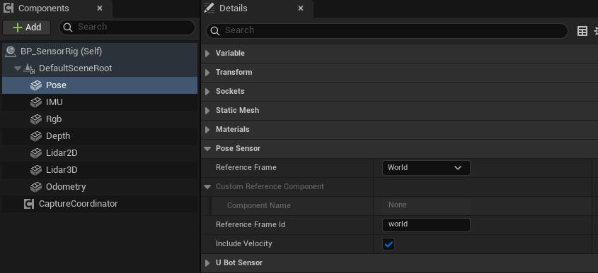

import { Steps } from "@astrojs/starlight/components";

用位姿传感器（`uBot Pose Sensor`）读取组件的位置、姿态和速度，并选择参考系。

## 快速用法

位姿传感器每采样一次就触发 `On Pose Data Updated`。下面的图在有速度时打印线速度的大小，单位是 m/s：

```blueprint
caption: 有速度时打印线速度的大小
nodes:
  E: { ref: UUBotPoseSensorComponent.OnPoseDataUpdated, component: Pose }
  B: { ref: Break:FUBotPoseSensorData, hideUnconnected: true }
  C: K2Node_IfThenElse
  L: UKismetMathLibrary.VSize
  S: UKismetStringLibrary.Conv_DoubleToString
  P: UKismetSystemLibrary.PrintString
wires:
  - E.Data -> B.UBotPoseSensorData
  - E.then -> C.execute
  - B.bHasVelocity -> C.Condition
  - B.LinearVelocityMetersPerSecond -> L.A
  - L.ReturnValue -> S.InDouble
  - S.ReturnValue -> P.InString
  - C.True -> P.execute
notes:
  B: 选中节点，在「Details」面板中取消勾选不需要的字段，即可隐藏对应引脚。
  C: 没有速度时 `Has Velocity` 为 false，速度字段是 0。
```

如需主动读取数据，可在 `Event Tick` 中调用 `Get Latest Pose Data`，获取最近一次采样结果；对返回结构体的处理方式与事件参数相同。

## 步骤

<Steps>

1. **添加组件**

   在「Components」面板点击「Add」，搜索 `uBot Pose Sensor`，将其附着到待测部件。传感器输出自身组件的位姿。

2. **选择参考系**

   在「Details」面板的「Pose Sensor」类别中设置 `Reference Frame`。选择 `Custom Component` 时，还需通过 `Custom Reference Component` 指定参考组件。

   

3. **设置参考系名称**

   `Reference Frame Id` 默认是 `world`。参考系不是 `World` 时，应将该属性改为实际参考坐标系的名称，或留空以使用自动解析的组件名称。

4. **连接蓝图节点**

   选中组件，在「Details」面板底部「Events」区域点击 `On Pose Data Updated` 旁的「+」，按照上方节点图连接节点。

</Steps>

## 关键属性

| 属性 | 默认值 | 作用 |
| --- | --- | --- |
| `Reference Frame` | `World` | 用于表示位姿的参考坐标系，见下表 |
| `Custom Reference Component` | 空 | `Reference Frame` 为 `Custom Component` 时使用的组件 |
| `Reference Frame Id` | `world` | 写入输出的参考系名称；为空时按参考系自动取名 |
| `Include Velocity` | true | 是否输出速度。差分模式用相邻样本差分计算 |
| `Use Body State` | true | 0.1.2 起。`Reference Frame` 为 `World` 且机体有刚体状态源时，从刚体状态读取速度；关闭后始终使用差分模式，见[读取刚体状态](/sensor/body-state/)。在「Pose Sensor」类别里 |
| `Update Rate Hz` | 30 | 采样频率，单位 Hz |
| `Sensor Id`、`Frame Id` | `pose_sensor` | 写入帧头的标识 |

`Reference Frame` 支持以下三种参考系：

| `Reference Frame` | 位姿相对于 | `Reference Frame Id` 为空时用 | 无效时 |
| --- | --- | --- | --- |
| `World` | 世界坐标系 | `world` | 不会无效 |
| `Parent` | 组件所附着的父组件 | 父组件的名字 | 没有父组件，样本为 `Error` |
| `Custom Component` | `Custom Reference Component` | 该组件的名字 | 组件无效，样本为 `Error` |

通用属性（`Auto Start`、`Sensor Enabled` 等）见[传感器通用用法](/sensor/basics/)。

## 输出与事件

`Get Latest Pose Data` 返回 `UBot Pose Sensor Data`，通过 `Break UBot Pose Sensor Data` 访问各字段：

| 字段 | 单位 | 说明 |
| --- | --- | --- |
| `Header` | | 帧头，见[帧头与采样状态](/concepts/frame-header/) |
| `Reference Frame Id` | | 这一次实际使用的参考系名称 |
| `Position Meters` | m | 在参考系里的位置，轴向是 UE 的 X 前、Y 右、Z 上 |
| `Orientation Quaternion` | | 在参考系里的姿态，已归一化 |
| `Linear Velocity Meters Per Second` | m/s | 位置差分得到的线速度，轴向与位置相同 |
| `Angular Velocity Rad Per Second` | rad/s | 姿态差分得到的角速度，轴向与位置相同 |
| `Has Velocity` | | 速度是否有值 |

- `On Pose Data Updated`：每次采样都触发，通过 `Data` 引脚提供数据。参考系无效时也会触发，此时 `Header` 的 `Status` 是 `Error`，其余字段为默认值。
- `Get Latest Pose Data`：返回最近一次的数据，不会触发采样。
- `Sample Pose`：立即采样一次，样本为 `Valid` 时返回 true。
- `Is Using Body State`、`Get Body State Age Seconds`（0.1.2 起）：分别返回最新样本的速度是否取自刚体状态，以及所用状态的年龄（单位 s）。

### 状态码

位姿传感器的状态码：

| `Status` | 什么时候 |
| --- | --- |
| `Valid` | 参考系解析成功，包括启动后的第一个样本 |
| `Error` | `Parent` 没有父组件，或 `Custom Component` 无效；同时触发 `On Sensor Error` |
| `Disabled` | `Sensor Enabled` 为 false，只触发 `On Sensor Sampled` |

## 注意事项

- 差分模式下速度由相邻两个样本差分得到，所以启动后的第一个样本没有速度。`Include Velocity` 关闭，或两个样本的仿真时间相同，也没有速度。
- 0.1.2 起，`Reference Frame` 为 `World` 且机体有刚体状态源（例如无人机）时，速度从刚体状态读取，首个样本即可提供；刚体具有状态源但尚未提供状态时，位姿有效但没有速度。采用 `Parent` 或 `Custom Component` 参考系时，始终使用差分模式。位姿传感器不检查状态的年龄。
- 速度的轴向是参考系的轴向，不是传感器的本地轴向。IMU 和里程计的速度则在各自的本地坐标系中表示。
- 位姿传感器不做瞬移检测：Actor 发生瞬移时，下一个样本的速度会很大。
- `Noise Enabled` 对位姿传感器无效，输出始终是真值。
- 参考组件的缩放不是 1 时，相对位置也会被缩放。建议选择缩放为 1 的组件作为参考。
- 数据保持 UE 的轴向，位置从厘米换算成米。需要采用右手坐标系（例如 ROS 和 MuJoCo 的约定）时，用 `UE To Right-Handed Vector`、`UE To Right-Handed Rotation` 和 `UE To Right-Handed Angular Velocity`，见[坐标约定库](/core/conventions/)。
- 所有属性在蓝图中只读，要在「Details」面板中设置。

## 相关参考

- [uBot Pose Sensor](/reference/ubotsensor/uubotposesensorcomponent/)：全部节点和属性。
- [UBot Pose Sensor Data](/reference/ubotsensor/structs/fubotposesensordata/)：每个字段的含义。
- [EUBot Pose Reference Frame](/reference/ubotsensor/enums/eubotposereferenceframe/)：参考系枚举。
- [UBot Conventions Library](/reference/ubotcore/uubotconventionslibrary/)：UE 与右手系之间的换算节点。
- [读取刚体状态](/sensor/body-state/)：状态模式的规则和年龄。
- [传感器通用用法](/sensor/basics/)：启动、停止、手动采样和通用事件。
