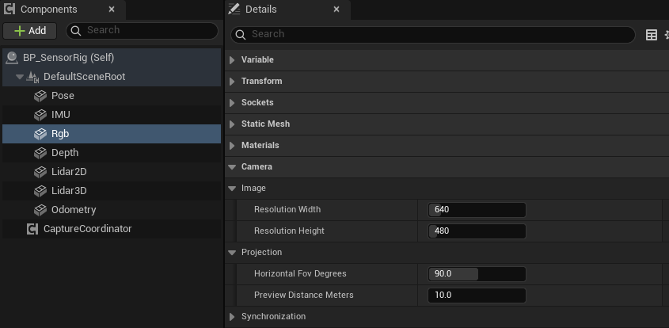
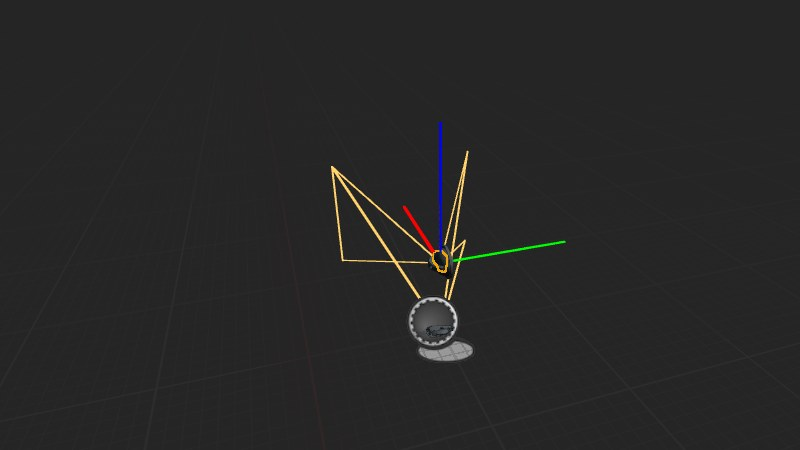

import { Steps } from "@astrojs/starlight/components";

使用彩色相机组件 `uBot RGB Camera Sensor` 采集 RGB 图像，并在蓝图中将像素从图形处理器（GPU）读回（Readback）到中央处理器（CPU）内存。

## 快速用法

```blueprint
caption: 每帧把像素读回 CPU，成功后打印像素缓冲区的字节数
nodes:
  A: { ref: UUBotCameraSensorComponent.OnImageFrameReady, component: Rgb }
  B: UUBotImageFrame.RequestPixelReadback
  C: K2Node_IfThenElse
  D: UUBotImageFrame.GetPixelDataSizeBytes
  E: UKismetStringLibrary.Conv_IntToString
  F: UKismetSystemLibrary.PrintString
wires:
  - A.then -> B.execute
  - A.Frame -> B.Target
  - A.Frame -> D.Target
  - B.then -> C.execute
  - B.ReturnValue -> C.Condition
  - D.ReturnValue -> E.InInt
  - C.then -> F.execute
  - E.ReturnValue -> F.InString
notes:
  B: "相机每次采样只把图像渲染到 Render Target，需要通过该节点将像素读回 CPU。失败原因通过 `Error Message` 返回。"
  C: 读回成功后，CPU 上才有像素数据。
```

## 步骤

<Steps>

1. **添加组件**

   在「Components」面板点击「Add」，搜索 `uBot RGB Camera Sensor`，重命名为 `Rgb`，并附着到机器人上。相机朝向组件的 X 轴。

2. **设置分辨率与视场**

   选中组件，在「Details」面板的「Camera > Image」里设置分辨率，在「Camera > Projection」里设置水平视场。默认是 640 × 480、90°。

   

3. **连接蓝图节点**

   在「Details」面板的「Events」区域点击 `On Image Frame Ready` 旁的「+」，按照上方节点图连接节点。

4. **运行**

   `Auto Start` 默认开启，开始运行后相机立即采集一帧，之后按 `Update Rate Hz`（30 Hz）持续采集。

</Steps>

## 关键属性

| 属性 | 默认值 | 作用 |
| --- | --- | --- |
| `Resolution Width` | 640 | 图像宽度，单位像素，范围 16 到 4096 |
| `Resolution Height` | 480 | 图像高度，单位像素，范围 16 到 4096 |
| `Horizontal Fov Degrees` | 90 | 水平视场（Field of View，FOV），单位 °，范围 1 到 170。垂直视场由宽高比算出 |
| `Preview Distance Meters` | 10 | 编辑器视口里视锥的长度，单位 m。也是烟雾叠加的最远距离 |
| `External Render Target` | 空 | 使用用户指定的渲染目标（Render Target），代替相机自动创建的渲染目标。格式必须是 RGBA8，图像尺寸由该渲染目标决定 |
| `Capture Group Id` | 空 | 非空时由[相机采集协调器](/sensor/capture-coordinator/)统一触发，相机不再独立采样 |
| `Update Rate Hz` | 30 | 采集频率，单位 Hz |
| `Sensor Id`、`Frame Id` | `rgb_camera` | 帧头中的传感器标识和坐标系标识，见[帧头与采样状态](/concepts/frame-header/) |

通用属性（`Auto Start`、`Sensor Enabled` 等）见[传感器通用用法](/sensor/basics/)。

烟雾相关的属性（`Enable Smoke Interference`、`Smoke Interference Tint` 等）见[感知介质（烟雾干扰）](/sensor/medium/)。

## 输出与事件

- `On Image Frame Ready`：每次产生有效帧后触发，`Frame` 引脚提供本次生成的帧对象。深度相机共用这个事件。
- `Get Latest Image Frame`：返回最近一帧，不会触发新的采集；尚未完成采样时返回空值。
- `Sample RGBCamera`：手动采集一次，得到有效帧时返回 true。
- `Get Preview Render Target`：返回相机渲染到的 Render Target。

### 图像帧

`Frame` 是一个 `UBot Image Frame` 对象。图像保存在 GPU 的渲染目标（Render Target）中，以下节点用于将像素读回 CPU 并访问像素数据：

| 节点 | 作用 |
| --- | --- |
| `Request Pixel Readback` | 把这一帧的像素读回 CPU，返回是否成功，失败原因通过 `Error Message` 返回 |
| `Has CPUPixel Data` | 像素是否已经在 CPU 上 |
| `Get BGRAPixel by Coordinates` | 取坐标 (`X`, `Y`) 处的 `Color`。坐标越界或没有像素数据时 `Return Value` 为 false |
| `Get Pixel Data Size Bytes` | 像素缓冲区的字节数 |
| `Copy Pixel Bytes (High Cost)` | 全部像素字节的副本 |
| `Clear CPUPixel Data` | 释放 CPU 上的像素数据 |

- 编码（`Encoding`）是 `BGRA8`：每个像素 4 个字节，顺序为 B、G、R、A，`Row Stride Bytes` 等于 `Width` × 4。
- 像素坐标的原点在左上角，X 向右，Y 向下。
- 帧上还有 `Width`、`Height`（单位像素）、`Horizontal Fov Radians`、`Vertical Fov Radians`（单位 rad）、`Sensor Transform World`（采集时传感器在 UE 世界坐标系中的变换，位置单位 cm）和 `Header`。
- `Capture Group Id`、`Capture Sequence`、`Capture Timestamp Seconds` 和 `Synchronized` 只在相机属于采集组时有意义，见[相机采集协调器](/sensor/capture-coordinator/)。

### 相机内参

帧上的 `Fx`、`Fy`、`Cx`、`Cy` 是针孔模型的内参（Intrinsics），单位像素，由分辨率和水平视场算出。

| 量 | 计算 | 默认值（640 × 480，90°） |
| --- | --- | --- |
| `Fx` | `Width / (2 * tan(Horizontal Fov / 2))` | 320 |
| `Fy` | 与 `Fx` 相同（方形像素） | 320 |
| `Cx` | `(Width - 1) / 2` | 319.5 |
| `Cy` | `(Height - 1) / 2` | 239.5 |

### 预览

- 编辑器视口里选中组件，会画出一个长度为 `Preview Distance Meters` 的视锥，用来检查视野。

  

  图中为示意配置，视锥长度和视场与默认值不同；默认值以属性表为准。
- `Get Preview Render Target` 返回的是一个普通的渲染目标（Render Target），可以用于材质或用户界面中，以显示相机画面。

## 注意事项

- `Request Pixel Readback` 是同步的，会等待渲染完成，开销高。只在需要像素的时候调用，无需逐帧读回。
- 只有最新一次采集的帧能读回。相机再次采集后，旧帧的读回会失败，`Error Message` 说明帧已过期；已经读回的数据不受影响。建议在 `On Image Frame Ready` 事件回调中完成读回，以确保帧尚未过期。
- 读回后的像素缓冲区占用较多内存：640 × 480 时约 1.2 MB。使用完毕后调用 `Clear CPUPixel Data` 释放。
- `Copy Pixel Bytes (High Cost)` 每次调用都复制整个缓冲区。只读几个像素时用 `Get BGRAPixel by Coordinates`。
- 烟雾叠加发生在读回时，仅修改 CPU 内存中的像素，Render Target 本身不受影响，所以预览画面里看不到烟雾。
- `External Render Target` 的格式不是 RGBA8 时，这次采样的状态是 `Error`，触发 `On Sensor Error`，不产生帧。

## 相关参考

- [uBot RGB Camera Sensor](/reference/ubotsensor/uubotrgbcamerasensorcomponent/)：该组件的专用属性。
- [UBot Camera Sensor Component](/reference/ubotsensor/uubotcamerasensorcomponent/)：RGB 和深度相机共有的属性和节点。
- [UBot Image Frame](/reference/ubotsensor/uubotimageframe/)：帧上的节点和属性。
- [深度相机](/sensor/depth-camera/)：深度编码和深度读取。
- [相机采集协调器](/sensor/capture-coordinator/)：多个相机在同一仿真时刻采集的配置方法。
- [性能与采样频率](/sensor/performance/)：读回的开销和建议频率。
