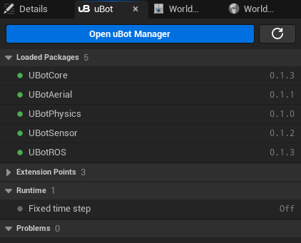
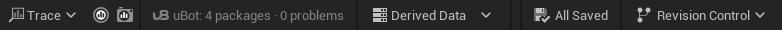

import { Steps } from "@astrojs/starlight/components";
import RecipeTable from "../../../components/RecipeTable.astro";

通过 uBot Manager 在 UE 5.5 工程中安装 uBot 插件，并在编辑器中验证安装结果。

uBot Manager 是 Windows 桌面程序，负责下载插件、处理依赖、修改 `.uproject`，需要时编译工程。

## 运行要求

| 项目 | 要求 | 说明 |
| --- | --- | --- |
| 操作系统 | Windows 10 或 11 | uBot Manager 目前只支持 Windows，界面基于 WebView2，Windows 11 已自带 |
| 虚幻引擎 | UE 5.5 | 启动器版本和源码构建的版本都可以，预编译包（prebuilt package）只用于启动器版本 |
| git | 从源码安装时需要 | 可通过 `PATH` 查找，或在 uBot Manager 的「设置 > 安装」中指定路径；预编译安装不需要 |
| Visual Studio 2022 | 编译 C++ 时需要，含 C++ 工具链 | 从源码安装的插件要编译，打包游戏时 UE 也要编译插件；全部用预编译包时安装本身不需要 |
| ROS 2 | 使用 uBotROS 时需要 | 见[准备 ROS 2 端](/ros/ros2-setup/) |

## 安装 uBot Manager

<Steps>

1. **下载**

   打开 [uBot Manager 的 Releases 页面](https://github.com/AstreoX/uBotManager/releases)，下载最新版本的 `uBot-Manager_<版本>_x64-setup.exe`。

2. **运行安装包**

   安装包仅为当前用户安装程序，无需管理员权限。安装向导支持选择安装目录，并根据系统语言显示中文或英文界面。当前 Manager v0.1.3 尚未签名，SignPath 申请仍在等待审批。先确认下载来自上述仓库，再用 `Get-FileHash .\uBot-Manager_0.1.3_x64-setup.exe -Algorithm SHA256` 核对发布页 `.sha256` 中的值，确认后可在 SmartScreen 选择「更多信息 → 仍要运行」。也可以按仓库说明从源码构建。

   后续签名版发布后应检查有效发布者签名；[代码签名不保证 SmartScreen 立即建立信誉](https://learn.microsoft.com/en-us/windows/apps/package-and-deploy/smartscreen-reputation)，仍可能出现提示。

3. **启动**

   启动 uBot Manager。首次启动时语言跟随系统界面语言，主题默认深色。

</Steps>

## 更新 uBot Manager

从 0.1.2 起，uBot Manager 在启动时检查更新；发现新版本后，状态栏会显示「新版本 x.y.z」。点击该提示，再点击「打开发布页面…」，下载并运行新版本安装包即可完成更新，原有设置和任务历史会保留。

自动检查更新可在「设置 > 关于」中关闭。

## 打开工程

<Steps>

1. **选择 `.uproject`**

   在初始页面点击「打开…」，选择工程的 `.uproject` 文件。后续启动时，uBot Manager 会自动打开上次使用的工程。

2. **确认引擎**

   uBot Manager 根据 `.uproject` 中的 `EngineAssociation` 查找工程使用的引擎。如果未找到对应引擎，需要编译的更改将无法应用。

</Steps>

:::caution[先关闭 UE 编辑器]
UE 编辑器正在运行当前工程时，需要关闭编辑器的步骤会等待其退出后执行。「应用更改」对话框中的「关闭编辑器」按钮可以请求编辑器正常退出。
:::

## 安装插件：预编译与源码编译

<Steps>

1. **选择要装的插件**

   点击标题栏的「Recipe」，在「应用 Recipe」对话框中选择组合，再点击「查看更改…」。当前可用的组合如下：

   <RecipeTable available />

   也可以在「Package」视图中选中插件并点击「安装」，uBot Manager 会自动添加所需依赖。更改会先进入待应用列表，点击状态栏的「应用…」即可查看执行计划。

2. **检查计划**

   「应用更改」对话框按组列出要执行的步骤：「下载」「项目」「编译」「完成后」。底栏的「需要编译」表示这次计划里有 C++ 要编译。

3. **应用**

   点击「应用」，并在「任务」视图中查看执行进度。安装任务成功完成后，插件位于工程的 `Plugins/uBot/` 下，并已在 `.uproject` 中启用。

</Steps>

uBot Manager 优先下载预编译包，条件不满足时改为克隆源码并编译：

| | 预编译包 | 源码 |
| --- | --- | --- |
| 适用条件 | 引擎是 Epic 启动器安装的 UE 5.5，平台 Win64，索引里有这个版本的预编译包 | 源码构建的引擎，索引里没有对应的预编译包，或已关闭优先使用预编译版本的选项 |
| 安装过程 | 下载 zip，校验 SHA-256，解压到 `Plugins/uBot/` | 克隆仓库，检出索引里这个版本的标签，再编译 |
| 需要 git | 不需要 | 需要 |
| 需要 Visual Studio 2022 | 不需要（打包游戏时需要） | 需要 |
| 计划中的步骤 | 有「下载」，没有「编译」 | 有「编译」 |

如需从源码安装，请在「设置 > 安装」中取消勾选「有预编译版本时优先使用」。对于已通过预编译包安装的插件，需卸载后重新安装，才能切换安装方式。

## 不用 Manager：手动安装

手动安装采用源码方式，因此工程需要具备 C++ 编译环境。请先安装 uBotCore，再安装其他插件。

<Steps>

1. **克隆到 `Plugins/uBot/`**

   把仓库克隆到 `<工程>/Plugins/uBot/<插件名>`，用版本标签检出（标签是版本号前加 `v`，各版本见[版本记录](/appendix/changelog/)）：

   ```powershell
   git clone --branch v0.1.1 https://github.com/AstreoX/uBotCore.git <工程>/Plugins/uBot/uBotCore
   git clone --branch v0.1.1 https://github.com/AstreoX/uBotSensor.git <工程>/Plugins/uBot/uBotSensor
   ```

2. **启用插件**

   在编辑器的「Edit > Plugins」里搜索 uBot Core（分类 uBot）并勾选。也可以在 `.uproject` 里加入：

   ```json
   "Plugins": [
       { "Name": "UBotCore", "Enabled": true },
       { "Name": "UBotSensor", "Enabled": true }
   ]
   ```

3. **重启编辑器**

   首次打开工程时，编辑器会提示编译模块。

</Steps>

安装 uBotCore 后，也可以通过命令行安装其他插件。命令会同时安装并启用缺少的依赖；完成后需要重启编辑器：

```powershell
& '<UE_5.5>\Engine\Binaries\Win64\UnrealEditor-Cmd.exe' '<工程>\<工程>.uproject' -run=UBotPackage -Install=UBotSensor
```

## 确认安装成功

<Steps>

1. **打开 uBot 面板**

   使用 UE 5.5 打开工程，通过「Window > uBot」菜单打开 uBot 面板。

2. **看已加载的 Package**

   「Loaded Packages」（中文界面是「已加载的 Package」）列出已启用的 uBot 插件和版本。

   

3. **看状态栏**

   编辑器状态栏右侧显示「uBot：2 个 Package · 0 个问题」这样的统计。问题数量不为 0 时，可在面板的「Problems」中查看依赖缺失、版本不满足等问题，再通过 uBot Manager 的「问题」视图处理。

   

4. **看组件**

   在任意 Actor 蓝图的「Components」面板点击「Add」，「uBot」分类下应该有 `uBot IMU Sensor` 等传感器组件。

</Steps>

后续管理插件时，可在 uBot 面板中点击「Open uBot Manager」（中文界面为「打开 uBot Manager」），并以当前工程启动管理器。

## 下一步

安装完成后，可按[五分钟上手](/start/quickstart/)为 Actor 添加 IMU 传感器，并查看采样序号。如需安装一组配套插件，参见[选择组合](/start/recipes/)。
