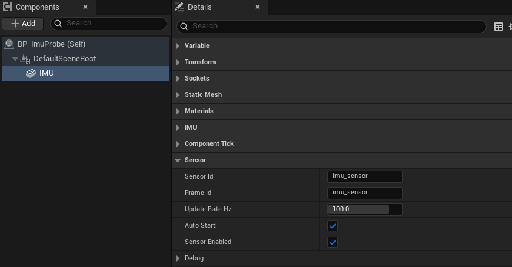
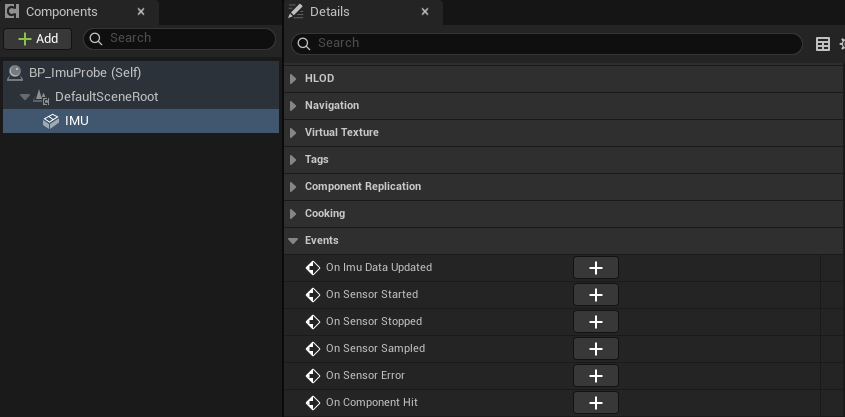

import { Steps } from "@astrojs/starlight/components";

为 Actor 添加惯性测量单元（Inertial Measurement Unit，IMU）组件，并在运行时显示持续递增的采样序号，以验证传感器正常采样。

## 准备

按照[安装 uBot](/start/install/)中的步骤安装 `UBotCore` 和 `UBotSensor`，然后使用 UE 5.5 打开工程。

## 添加一个 IMU 传感器

<Steps>

1. **新建 Actor 蓝图**

   在「Content Browser」中右键，选择「Blueprint Class → Actor」，命名为 `BP_ImuProbe`。

2. **添加 IMU 组件**

   打开 `BP_ImuProbe`，在「Components」面板点击「Add」，搜索 `uBot IMU Sensor`，把新组件重命名为 `IMU`。

   

</Steps>

组件默认在开始运行时自动启动（`Auto Start`），采样频率 100 Hz（`Update Rate Hz`）。

## 在屏幕上打印采样序号

选中 `IMU` 组件，在「Details」面板最下面的「Events」区点 `On Sensor Sampled` 旁的「+」，然后按照下图连接节点：



```blueprint
caption: 每次采样时把帧序号打印到屏幕
nodes:
  A: { ref: UUBotSensorComponent.OnSensorSampled, component: IMU }
  B: { ref: Break:FUBotFrameHeader, hideUnconnected: true }
  C: UKismetStringLibrary.Conv_Int64ToString
  D: { ref: UKismetSystemLibrary.PrintString, set: { Key: imu } }
wires:
  - A.then -> D.execute
  - A.Header -> B.UBotFrameHeader
  - B.Sequence -> C.InInt
  - C.ReturnValue -> D.InString
notes:
  C: 把 `Sequence` 直接连到 `In String`，编辑器会自动插入这个转换节点。
  D: 展开 `Print String` 的高级引脚，将 `Key` 设置为固定值，使后续输出更新同一行文字。
```

`On Sensor Sampled` 是所有 uBot 传感器共有的事件，`Header` 是这一次采样的[帧头](/concepts/frame-header/)。

## 运行并查看结果

<Steps>

1. **放进关卡**

   把 `BP_ImuProbe` 从「Content Browser」拖进关卡。

2. **运行**

   点击「Play」。屏幕左上角的数字不断增加。

</Steps>

采样频率是 100 Hz，但每帧最多采样一次。帧率低于每秒 100 帧（FPS）时，采样序号每秒的增量等于实际帧数，原因见[仿真时钟与采样调度](/concepts/clock-and-scheduling/)。

## 下一步

- [IMU 传感器](/sensor/imu/)：将姿态转换为横滚（Roll）、俯仰（Pitch）和偏航（Yaw）角。
- [帧头与采样状态](/concepts/frame-header/)：`Sequence` 和状态码。
- [选择组合](/start/recipes/)：选择包含 ROS 2 数据发布功能的插件组合。
